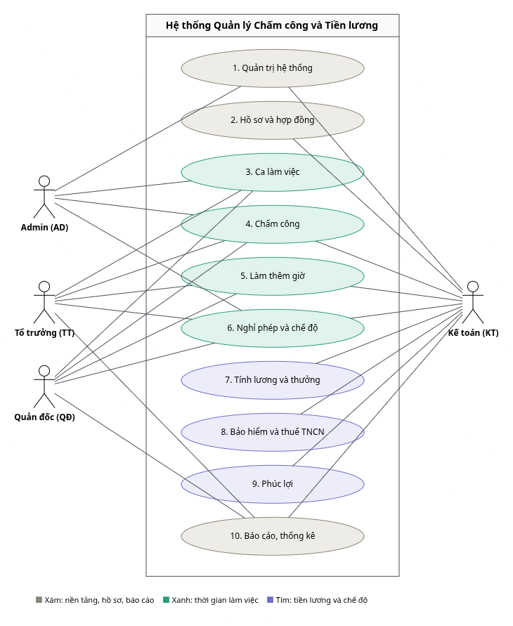

# 07. Yêu cầu chức năng

**AI ưu tiên trong kế hoạch:** [24 — AI-02 trợ lý nghiệp vụ](24-ai-tro-ly-nghiep-vu-theo-vai-tro.md),
Google Gemini cho TT/QĐ/KT/AD, 8 AI02-REQ và 12 AC riêng. Chỉ hướng dẫn tài liệu theo
quyền, không đọc/ghi dữ liệu nhân sự/lương. Không thay 158 FR/152 M; AI-01 ở tài liệu
23 chuyển sang sau sprint, không phải chức năng đang giao trong roadmap 5 ngày.

Hệ thống gồm **10 phân hệ / 49 chức năng** theo sơ đồ phân rã chức năng
([`diagrams/BFD.png`](../diagrams/BFD.png)). Mỗi chức năng mang mã BFD `x.y` và được mô tả bằng
use case ([`diagrams/usecase/`](../diagrams/usecase/)), sequence diagram
([`diagrams/sequence/`](../diagrams/sequence/)) và activity diagram
([`diagrams/activity/`](../diagrams/activity/)). Yêu cầu chi tiết có mã `FR-x.y.z` và mức ưu
tiên:

| Mức | Ý nghĩa |
|---|---|
| **M** (Must) | Bắt buộc có ở bản phát hành đầu tiên |
| **S** (Should) | Backlog sau R1, không thuộc nghiệm thu bản đầu; không đồng nghĩa GĐ 2 cắt chuyển |
| **C** (Could) | Tiện ích xem xét sau R1, không thuộc nghiệm thu bản đầu |

**Phạm vi R1 đã chốt ngày 17/10/2026:** [19](19-pham-vi-ban-dau-va-ma-tran-nghiem-thu.md)
và [manifest R1](config/hrtp-release-r1.json). R1 gồm 152 yêu cầu M trong tổng 158 FR;
151 yêu cầu hoạt động và một yêu cầu bắt buộc kiểm tra chức năng nghỉ bù OT chưa kích hoạt
(FR-5.5.1). Sáu FR còn lại ở backlog sau R1. Phúc lợi, quyết toán thuế năm và báo cáo lõi
đều nằm trong R1, không chuyển các yêu cầu M sang giai đoạn sau nghiệm thu.

**Tác nhân:** TT – Tổ trưởng · QĐ – Quản đốc · KT – Kế toán · AD – Admin · Hệ thống – xử lý
tự động. Công nhân không đăng nhập hệ thống ([02](02-cac-ben-lien-quan-va-vai-tro.md)).

---

## 1. Quản trị hệ thống

Use case: [PhanHe1](../diagrams/usecase/PhanHe1.png) · Activity: AD-01 · Lớp: gói G1

### 1.1. Tài khoản, phân quyền theo đơn vị — AD · SQ-13, SQ-15

| Mã | Yêu cầu | Mức | Quy tắc |
|---|---|---|---|
| FR-1.1.1 | Tài khoản chỉ cấp cho bốn vai trò **TT, QĐ, KT, AD**; công nhân không có tài khoản | M | [02](02-cac-ben-lien-quan-va-vai-tro.md) |
| FR-1.1.2 | Phân quyền theo đơn vị: mỗi bản ghi gồm tài khoản, vai trò, **đơn vị phạm vi**, hiệu lực; một hành động chỉ thực hiện được khi thỏa **đồng thời** quyền chức năng của vai trò và phạm vi đơn vị; kiểm tra vai trò, phạm vi phù hợp khi cấp (SQ-15) | M | [10](10-phan-quyen-va-bao-mat.md) |
| FR-1.1.3 | Danh sách loại trừ ẩn hồ sơ, lương của nhóm nhân sự đặc biệt khỏi tài khoản KT có phạm vi hạn chế; trả kết quả rỗng thay vì lỗi 403 | M | – |
| FR-1.1.4 | Che trường nhạy cảm theo quyền (số tài khoản, CCCD, tiền lương); AD không xem lương chi tiết | M | – |
| FR-1.1.5 | Đăng nhập, đổi mật khẩu, chính sách mật khẩu, khóa / mở khóa tài khoản, quản lý và thu hồi phiên | M | [10 §5](10-phan-quyen-va-bao-mat.md) |

### 1.2. Cơ cấu tổ chức đa cấp, đa cơ sở — AD · SQ-15

| Mã | Yêu cầu | Mức | Quy tắc |
|---|---|---|---|
| FR-1.2.1 | Cây tổ chức 5 cấp: Công ty → Cơ sở → Khối → Phòng ban / Phân xưởng → Tổ; mỗi cơ sở mang **vùng lương**, mỗi phòng ban / phân xưởng mang cost center, kế thừa xuống dưới | M | BR-66 · [03](03-co-cau-to-chuc.md) |
| FR-1.2.2 | Cây tổ chức có **phiên bản theo thời gian**; truy vấn theo ngày trả đúng cấu trúc tại ngày đó; chặn vòng lặp cha – con, tối đa 5 cấp, đơn vị thuộc đúng cơ sở | M | BR-72 |
| FR-1.2.3 | Danh mục chức danh, cấp chức vụ, ngạch | M | [03 §6](03-co-cau-to-chuc.md) |
| FR-1.2.4 | Quan hệ báo cáo hai tuyến; tuyến chức năng chỉ cấp quyền xem báo cáo, không cấp quyền duyệt | S | BR-74 |
| FR-1.2.5 | Sơ đồ tổ chức trực quan theo ngày tham chiếu, xuất được | C | BR-72 |

### 1.3. Vùng lương, tham số pháp lý theo hiệu lực — AD · SQ-10

| Mã | Yêu cầu | Mức | Quy tắc |
|---|---|---|---|
| FR-1.3.1 | Vùng lương I – IV gắn với cơ sở; mức lương tối thiểu tra theo vùng và ngày | M | BR-06, BR-66 |
| FR-1.3.2 | Tham số pháp lý theo khoảng hiệu lực, bắt buộc văn bản căn cứ; thêm tham số mới **đóng hiệu lực bản cũ** (ngày hết hiệu lực = ngày trước hiệu lực mới), **không ghi đè**; chồng lấn → báo lỗi chỉ ra bản ghi chồng lấn | M | BR-02, BR-04 |
| FR-1.3.3 | Cảnh báo tham số sắp hết hiệu lực mà chưa có bản ghi kế tiếp | M | BR-04 |

### 1.4. Cấu hình chính sách theo cơ sở — AD · SQ-15

| Mã | Yêu cầu | Mức | Quy tắc |
|---|---|---|---|
| FR-1.4.1 | Chính sách theo cơ sở có hiệu lực: chế độ ca, ngày chốt công, ngày công chuẩn tháng (26 hoặc theo thực tế), dung sai, quy tắc OT, làm tròn, định dạng tệp chấm công; kế thừa theo cây, ghi đè từng khóa, hiển thị nguồn gốc giá trị | M | BR-05, BR-14, BR-75 |
| FR-1.4.2 | Danh mục dùng chung: loại hợp đồng, loại phụ cấp, ngân hàng, địa bàn, trình độ | M | – |

### 1.5. Quản lý kỳ công, kỳ lương — AD, KT · SQ-11

| Mã | Yêu cầu | Mức | Quy tắc |
|---|---|---|---|
| FR-1.5.1 | AD tạo kỳ Lập kế hoạch, mở trước cửa sổ Vào đầu tiên; không chồng ngày công cùng loại/phạm vi; được mở khi kỳ trước chưa khóa. PLANNED → OPEN → CLOSED → LOCKED; KT được trả CLOSED → OPEN có lý do trước khóa | M | BR-01 · [17](17-vong-doi-ky-cong-va-ca-qua-ngay-chot.md) |
| FR-1.5.2 | KT khóa kỳ CLOSED khi đủ nguồn/cửa sổ ca, không còn tác vụ ghi/ngoại lệ chặn, kỳ trước đã tồn tại cùng loại/phạm vi đã khóa; kỳ đầu xử lý khởi tạo. Kỳ lương còn yêu cầu nguồn công đã khóa và bảng lương đã duyệt. Kiểm tra revision và snapshot nguyên tử; ghi nhật ký | M | BR-01 |
| FR-1.5.3 | Kỳ đã khóa **không bị sửa và không mở khóa lại**; điều chỉnh phát sinh sau khóa ghi vào kỳ đang mở | M | BR-42 |

### 1.6. Nhật ký kiểm toán — AD · SQ-10, SQ-11

| Mã | Yêu cầu | Mức | Quy tắc |
|---|---|---|---|
| FR-1.6.1 | Nhật ký **chỉ thêm**: thu hồi quyền UPDATE/DELETE ở tầng CSDL, chuỗi băm liên kết, kiểm tra toàn vẹn định kỳ | M | [10 §4](10-phan-quyen-va-bao-mat.md) |
| FR-1.6.2 | Mỗi bản ghi lưu: người thực hiện, thời điểm, hành động, đối tượng và mã đối tượng, giá trị cũ, giá trị mới, lý do, địa chỉ IP | M | BR-22 |
| FR-1.6.3 | Ghi vết bắt buộc cho: cấu hình, tham số, mở / khóa kỳ, điều chỉnh công, hồi tố, chấm dứt HĐ, phân quyền | M | – |
| FR-1.6.4 | AD tra cứu nhật ký theo phạm vi và điều kiện lọc; ghi nhật ký cả truy cập dữ liệu nhạy cảm bị từ chối | M | – |

---

## 2. Hồ sơ và hợp đồng

Use case: [PhanHe2](../diagrams/usecase/PhanHe2.png) · Activity: AD-02 · Lớp: gói G2. Toàn bộ
phân hệ do **KT** thực hiện (không có tác nhân HR / C&B riêng).

### 2.1. Hồ sơ nhân viên, người phụ thuộc — KT · SQ-14

| Mã | Yêu cầu | Mức | Quy tắc |
|---|---|---|---|
| FR-2.1.1 | Hồ sơ cá nhân: CCCD / số định danh, MST, số sổ BHXH, ngày vào làm, tài khoản ngân hàng, liên hệ khẩn cấp, tệp đính kèm; kiểm tra trùng mã NV, MST, số sổ BHXH | M | – |
| FR-2.1.2 | Người phụ thuộc kèm **tháng bắt đầu / kết thúc** được giảm trừ và chứng từ | M | BR-53 |
| FR-2.1.3 | Quá trình công tác dạng lịch sử: tuyển dụng → thử việc → chính thức → điều chuyển → nghỉ việc | M | – |
| FR-2.1.4 | Nhân sự đặc thù: người nước ngoài (giấy phép lao động, cư trú thuế), người đã hưởng hưu, lao động chưa thành niên, lao động nữ | M | BR-49 |
| FR-2.1.5 | Kết xuất **Sổ quản lý lao động** đủ 20 tiêu chí theo Khoản 2 Điều 3 NĐ 145/2020 | M | [12](12-tuan-thu-phap-ly.md) |
| FR-2.1.6 | Cảnh báo hết hạn giấy tờ, đến hạn nâng lương | S | – |
| FR-2.1.7 | Cảnh báo trên sổ quản lý lao động khi giờ OT lũy kế năm vượt 200 hoặc 300 giờ | M | BR-27 |

**20 tiêu chí Sổ quản lý lao động:** họ tên · giới tính · ngày sinh · quốc tịch · nơi cư trú ·
số định danh cá nhân / CCCD / hộ chiếu · trình độ chuyên môn kỹ thuật · bậc kỹ năng nghề · vị
trí việc làm · chức danh công việc · loại HĐLĐ · thời điểm bắt đầu hiệu lực · thời điểm chấm
dứt · mức lương thỏa thuận · mức lương đóng BHXH · tình hình tham gia BHXH / BHYT / BHTN hằng
tháng · số ngày nghỉ · số giờ làm thêm lũy kế trong năm · chế độ đào tạo · kỷ luật và trách
nhiệm vật chất · tai nạn lao động và bệnh nghề nghiệp · lý do chấm dứt HĐLĐ.

### 2.2. Quản lý HĐLĐ và phụ lục — KT · SQ-14

| Mã | Yêu cầu | Mức | Quy tắc |
|---|---|---|---|
| FR-2.2.1 | Các loại HĐ: thử việc, xác định thời hạn, không xác định thời hạn, dưới 1 tháng, khoán việc, cộng tác viên | M | BR-57 |
| FR-2.2.2 | Vòng đời hợp đồng: lập → hiệu lực → phụ lục → gia hạn → chấm dứt; kiểm tra chồng lấn thời hạn và loại HĐ được phép ký tiếp | M | BR-58 |
| FR-2.2.3 | Kiểm tra lương thử việc ≥ 85% lương chính thức khi lưu hợp đồng | M | BR-09, `CP-02` |
| FR-2.2.4 | Liên kết HĐ ↔ diện đóng bảo hiểm, tự xác định đối tượng tham gia BH theo loại HĐ | M | BR-49 |
| FR-2.2.5 | Mẫu hợp đồng động (trường trộn), in ấn | S | – |

### 2.3. Quyết định điều chuyển, thay đổi lương — KT · SQ-07

| Mã | Yêu cầu | Mức | Quy tắc |
|---|---|---|---|
| FR-2.3.1 | Quyết định điều chuyển / thay đổi lương có **ngày hiệu lực**, lưu lịch sử hiệu lực; xử lý được hiệu lực giữa kỳ lương | M | BR-40, BR-68 |
| FR-2.3.2 | Một nhân sự thuộc nhiều đơn vị trong cùng kỳ; phân bổ chi phí theo tỷ lệ ngày công | M | BR-67, BR-70 |
| FR-2.3.3 | Quyết định có **hiệu lực quá khứ** → hệ thống cảnh báo hồi tố, tìm các kỳ lương đã khóa bị ảnh hưởng và chuyển sang 7.4 | M | BR-42 |
| FR-2.3.4 | Cảnh báo khi điều chuyển liên vùng kèm giảm lương | M | BR-08 |

### 2.4. Cảnh báo hết hạn hợp đồng — KT · SQ-14

| Mã | Yêu cầu | Mức | Quy tắc |
|---|---|---|---|
| FR-2.4.1 | Danh sách cảnh báo HĐ hết hạn trong N ngày tới (30 / 60) hoặc đã quá hạn, hết hạn thử việc, đã ký đủ 2 lần HĐ xác định thời hạn; hiển thị số ngày còn lại | M | BR-58 |
| FR-2.4.2 | Cảnh báo **không tự động chấm dứt** hợp đồng | M | – |

### 2.5. Chấm dứt hợp đồng — KT · SQ-09

| Mã | Yêu cầu | Mức | Quy tắc |
|---|---|---|---|
| FR-2.5.1 | KT lập quyết định chấm dứt (nhân viên, ngày hiệu lực, lý do, căn cứ); hệ thống lấy HĐ hiệu lực và thâm niên, tính trợ cấp (9.3), phép chưa nghỉ (6.2), lập danh sách báo giảm BH (8.3) | M | BR-59 |
| FR-2.5.2 | KT xác nhận → cập nhật trạng thái HĐ và ngày nghỉ việc, đưa khoản trợ cấp, tiền phép vào kỳ lương gần nhất, ghi nhật ký; chưa xác nhận → không thay đổi dữ liệu | M | BR-59 |

---

## 3. Ca làm việc

Use case: [PhanHe3](../diagrams/usecase/PhanHe3.png) (3.3 «extend» 3.2) · Activity: AD-03 ·
Sequence: SQ-01 · Lớp: gói G3

### 3.1. Định nghĩa ca, lịch nghỉ lễ — AD

| Mã | Yêu cầu | Mức | Quy tắc |
|---|---|---|---|
| FR-3.1.1 | Định nghĩa ca: giờ vào / ra, nghỉ giữa ca, biên độ, cờ ca đêm, **cờ ca qua nửa đêm** | M | BR-10, BR-13 |
| FR-3.1.2 | Lịch nghỉ lễ theo năm (chung hoặc theo cơ sở); nghỉ bù khi lễ trùng ngày nghỉ hằng tuần; hoán đổi ngày nghỉ Tết | M | BR-16 |
| FR-3.1.3 | Mẫu xoay ca: chu kỳ, thứ tự ca, ràng buộc nghỉ tối thiểu giữa hai ca | M | BR-11 |

### 3.2. Xếp ca, xoay ca cho tổ — TT

| Mã | Yêu cầu | Mức | Quy tắc |
|---|---|---|---|
| FR-3.2.1 | Lập lịch ca tổ theo kỳ và mẫu xoay ca; phân ca hàng loạt; sao chép lịch tháng trước | M | – |
| FR-3.2.2 | Kiểm tra ràng buộc: nghỉ giữa hai ca, trần giờ tuần, trùng đơn nghỉ đã duyệt, trạng thái công liên quan | M | BR-11 |
| FR-3.2.3 | Gửi duyệt → Chờ duyệt; chỉ lịch **Đã duyệt** mới có hiệu lực và được dùng để ghép công | M | – |

### 3.3. Đề xuất đổi ca — TT

| Mã | Yêu cầu | Mức | Quy tắc |
|---|---|---|---|
| FR-3.3.1 | Đề xuất đổi ca sau khi lịch đã duyệt (nhân viên, ca cũ, ca mới, lý do); kiểm tra ràng buộc ca mới; **chưa duyệt thì giữ lịch hiện hành** | M | – |

### 3.4. Duyệt lịch ca toàn xưởng — QĐ

| Mã | Yêu cầu | Mức | Quy tắc |
|---|---|---|---|
| FR-3.4.1 | Xem lịch ca các tổ trong xưởng; duyệt hoặc trả lại kèm lý do; thông báo TT; lưu lịch sử | M | – |
| FR-3.4.2 | Duyệt đề xuất đổi ca → cập nhật lịch, thông báo TT | M | – |
| FR-3.4.3 | In / xuất lịch ca đã duyệt của tổ để phổ biến cho công nhân | S | – |

---

## 4. Chấm công

Use case: [PhanHe4](../diagrams/usecase/PhanHe4.png) (4.1 «include» 4.2; 4.3 «extend» 4.2) ·
Activity: AD-04 · Lớp: gói G4

### 4.1. Tiếp nhận dữ liệu chấm công các cơ sở — AD · SQ-02

| Mã | Yêu cầu | Mức | Quy tắc |
|---|---|---|---|
| FR-4.1.1 | AD chọn cơ sở, kỳ tham chiếu và tải tệp; phân tuyến mỗi dòng theo ca/ngày công về kỳ đích, cho phép file hỗn hợp qua ngày chốt; trả số đã xử lý/chờ/muộn theo kỳ. Kỳ đích khóa không chặn công hợp lệ của kỳ mở khác | M | [11 §1](11-tich-hop-he-thong.md) · [17 §3](17-vong-doi-ky-cong-va-ca-qua-ngay-chot.md) |
| FR-4.1.2 | Cấu hình ánh xạ cột tệp theo cơ sở / loại máy | M | BR-75 |
| FR-4.1.3 | Kiểm tra định dạng, cấu trúc và mã nhân viên; tệp lỗi → báo lỗi kèm danh sách dòng lỗi, không ghi vào log gốc | M | – |
| FR-4.1.4 | Lưu bản ghi thô (mã NV, thời điểm quẹt, thiết bị, cơ sở) **bất biến**, chỉ ghi thêm | M | BR-19 |

> Hệ thống **không** kết nối trực tiếp máy chấm công, không có dịch vụ đồng bộ hay giám sát
> thiết bị — chỉ tiếp nhận và xử lý dữ liệu.

### 4.2. Ghép cặp vào/ra theo ca — Hệ thống · SQ-02

| Mã | Yêu cầu | Mức | Quy tắc |
|---|---|---|---|
| FR-4.2.1 | Khử lượt quẹt trùng trong cửa sổ 5 phút | M | BR-17 |
| FR-4.2.2 | Ghép vào/ra theo lịch đã duyệt, cửa sổ timestamp có ngày/múi giờ và OT nối tiếp; một lượt chỉ dùng cho một ca, ứng viên chồng lấn đưa ngoại lệ | M | BR-18 |
| FR-4.2.3 | Gán ca về ngày bắt đầu trong lịch đã duyệt, kể cả vào sớm ngày trước và ra sau ngày chốt; lấy kỳ công chứa ngày đó, không lấy ngày lịch lượt quẹt | M | BR-13 |
| FR-4.2.4 | Tách dải giờ 22:00 – 06:00 để áp phụ cấp đêm; tách theo mốc 00:00 để phân loại ngày | M | BR-24 |
| FR-4.2.5 | Sinh dữ liệu dẫn xuất: công thực tế, giờ làm, giờ ngày, giờ đêm, đi muộn, về sớm, vắng | M | – |
| FR-4.2.6 | Đánh dấu ngày thiếu lượt quẹt là ngoại lệ `ERR`; trả kết quả nhập (số bản ghi, số ngày ngoại lệ) cho AD | M | BR-18 |

### 4.3. Xử lý ngoại lệ, giải trình công — TT · SQ-03

| Mã | Yêu cầu | Mức | Quy tắc |
|---|---|---|---|
| FR-4.3.1 | Danh sách ngày công ngoại lệ của tổ (thiếu lượt, quên quẹt, đi muộn / về sớm, OT lệch đề xuất), cảnh báo màu cam | M | – |
| FR-4.3.2 | TT nhập giải trình hoặc điều chỉnh công kèm **lý do và chứng cứ**; lưu giá trị cũ – mới – người sửa; **không ghi đè log gốc**; ghi nhật ký | M | BR-22 |
| FR-4.3.3 | Điều chỉnh cho nhiều thành viên của tổ khi sự cố máy chấm công cả ngày, kèm biên bản sự cố | M | – |
| FR-4.3.4 | Cảnh báo bất thường: vượt trần pháp luật, có dữ liệu tại hai cơ sở bất khả thi, công âm | M | – |

### 4.4. Xác nhận công thực tế — TT · SQ-03

| Mã | Yêu cầu | Mức | Quy tắc |
|---|---|---|---|
| FR-4.4.1 | TT xác nhận công thực tế của tổ khi đủ căn cứ → bảng công **Tổ đã xác nhận**; chưa đủ căn cứ → giữ chờ bổ sung | M | BR-01 |

### 4.5. Tổng hợp và chốt bảng công — QĐ, KT · SQ-03

| Mã | Yêu cầu | Mức | Quy tắc |
|---|---|---|---|
| FR-4.5.1 | QĐ tổng hợp bảng công xưởng từ công đã xác nhận, OT đã duyệt, đơn nghỉ đã duyệt; chạy đối soát `XC-01` … `XC-10` | M | [05 §5](05-quy-trinh-nghiep-vu.md) |
| FR-4.5.2 | Chưa qua cửa sổ Ra cuối kỳ, chưa xác nhận đủ nguồn, còn tác vụ/chờ phân tuyến có thể thuộc kỳ, tổ chưa xác nhận hoặc sai lệch BLOCKING → không chốt; dữ liệu đổi hủy xác nhận/chốt bị ảnh hưởng | M | [17 §4](17-vong-doi-ky-cong-va-ca-qua-ngay-chot.md) |
| FR-4.5.3 | QĐ chốt bảng công xưởng → **Xưởng đã chốt**; thông báo KT | M | – |
| FR-4.5.4 | KT kiểm tra bảng công các xưởng trong phạm vi kỳ và **khóa kỳ công** → **Đã khóa**; lưu snapshot kèm mã băm; bảng công chỉ đọc | M | BR-65 |
| FR-4.5.5 | Bảng chấm công tháng theo mẫu, ký hiệu công từng ngày và các cột tổng hợp | M | BR-20 |

---

## 5. Làm thêm giờ

Use case: [PhanHe5](../diagrams/usecase/PhanHe5.png) (5.2 «include» 5.3; 5.5 «include» 5.4) ·
Activity: AD-05 · Sequence: SQ-04 · Lớp: gói G5

### 5.1. Đề xuất OT — TT

| Mã | Yêu cầu | Mức | Quy tắc |
|---|---|---|---|
| FR-5.1.1 | TT lập đề xuất OT cho tổ: ngày, giờ bắt đầu / kết thúc, **danh sách nhân viên** và số giờ dự kiến, lý do; lưu Chờ duyệt, thông báo QĐ | M | BR-30 |
| FR-5.1.2 | **Chặn đề xuất khi chưa có căn cứ đồng ý làm thêm** của người lao động | M | BR-28 |

### 5.2. Duyệt OT cấp 2 — QĐ

| Mã | Yêu cầu | Mức | Quy tắc |
|---|---|---|---|
| FR-5.2.1 | QĐ duyệt, từ chối hoặc trả lại kèm lý do; thông báo kết quả cho TT | M | BR-30 |
| FR-5.2.2 | Đề xuất chưa được duyệt khi đến giờ bắt đầu → không huy động; giờ làm thêm phát sinh xử lý như ngoại lệ công | M | BR-30 |

### 5.3. Kiểm soát trần OT — QĐ, Hệ thống

| Mã | Yêu cầu | Mức | Quy tắc |
|---|---|---|---|
| FR-5.3.1 | Cộng dồn giờ OT theo ngày, tháng, năm và so với trần cấu hình theo cơ sở / ngành: ≤ 50% giờ bình thường / ngày, ≤ 40 giờ / tháng, ≤ 200 giờ / năm (300 nếu đã thông báo) | M | BR-27 |
| FR-5.3.2 | Vượt trần → cảnh báo, **không cho duyệt** | M | BR-27, `CP-03` |
| FR-5.3.3 | Cảnh báo khi chạm 90% trần tháng, hiển thị số giờ còn có thể huy động hợp pháp | M | – |

### 5.4. Tính giờ OT theo hệ số — Hệ thống

| Mã | Yêu cầu | Mức | Quy tắc |
|---|---|---|---|
| FR-5.4.1 | Đối chiếu giờ OT thực tế với đề xuất đã duyệt, lấy giá trị nhỏ hơn; phần lệch chuyển sang ngoại lệ công (4.3) | M | BR-26 |
| FR-5.4.2 | Phân loại giờ OT theo loại ngày, ban đêm; hệ số tính bằng công thức ba số hạng từ tham số | M | BR-23 |
| FR-5.4.3 | Tách giờ khi ca OT vắt qua nửa đêm hoặc sang ngày lễ | M | BR-24 |
| FR-5.4.4 | Phân biệt OT đêm ngày thường theo cờ “đã có OT ban ngày trong cùng ngày công”: chưa có / đã có cho 200% / 210% khi OT ngày thường là 150%, hoặc 210% / 222% khi OT ngày thường là 160% (giữ phụ cấp đêm 30%, hệ số cộng 20%) | M | BR-25 |

### 5.5. Quy đổi nghỉ bù — KT

| Mã | Yêu cầu | Mức | Quy tắc |
|---|---|---|---|
| FR-5.5.1 | R1 bắt buộc kiểm tra chức năng chưa kích hoạt theo DEC-01: COMP_TIME_ENABLED=false, yêu cầu quy đổi trả COMP_TIME_DISABLED; không sinh quỹ, không giảm tiền OT hoặc giờ thực tế. Kích hoạt quyền nghỉ bổ sung tương lai cần chính sách riêng, không thay tiền OT | M | BR-29 · [18](18-xac-nhan-chinh-sach-va-dau-vao-tinh-luong.md) |

---

## 6. Nghỉ phép và chế độ

Use case: [PhanHe6](../diagrams/usecase/PhanHe6.png) · Activity: AD-06 · Sequence: SQ-05 ·
Lớp: gói G6

### 6.1. Danh mục loại nghỉ — AD

| Mã | Yêu cầu | Mức | Quy tắc |
|---|---|---|---|
| FR-6.1.1 | Danh mục loại nghỉ cấu hình được: hưởng lương, tính công, trừ quỹ phép, hưởng BHXH, cần chứng từ, giới hạn ngày | M | – |
| FR-6.1.2 | Hỗ trợ: phép năm, không lương, nghỉ bù, ốm đau, con ốm, thai sản, khám thai, dưỡng sức, tai nạn lao động, kết hôn, tang, việc riêng, chế độ riêng công ty | M | – |

### 6.2. Quản lý quỹ phép năm — KT

| Mã | Yêu cầu | Mức | Quy tắc |
|---|---|---|---|
| FR-6.2.1 | Tính quỹ phép năm 12 / 14 / 16 ngày + 1 ngày mỗi 5 năm thâm niên, pro-rata cho người vào / nghỉ giữa năm | M | BR-31 |
| FR-6.2.2 | Chuyển phép sang năm sau có trần và hạn; ứng phép trước | M | BR-32 |
| FR-6.2.3 | Tính số ngày phép chưa nghỉ và tiền thanh toán khi chấm dứt HĐ (SQ-09) | M | BR-36 |

### 6.3. Ghi nhận, duyệt đơn nghỉ cấp 1 — TT

| Mã | Yêu cầu | Mức | Quy tắc |
|---|---|---|---|
| FR-6.3.1 | TT **ghi nhận đơn nghỉ thay công nhân** (nhân viên, loại nghỉ, từ ngày, đến ngày; ngày / nửa ngày / giờ); kiểm tra loại nghỉ, lịch, số dư, giới hạn ngày; nghỉ đột xuất ghi nhận sau; hủy đơn hoàn số dư | M | BR-33 |
| FR-6.3.2 | TT duyệt hoặc từ chối kèm lý do — **cấp duyệt duy nhất**; duyệt → trừ quỹ phép nếu là phép năm, chuyển ký hiệu công vào bảng công | M | BR-33 |
| FR-6.3.3 | Ngày lễ xen giữa kỳ nghỉ phép không bị trừ quỹ | M | BR-34 |
| FR-6.3.4 | Đối chiếu đơn nghỉ ↔ bảng công | M | `XC-01` |

### 6.4. Theo dõi ốm đau, thai sản — KT

| Mã | Yêu cầu | Mức | Quy tắc |
|---|---|---|---|
| FR-6.4.1 | Nhập chứng từ ốm đau, thai sản; kiểm tra chứng từ và chính sách; tính số ngày hưởng theo thâm niên đóng BH và mức hưởng dự tính; theo dõi tiền BHXH chi trả | M | BR-35 |

### 6.5. Theo dõi tỷ lệ vắng mặt — QĐ

| Mã | Yêu cầu | Mức | Quy tắc |
|---|---|---|---|
| FR-6.5.1 | QĐ chọn xưởng, khoảng thời gian; hệ thống tổng hợp đơn nghỉ và ngày công vắng, hiển thị tỷ lệ vắng theo tổ, theo ngày, cảnh báo nếu vượt ngưỡng | M | – |

---

## 7. Tính lương và thưởng

Use case: [PhanHe7](../diagrams/usecase/PhanHe7.png) (7.2 «include» 7.1) · Activity: AD-07 ·
Lớp: gói G7. Toàn bộ phân hệ do **KT** thực hiện.

### 7.1. Cấu hình cơ cấu lương, công thức — SQ-06

| Mã | Yêu cầu | Mức | Quy tắc |
|---|---|---|---|
| FR-7.1.1 | Cơ cấu thu nhập nhiều khoản, mỗi khoản gắn 3 cờ độc lập: tính BH, chịu thuế, tính theo ngày công | M | BR-37 |
| FR-7.1.2 | **Bộ máy công thức khai báo bằng dữ liệu**: tham chiếu mã tham số, đồ thị phụ thuộc, sắp thứ tự tô-pô, phát hiện phụ thuộc vòng, phiên bản theo hiệu lực | M | BR-39 |
| FR-7.1.3 | Chạy thử công thức với dữ liệu mẫu | M | – |
| FR-7.1.4 | Giữ đủ thời gian/sản phẩm/khoán/hoa hồng/3P theo DEC-02; phương án theo nhân viên/đoạn hiệu lực xác định khoản thay thế/cộng thêm, nguồn/đơn giá/công thức và cách phân bổ tổ; không cộng trùng các hình thức | M | BR-38 · [18 §4](18-xac-nhan-chinh-sach-va-dau-vao-tinh-luong.md) |
| FR-7.1.5 | Thang bảng lương, ngạch – bậc | S | – |
| FR-7.1.6 | Chính sách làm tròn khai báo tường minh (bước nào, hàng nào) | M | BR-41 |

### 7.2. Tính lương theo vùng, cơ sở — SQ-06

| Mã | Yêu cầu | Mức | Quy tắc |
|---|---|---|---|
| FR-7.2.1 | Chọn kỳ lương, cơ sở, vùng lương và chạy tính; chỉ chạy khi kỳ công tương ứng đã khóa; dùng tham số còn hiệu lực trong kỳ | M | BR-01, BR-03 |
| FR-7.2.2 | Đơn giá giờ thực trả không đưa ngày lễ vào mẫu số | M | BR-15 |
| FR-7.2.3 | Xử lý: vào / nghỉ giữa tháng, tăng lương giữa kỳ, chuyển bộ phận giữa tháng, gross-up NET, nghỉ dài ngày vắt hai kỳ, làm việc 2 cơ sở | M | BR-40 |
| FR-7.2.4 | Khấu trừ hợp pháp: BH phần NLĐ, thuế TNCN, đoàn phí, tạm ứng, bồi thường vật chất (trần 30% NET) | M | BR-44 |
| FR-7.2.5 | **Không cài đặt chức năng trừ lương do đi trễ / về sớm / không đạt KPI / vi phạm nội quy** | M | BR-45 |
| FR-7.2.6 | Cơ chế thay thế: điểm chuyên cần ảnh hưởng khoản thưởng | M | BR-45 |
| FR-7.2.7 | KT tiếp nhận lô đầu vào lương có nguồn/version/nghiệm thu, chỉ dùng CONFIRMED cho lương chính thức; phân biệt MISSING/CONFIRMED_ZERO/NOT_APPLICABLE. Thiếu khoản bắt buộc chặn xác nhận lương nhân viên bị ảnh hưởng; chống nhập trùng, thay phiên bản có liên kết; sửa trước khóa về Nháp, sau khóa ghi điều chỉnh; cùng bộ nguồn/hash cho cùng kết quả | M | BR-38/39/43 · [18 §4](18-xac-nhan-chinh-sach-va-dau-vao-tinh-luong.md) |
| FR-7.2.8 | So sánh chênh lệch với kỳ trước, liệt kê biến động vượt ngưỡng để KT xác nhận | M | `CP-08` |
| FR-7.2.9 | Giải trình từng dòng lương: số tiền → công thức → giá trị biến → tham số → dữ liệu công gốc | M | – |
| FR-7.2.10 | Chạy cổng chặn `CP-01` … `CP-09`; BLOCKING không cho duyệt; lưu kết quả kèm kỳ lương | M | [12 §4](12-tuan-thu-phap-ly.md) |

### 7.3. Tính thưởng — SQ-06

| Mã | Yêu cầu | Mức | Quy tắc |
|---|---|---|---|
| FR-7.3.1 | Quản lý thưởng tháng / quý / năm, KPI, lễ Tết, thâm niên, đột xuất theo nhân viên hoặc đơn vị; chỉ chạy khi kỳ có chi thưởng, tính **trước** khi tổng hợp thu nhập; ảnh hưởng thuế của tháng chi trả | M | – |

### 7.4. Truy lĩnh, truy thu — SQ-07

| Mã | Yêu cầu | Mức | Quy tắc |
|---|---|---|---|
| FR-7.4.1 | Từ quyết định có hiệu lực quá khứ: tìm các kỳ lương đã khóa bị ảnh hưởng; lấy công, OT và tham số lương/BH của kỳ gốc để tính chênh lệch; thuế khoản chi bổ sung theo thời điểm chi trả, tách khỏi sửa sai thuế đã khai; hiển thị chênh lệch và kỳ thuế liên quan | M | BR-42, BR-03, BR-55 |
| FR-7.4.2 | KT xác nhận → ghi **bút toán điều chỉnh** vào kỳ lương đang mở, ghi nhật ký; **kỳ đã khóa giữ nguyên**; không xác nhận → hủy kết quả, không thay đổi dữ liệu | M | BR-42 |

### 7.5. Duyệt và khóa bảng lương — SQ-06, SQ-11

| Mã | Yêu cầu | Mức | Quy tắc |
|---|---|---|---|
| FR-7.5.1 | KT duyệt bảng lương → Đã duyệt; dữ liệu đầu vào thay đổi sau khi duyệt → quay về Nháp, phải duyệt lại | M | BR-43 |
| FR-7.5.2 | KT khóa kỳ lương → Đã khóa; lưu snapshot; ghi nhật ký | M | BR-01 |
| FR-7.5.3 | Cảnh báo khi sắp đến hạn chi lương mà bảng lương chưa khóa | M | BR-61 |
| FR-7.5.4 | Tính tiền đền bù khi chậm trả lương quá 15 ngày theo ngày chi trả thực tế do KT ghi nhận; cộng vào lương kỳ kế tiếp thành dòng riêng | M | BR-61 |

### 7.6. Phiếu lương, file chi lương — SQ-06

| Mã | Yêu cầu | Mức | Quy tắc |
|---|---|---|---|
| FR-7.6.1 | Xuất **phiếu lương** từng người từ bảng lương đã khóa (PDF / bản in), đủ nội dung bảng kê bắt buộc | M | BR-62 |
| FR-7.6.2 | Xuất **file chi lương** theo định dạng của ngân hàng chi trả; doanh nghiệp chịu phí, người lao động nhận trọn thực lĩnh | M | BR-60 |
| FR-7.6.3 | Xuất file **không** đồng nghĩa đã thanh toán; KT ghi nhận ngày chi trả thực tế | M | BR-61 |

---

## 8. Bảo hiểm và thuế TNCN

Use case: [PhanHe8](../diagrams/usecase/PhanHe8.png) (8.2 «include» 8.1) · Activity: AD-08 ·
Sequence: SQ-08 · Lớp: gói G8. Toàn bộ phân hệ do **KT** thực hiện.

### 8.1. Mức đóng BH theo vùng (sàn, trần)

| Mã | Yêu cầu | Mức | Quy tắc |
|---|---|---|---|
| FR-8.1.1 | Mức đóng theo vùng và loại (BHXH, BHYT, BHTN, KPCĐ): tỷ lệ NLĐ, tỷ lệ DN, sàn, trần, ngày hiệu lực | M | BR-47, BR-48 |

### 8.2. Tính BHXH, BHYT, BHTN, KPCĐ

| Mã | Yêu cầu | Mức | Quy tắc |
|---|---|---|---|
| FR-8.2.1 | Mức lương đóng BH quản lý riêng với lương thực trả; kiểm tra sàn, trần | M | BR-47 |
| FR-8.2.2 | Tính BHXH, BHYT, BHTN tách phần NLĐ và DN; KPCĐ 2% (DN); đoàn phí 1% có trần | M | BR-48, BR-50 |
| FR-8.2.3 | Xác định đối tượng tham gia theo loại HĐ và tình trạng nhân sự; ngoại lệ người nước ngoài, đã hưởng hưu, nghỉ không lương ≥ 14 ngày / tháng | M | BR-49 |

### 8.3. Báo tăng, giảm BH

| Mã | Yêu cầu | Mức | Quy tắc |
|---|---|---|---|
| FR-8.3.1 | Lập danh sách báo tăng / giảm / điều chỉnh mức đóng từ biến động (vào làm, nghỉ việc, đổi lương) để kê khai; xuất tệp | M | – |
| FR-8.3.2 | Theo dõi truy thu – thoái thu khi báo tăng / giảm muộn | M | – |
| FR-8.3.3 | Đối chiếu với thông báo kết quả đóng BH (C12), liệt kê chênh lệch theo nhân sự | M | BR-51 |

### 8.4. Khấu trừ thuế TNCN

| Mã | Yêu cầu | Mức | Quy tắc |
|---|---|---|---|
| FR-8.4.1 | Phân loại cư trú độc lập với loại HĐ: cư trú HĐ ≥ 3 tháng dùng lũy tiến; không cư trú dùng 20%; cư trú không HĐ/HĐ < 3 tháng dùng 10% theo ngưỡng mỗi lần trả và cam kết hợp lệ theo hiệu lực (bộ cũ 2 triệu, bộ 2026 5 triệu); không tự áp giảm trừ vào nhánh 10%/20% | M | BR-52 |
| FR-8.4.2 | Giảm trừ bản thân/NPT theo tháng đủ điều kiện, BH bắt buộc, hưu trí tự nguyện có trần, từ thiện và khoản giảm trừ khác theo bộ hiệu lực; khoản y tế/giáo dục của bộ 2026 có trần năm và chứng từ, chống trừ lặp khi quyết toán | M | BR-53 |
| FR-8.4.3 | Bóc tách miễn thuế theo bộ quy tắc và chứng từ: bộ 2025 miễn chênh lệch OT/đêm; bộ 2026 miễn tiền OT/đêm và tiền ngày không nghỉ phép đủ điều kiện, phần vượt mức vẫn chịu thuế; ăn ca và các khoản khác theo hiệu lực riêng; không đếm trùng lương ca đêm | M | BR-54 |
| FR-8.4.4 | Kỳ thuế theo thời điểm chi trả, biểu/giảm trừ theo đối tượng và kỳ thuế; cá nhân cư trú dùng 5 bậc từ 2026; lưu ngày trả, phiên bản căn cứ và trạng thái dự kiến/thực tế; hỗ trợ chuyển tiếp hồ sơ đã nộp 6 tháng đầu 2026 và quyết toán năm | M | BR-03, BR-52, BR-55 |
| FR-8.4.5 | Thuế do công ty chịu thay (thu nhập NET), liên kết gross-up | M | BR-56 |
| FR-8.4.6 | Kết quả khấu trừ tháng lưu theo người, theo kỳ, **dùng chung với bảng lương** — không khấu trừ hai lần | M | BR-55 |

### 8.5. Quyết toán thuế năm

| Mã | Yêu cầu | Mức | Quy tắc |
|---|---|---|---|
| FR-8.5.1 | Tổng hợp thu nhập, giảm trừ, thuế đã khấu trừ cả năm; kiểm tra dữ liệu; tính thuế phải nộp và chênh lệch nộp thừa / thiếu; quản lý ủy quyền quyết toán | M | BR-55 |
| FR-8.5.2 | Lập **dự thảo hồ sơ** quyết toán kèm phụ lục, xuất tệp; không kê khai điện tử trực tiếp | M | – |

---

## 9. Phúc lợi

Use case: [PhanHe9](../diagrams/usecase/PhanHe9.png) (9.2 «include» 9.1) · Activity: AD-09 ·
Lớp: gói G9. Toàn bộ phân hệ do **KT** thực hiện.

### 9.1. Danh mục, điều kiện hưởng — SQ-12

| Mã | Yêu cầu | Mức | Quy tắc |
|---|---|---|---|
| FR-9.1.1 | Danh mục phúc lợi: bảo hiểm sức khỏe tự nguyện, khám sức khỏe, ăn ca, xe đưa đón, điện thoại, đồng phục, quà lễ Tết / sinh nhật, hiếu hỉ, du lịch, đào tạo, hỗ trợ nhà ở, nuôi con nhỏ | M | – |
| FR-9.1.2 | Điều kiện hưởng theo thâm niên, cấp bậc, loại hợp đồng, đơn vị; mức hưởng có hiệu lực | M | – |
| FR-9.1.3 | Gắn cờ tính thuế cho từng khoản, tự đưa vào thu nhập chịu thuế nếu thuộc diện | M | BR-37 |

### 9.2. Cấp phát phúc lợi — SQ-12

| Mã | Yêu cầu | Mức | Quy tắc |
|---|---|---|---|
| FR-9.2.1 | Chọn phúc lợi, kỳ, đối tượng → lọc nhân viên đủ điều kiện, lập **danh sách dự kiến**; KT thêm / bớt, hệ thống kiểm tra lại; KT xác nhận → kiểm tra trùng cấp phát, ghi nhận cho từng nhân viên | M | – |
| FR-9.2.2 | Ghi phần liên quan vào kỳ lương nếu áp dụng; danh sách chưa xác nhận vẫn là dự kiến | M | – |

### 9.3. Trợ cấp thôi việc, mất việc — SQ-09

| Mã | Yêu cầu | Mức | Quy tắc |
|---|---|---|---|
| FR-9.3.1 | Tính trợ cấp thôi việc / mất việc theo thâm niên khi KT xác nhận chấm dứt HĐ (2.5); khoản chi trả ở kỳ lương gần nhất; **không ghi nhận hai lần** | M | BR-59 |

### 9.4. Theo dõi chi phí phúc lợi — SQ-12

| Mã | Yêu cầu | Mức | Quy tắc |
|---|---|---|---|
| FR-9.4.1 | Tổng hợp chi phí phúc lợi theo đơn vị, kỳ, loại phúc lợi, gồm cả trợ cấp thôi việc / mất việc | M | – |

---

## 10. Báo cáo, thống kê

Use case: [PhanHe10](../diagrams/usecase/PhanHe10.png) · Activity: AD-10 · Sequence: SQ-13 ·
Lớp: gói G10. Danh mục mẫu biểu: [13](13-bao-cao-va-ket-xuat.md).

**Yêu cầu chung:**

| Mã | Yêu cầu | Mức | Quy tắc |
|---|---|---|---|
| FR-10.0.1 | Kiểm tra quyền xem theo vai trò và đơn vị trước khi truy vấn; kiểm tra quyền kết xuất trước khi tạo tệp | M | [10](10-phan-quyen-va-bao-mat.md) |
| FR-10.0.2 | Hiển thị rõ trạng thái dữ liệu **nháp / chính thức** | M | – |
| FR-10.0.3 | Kết xuất Excel / PDF | M | – |
| FR-10.0.4 | Báo cáo dùng cấu trúc tổ chức của kỳ báo cáo | M | BR-72 |

| Chức năng | Tác nhân | Mã | Yêu cầu | Mức |
|---|---|---|---|---|
| 10.1 Công, OT theo tổ và xưởng | TT, QĐ | FR-10.1.1 | Báo cáo công, OT, đi muộn / về sớm theo tổ (TT) và theo xưởng (QĐ); bảng chấm công tháng | M |
| | | FR-10.1.2 | Báo cáo giờ làm việc theo tuần phục vụ đối soát; không đồng nghĩa chứng nhận SMETA / BSCI / RBA | M |
| 10.2 Biến động nhân sự | QĐ | FR-10.2.1 | Vào làm, nghỉ việc, điều chuyển, tỷ lệ nghỉ việc của xưởng | M |
| 10.3 Quỹ lương theo cơ sở, đơn vị | KT | FR-10.3.1 | Bảng thanh toán tiền lương, tiền thưởng; quỹ lương theo cơ sở, đơn vị; bảng phân bổ chi phí lương theo cost center (TK 622 / 642) — xuất tệp, không đẩy trực tiếp sang ERP | M |
| 10.4 Báo cáo BH, thuế | KT | FR-10.4.1 | Bảng trích BH, danh sách tăng giảm, báo cáo thuế khấu trừ, tổng hợp quyết toán; báo cáo tình hình sử dụng lao động | M |

---

## 11. Yêu cầu xuyên suốt

| Mã | Yêu cầu | Mức | Quy tắc |
|---|---|---|---|
| FR-X.1 | Mã hóa AES-256 ở tầng CSDL cho: CCCD, số tài khoản ngân hàng, lương đóng BH, lương thực nhận | M | [10 §3](10-phan-quyen-va-bao-mat.md) |
| FR-X.2 | Quản lý khóa mã hóa tách biệt, có quy trình xoay khóa | M | – |
| FR-X.3 | Không xóa cứng: xóa mềm có ngày và lý do | M | BR-63 |
| FR-X.4 | Lưu trữ dữ liệu chấm công và tiền lương tối thiểu 3 năm; sao lưu định kỳ có kiểm chứng phục hồi | M | BR-64 |
| FR-X.5 | Thông báo trong ứng dụng cho TT, QĐ, KT (lịch chờ duyệt, OT chờ duyệt, bảng công đã chốt…); email không thuộc R1 | M | – |
| FR-X.6 | Bộ kiểm thử tuân thủ và dữ liệu nghiệm thu chạy tự động trong CI | M | [06 §11](06-thuat-toan-cham-cong-va-tinh-luong.md) |

---

## 12. Ánh xạ sequence diagram ↔ use case

| Biểu đồ | Nội dung | Use case bao phủ | Tác nhân | AD |
|---|---|---|---|---|
| [SQ-01](../diagrams/sequence/SQ1.png) | Xếp ca, duyệt lịch ca, đổi ca | 3.1 – 3.4 | TT, QĐ | AD-03 |
| [SQ-02 nguồn cập nhật](../diagrams/sequence/src/SQ2.mmd) | Tiếp nhận, phân tuyến qua ngày chốt, ghép ca và xử lý log muộn | 4.1, 4.2 | AD, Hệ thống | AD-04 · [17](17-vong-doi-ky-cong-va-ca-qua-ngay-chot.md) |
| [SQ-03 nguồn cập nhật](../diagrams/sequence/src/SQ3.mmd) | Ngoại lệ, xác nhận, đủ nguồn, chốt/khóa và trả lại trước khóa | 4.3 – 4.5 | TT, QĐ, KT | AD-04 · [17](17-vong-doi-ky-cong-va-ca-qua-ngay-chot.md) |
| [SQ-04 nguồn cập nhật](../diagrams/sequence/src/SQ4.mmd) | Đề xuất, duyệt, kiểm soát OT; quy đổi chưa kích hoạt DEC-01 | 5.1 – 5.5 | TT, QĐ, KT | AD-05 · [18](18-xac-nhan-chinh-sach-va-dau-vao-tinh-luong.md) |
| [SQ-05](../diagrams/sequence/SQ5.png) | Ghi nhận và duyệt đơn nghỉ, theo dõi vắng mặt, ốm đau | 6.1 – 6.5 | TT, QĐ, KT | AD-06 |
| [SQ-06](../diagrams/sequence/SQ6.png) | Tính lương, duyệt, khóa kỳ, phiếu lương | 7.1 – 7.3, 7.5, 7.6 | KT | AD-07 |
| [SQ-07](../diagrams/sequence/SQ7.png) | Truy lĩnh, truy thu hồi tố sau khóa kỳ | 2.3, 7.4 | KT | AD-07 |
| [SQ-08](../diagrams/sequence/SQ8.png) | BH, thuế khấu trừ, quyết toán năm | 8.1 – 8.5 | KT | AD-08 |
| [SQ-09](../diagrams/sequence/SQ9.png) | Chấm dứt hợp đồng (liên phân hệ) | 2.5, 9.3, 6.2, 8.3 | KT | AD-02 |
| [SQ-10](../diagrams/sequence/SQ10.png) | Thêm tham số pháp lý theo hiệu lực | 1.3, 1.6 | AD | AD-01 |
| [SQ-11 nguồn cập nhật](../diagrams/sequence/src/SQ11.mmd) | Lập kế hoạch, mở, chốt, trả lại trước khóa và khóa kỳ | 1.5 | AD, KT | AD-01 · [17](17-vong-doi-ky-cong-va-ca-qua-ngay-chot.md) |
| [SQ-12](../diagrams/sequence/SQ12.png) | Cấp phát phúc lợi | 9.1, 9.2, 9.4 | KT | AD-09 |
| [SQ-13](../diagrams/sequence/SQ13.png) | Báo cáo có phân quyền theo đơn vị | 10.1 – 10.4, 1.1 | TT, QĐ, KT | AD-10 |
| [SQ-14](../diagrams/sequence/SQ14.png) | Hồ sơ nhân viên, hợp đồng, phụ lục, cảnh báo hết hạn | 2.1, 2.2, 2.4 | KT | AD-02 |
| [SQ-15](../diagrams/sequence/SQ15.png) | Cơ cấu tổ chức, tài khoản, chính sách theo cơ sở | 1.1, 1.2, 1.4 | AD | AD-01 |

15 sequence diagram tham chiếu **49/49** chức năng BFD ở mức thiết kế; R1 phân biệt 48
hoạt động và 5.5 kiểm tra chưa kích hoạt theo 19, không coi việc có sơ đồ là đã cài đặt.
Ma trận chức năng ↔ sequence ↔ activity phiên bản gốc:
`diagrams/sequence/mô tả.docx`.

---

## 13. Bảng tổng hợp mức ưu tiên

| Phân hệ | Chức năng | Must | Should | Could | Ghi chú |
|---|---|---|---|---|---|
| 1. Quản trị hệ thống | 6 | 20 | 1 | 1 | Phân quyền và exclusion list bắt buộc R1 |
| 2. Hồ sơ và hợp đồng | 5 | 18 | 2 | 0 | |
| 3. Ca làm việc | 4 | 9 | 1 | 0 | |
| 4. Chấm công | 5 | 20 | 0 | 0 | **Ưu tiên cao nhất giai đoạn 1** |
| 5. Làm thêm giờ | 5 | 12 | 0 | 0 | 5.5 chỉ kiểm tra chưa kích hoạt theo DEC-01 |
| 6. Nghỉ phép và chế độ | 5 | 11 | 0 | 0 | |
| 7. Tính lương và thưởng | 6 | 25 | 1 | 0 | |
| 8. Bảo hiểm và thuế TNCN | 5 | 15 | 0 | 0 | C12 và điều chỉnh BH cùng R1 |
| 9. Phúc lợi | 4 | 7 | 0 | 0 | |
| 10. Báo cáo, thống kê | 4 | 9 | 0 | 0 | Báo cáo tuần thuộc R1; không cam kết chứng nhận |
| Xuyên suốt | – | 6 | 0 | 0 | Thông báo trong ứng dụng bắt buộc |
| **Tổng** | **49** | **152** | **5** | **1** | **158 FR**, gồm 1 kiểm tra chưa kích hoạt trong M |

---

## 14. Ánh xạ mã yêu cầu phiên bản 1.x → hiện tại

Bộ tài liệu phiên bản 1.x dùng 16 phân hệ `FR-01` … `FR-16`. Bảng dưới giúp tra mã cũ; “ngoài
phạm vi” là yêu cầu không còn thuộc BFD.

| Mã cũ | Mã hiện tại |
|---|---|
| FR-01 Nền tảng | 01.1 → 1.1.1, 1.1.2 · 01.2 → 1.1.3 · 01.3 → 1.1.4 · 01.4 → 1.2.1 · 01.5 → 1.2.2 · 01.6 → 2.3.2 · 01.7 → 1.3.2 · 01.8 → 1.3.3 · 01.9 → 1.5.1, 1.5.2 · 01.10 (mở khóa kỳ) → **bỏ**, thay bằng 1.5.3 · 01.11, 01.16 → 1.4.1 · 01.12 → 1.2.3, 1.4.2 · 01.13 → 1.2.3 · 01.14 (định biên) → **ngoài phạm vi** · 01.15 → 1.2.4 · 01.17 → 1.2.5 |
| FR-02 Hồ sơ | 02.1 → 2.1.1 · 02.2 → 2.1.2 · 02.3 → 2.1.3 · 02.4 → 2.3.1 · 02.5 → 2.1.4 · 02.6 → 2.1.5 · 02.7 → 2.1.6 · 02.8 → 2.1.7 |
| FR-03 Hợp đồng | 03.1 → 2.2.1 · 03.2 → 2.2.2 · 03.3 → 2.4.1 · 03.4 → 2.2.3 · 03.5 → 2.2.4 · 03.6 → 2.2.5 · 03.7 → 2.5.1, 2.5.2 |
| FR-04 Ca | 04.1 → 3.1.1 · 04.2 → 3.2.1 · 04.3 → 3.2.2 · 04.4 → 3.1.2 · 04.5 → 3.3.1, 3.4.2 · 04.6 → 1.4.1 · 04.7 (công bố lên ESS) → **ngoài phạm vi**, thay bằng 3.4.3 |
| FR-05 Chấm công | 05.1 → 4.1.1 (chỉ nhập tệp) · 05.2 → 4.1.2 · 05.3 → 4.1.4 · 05.4 → 4.2.1 · 05.5 → 4.2.2 · 05.6 → 4.2.3 · 05.7 → 4.2.4 · 05.8 → 4.2.5 · 05.9 (vùng `UNMATCHED`) → thay bằng 4.1.3 · 05.10 → 4.3.1, 4.3.2 · 05.11 → 4.3.3 · 05.12 → 4.3.2 · 05.13 → 4.5.1 · 05.14 → 4.3.4 · 05.15 → 4.5.5 · 05.16 → 4.5.3, 4.5.4 · 05.17 (giám sát thiết bị) → **ngoài phạm vi** |
| FR-06 OT | 06.1 → 5.1.1, 5.2.1 · 06.2 → 5.1.2 · 06.3 → 5.4.1 · 06.4 → 5.4.2 · 06.5 → 5.4.3 · 06.6 → 5.4.4 · 06.7 → 5.3.1, 5.3.2 · 06.8 → 5.3.3 · 06.9 → 5.5.1 · 06.10 (ngân sách OT) → **ngoài phạm vi** · 06.11 → 5.2.2 |
| FR-07 Nghỉ phép | 07.1 → 6.1.1 · 07.2 → 6.1.2 · 07.3 → 6.2.1 · 07.4 → 6.2.2 · 07.5 → 6.3.1 · 07.6 → 6.3.3 · 07.7 → 6.3.4 · 07.8 → 6.4.1 · 07.9 → 6.5.1 · 07.10 → 6.2.3 |
| FR-08 Tính lương | 08.1 → 7.1.1 · 08.2 → 7.1.2 · 08.3 → 7.1.3 · 08.4 → 7.1.4 · 08.5 → 7.2.2 · 08.6 → 7.1.5 · 08.7 → 7.2.3, 7.4.1 · 08.8 → 7.1.6 · 08.9 → 7.3.1 · 08.10 → 7.2.4 · 08.11 → 7.2.5 · 08.12 → 7.2.6 · 08.13 → 7.2.7 · 08.14 → 7.2.8 · 08.15 → 7.2.9 · 08.16 → 7.2.10 · 08.17 → 7.5.1 · 08.18 → 7.5.2, 7.4.2 · 08.19 → 7.5.3 · 08.20 → 7.5.4 |
| FR-09 Bảo hiểm | 09.1 → 8.2.1 · 09.2, 09.3 → 8.1.1 · 09.4 → 8.2.3 · 09.5 → 8.3.1 · 09.6 → 8.3.2 · 09.7 (thẻ BHYT) → **ngoài phạm vi** · 09.8 → 8.2.2 · 09.9 → 8.3.3 |
| FR-10 Thuế | 10.1 → 8.4.1 · 10.2 → 8.4.2 · 10.3, 10.4 → 8.4.3 · 10.5 → 8.4.4 · 10.6 → 8.5.1 · 10.7 → 8.5.2 · 10.8 (chứng từ điện tử) → **ngoài phạm vi** · 10.9 → 8.4.5 |
| FR-11 Phúc lợi | 11.1 → 9.1.1 · 11.2 → 9.1.2 · 11.3 (phúc lợi tự chọn) → **ngoài phạm vi** · 11.4 → **ngoài phạm vi** · 11.5 → 9.1.3 · 11.6 → 9.3.1 |
| FR-12 Workflow | **Ngoài phạm vi** — luồng duyệt cố định theo BFD (3.4, 5.2, 6.3, 7.5); 12.6 → FR-X.5 (một phần) · 12.7 → 1.6.3 |
| FR-13 ESS / MSS | **Ngoài phạm vi** — công nhân không đăng nhập; 13.7 → 3.4, 4.4, 4.5, 5.2, 6.3 · 13.9 → 4.3.1 |
| FR-14 Báo cáo | 14.1 → 10.1.1, 10.3.1 · 14.2 → 10.1.1, 10.2.1 · 14.3 → 10.4.1 · 14.4 → 10.3.1 · 14.5, 14.6 → **ngoài phạm vi** · 14.7 → 10.1.2 |
| FR-15 Tích hợp | 15.1, 15.2 → **ngoài phạm vi** · 15.3 → 4.1.1 · 15.4, 15.5 → 7.6.2 · 15.6 → 10.3.1 (xuất tệp) · 15.7 → 8.3.1, 8.5.2 (xuất tệp) · 15.8 – 15.10 → **ngoài phạm vi** |
| FR-16 Bảo mật | 16.1 → X.1 · 16.2 → X.2 · 16.3 → 1.6.1 · 16.4 → 1.6.2 · 16.5 → X.3 · 16.6 → 1.1.5 · 16.7 → X.4 · 16.8 → 1.6.4 · 16.9 → X.6 |
