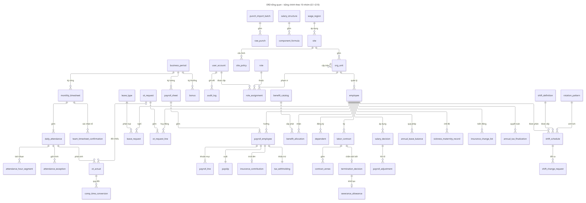

# 09. Mô hình dữ liệu

**AI-02 ưu tiên:** [24](24-ai-tro-ly-nghiep-vu-theo-vai-tro.md) dùng corpus hướng dẫn
có source/version/hash và metadata quyền; không đọc dữ liệu công/lương để trả lời.
Chưa yêu cầu bảng chat/vector database; audit metadata, không log question/response
thô mặc định. Cache phải gắn quyền/version. AI-01 dùng facts lương ở 23 chỉ là hướng sau sprint.

Mô hình dữ liệu hiện thực hóa **biểu đồ lớp 54 lớp / 10 gói** (tài liệu
`diagrams/class/Biểu đồ lớp - Class diagram.docx`, sơ đồ `diagrams/class/CD-00` … `CD-10`).
Mỗi gói `G1` … `G10` tương ứng một phân hệ BFD; mỗi lớp ánh xạ sang một bảng vật lý (tên
`snake_case`). Một số **bảng phụ trợ** không có lớp riêng (đoạn giờ, snapshot, kết quả kiểm
tra) phục vụ yêu cầu kỹ thuật.

**Phạm vi R1:** các bảng cần cho 152 M tại [19 §4](19-pham-vi-ban-dau-va-ma-tran-nghiem-thu.md)
là bắt buộc, kể cả đầu vào lương, nguồn công, hồ sơ muộn, phúc lợi và quyết toán năm.
`comp_time_conversion` chỉ giữ dữ liệu lịch sử nếu có, không tạo mới trong R1; trường/dữ
liệu tuyến báo cáo FUNCTIONAL và tiện ích thuộc sáu FR backlog là dự trữ. Dữ liệu vị trí/
ngạch/bậc cơ bản để xác định lương/P1/P2 vẫn có, dù bộ quản trị nâng cao FR-7.1.5 làm sau.
ERD bổ sung hiện hành: [R1-data](../diagrams/release/R1-data.mmd); ảnh tổng quan gốc bên
dưới không thay thế các bảng phụ trợ đã bổ sung ở 17/18.

**Hiện thực đơn nghỉ local:** `leave_request` lưu employee/leave_type/created_by,
ngày công từ–đến, DAY/HALF/HOUR, nửa ca hoặc khoảng giờ có múi giờ, lý do/chứng từ,
snapshot nguồn ca/phiên bản loại nghỉ/thời lượng, revision và thời điểm gửi.
Trạng thái hiện hành: DRAFT, PENDING, RETURNED, APPROVED, REJECTED, CANCELLED.
`leave_request_history` giữ actor/action/from_status/reason/revision/snapshot/thời điểm,
unique theo đơn + revision, trigger cấm sửa/xóa. Migration
`20261019130000_leave_decisions` mở rộng trạng thái và thêm from_status/reason;
không sửa lịch sử cũ (hai trường mới null ở bản ghi cũ). Migration
`20261019140000_leave_integration` thêm `leave_request.integration`, liên kết
`leave_operation.leave_request_id` và `daily_attendance.leave`. Duyệt tạo USE âm,
hủy đã duyệt tạo REFUND dương đối ứng từng nguồn/hạn/ngày hiệu lực, không sửa sổ cũ.
Nguồn công giữ đơn/revision, ca, phiên bản loại nghỉ và lịch lễ; phút nghỉ và công
từ nghỉ tách khỏi phút làm thực tế. Chi tiết đơn phản ánh trạng thái công hiện tại,
lịch sử quyết định vẫn bất biến. Hợp đồng tại [20 §7.19](20-tech-stack-va-moi-truong-phat-trien.md#719-tích-hợp-đơn-nghỉ-với-quỹ-và-bảng-công).

---

## 1. ERD tổng quan



Mã nguồn: `diagrams/class/src/ERD-tong-quan.mmd`. Ký hiệu: `||` đúng một, `o|` không hoặc
một, `|{` một hoặc nhiều, `o{` không hoặc nhiều.

### 1.1. Ánh xạ lớp → bảng

| Gói | Lớp → bảng |
|---|---|
| G1 Quản trị hệ thống | `CoSo` → `site` · `VungLuong` → `wage_region` · `DonViPhongBan` → `org_unit` · `TaiKhoan` → `user_account` · `VaiTro` → `role` · `PhanQuyen` → `role_assignment` · `ChinhSachCoSo` → `site_policy` · `ThamSoPhapLy` → `legal_parameter` · `KyNghiepVu` → `business_period` · `NhatKyKiemToan` → `audit_log` |
| G2 Hồ sơ và hợp đồng | `NhanVien` → `employee` · `NguoiPhuThuoc` → `dependent` · `HopDongLaoDong` → `labor_contract` · `PhuLucHopDong` → `contract_annex` · `QuyetDinhThayDoiLuong` → `salary_decision` · `QuyetDinhChamDut` → `termination_decision` |
| G3 Ca làm việc | `CaLamViec` → `shift_definition` · `NgayNghiLe` → `holiday_calendar` · `MauXoayCa` → `rotation_pattern` · `LichPhanCa` → `shift_schedule` · `DeXuatDoiCa` → `shift_change_request` |
| G4 Chấm công | `LoNhapChamCong` → `punch_import_batch` · `DuLieuChamCongTho` → `raw_punch` · `ChiTietCongNgay` → `daily_attendance` · `GiaiTrinhNgoaiLe` → `attendance_exception` · `XacNhanCongTo` → `team_timesheet_confirmation` · `BangChamCongThang` → `monthly_timesheet` |
| G5 Làm thêm giờ | `DeXuatOT` → `ot_request` · `ChiTietDeXuatOT` → `ot_request_line` · `TranOT` → `ot_cap` · `GioOTThucTe` → `ot_actual` · `QuyDoiNghiBu` → `comp_time_conversion` |
| G6 Nghỉ phép và chế độ | `LoaiNghi` → `leave_type` · `QuyPhepNam` → `annual_leave_balance` · `DonNghi` → `leave_request` · `HoSoOmDauThaiSan` → `sickness_maternity_record` |
| G7 Tính lương và thưởng | `CoCauLuong` → `salary_structure` · `CongThucLuong` → `component_formula` · `KhoanThuong` → `bonus` · `BangLuongThang` → `payroll_sheet` · `ChiTietLuongNhanVien` → `payroll_employee` · `KhoanMucLuong` → `payroll_line` · `ButToanDieuChinh` → `payroll_adjustment` · `PhieuLuong` → `payslip` |
| G8 Bảo hiểm và thuế | `MucDongBH` → `insurance_rate` · `BangTrichBH` → `insurance_contribution` · `DanhSachBaoTangGiam` → `insurance_change_list` · `BacThueTNCN` → `pit_bracket` · `KhauTruThue` → `tax_withholding` · `QuyetToanThueNam` → `annual_tax_finalization` |
| G9 Phúc lợi | `DanhMucPhucLoi` → `benefit_catalog` · `CapPhatPhucLoi` → `benefit_allocation` · `TroCapThoiViec` → `severance_allowance` |
| G10 Báo cáo | `BaoCao` → `report_run` |

**Bảng phụ trợ:** `job_title`, `job_grade`, `reporting_line`, `org_assignment` (G1 – G2);
`salary_component`, `employee_salary` (G7); `tax_profile` (G8); `attendance_hour_segment`,
`attendance_snapshot`, `crosscheck_result`, `ot_quota_tracking` (G4 – G5); `payroll_snapshot`,
`compliance_check_result` (G7); `notification` (xuyên suốt).

**Không còn trong mô hình** so với phiên bản 1.x: `approval_workflow` / `workflow_instance` /
`workflow_step` (luồng duyệt cố định theo BFD, trạng thái nằm trên từng bảng); `position`,
`headcount_plan` (định biên ngoài phạm vi); vùng chờ `UNMATCHED` của `raw_punch` (tệp sai mã
nhân viên bị từ chối khi nhập); các trạng thái `UNLOCK` và `PAID`.

---

## 2. G1 — Quản trị hệ thống

### 2.1. `site`, `wage_region`, `org_unit` — Cơ sở, vùng lương, đơn vị

| Bảng | Trường chính | Ghi chú |
|---|---|---|
| `wage_region` | `code` (I – IV) · `name` | Mức lương tối thiểu tra từ `legal_parameter` theo vùng và ngày |
| `site` | `code` · `name` · `address` · `wage_region_code` | Đơn vị cấp `SITE`; đơn vị nhập dữ liệu chấm công và mở kỳ |
| `org_unit` | `code` · `name` · `parent_id` · `unit_type` (`COMPANY` / `SITE` / `BLOCK` / `DEPARTMENT` / `TEAM`) · `level` (1..5) · `site_id` · `cost_center_code` · `accounting_account` (622 / 642) · `effective_from` / `effective_to` | **Chặn vòng lặp**; mọi thay đổi cấu trúc tạo **phiên bản mới**; vùng lương kế thừa từ `site` |

Truy vấn cây tổ chức luôn nhận tham số ngày và trả về cấu trúc đúng tại ngày đó. Danh mục
`job_title` (`code`, `name`, `job_level` 1–8, `job_grade_id`) và `job_grade` (A–F, số bậc) là
bảng phụ trợ; `reporting_line` (`SOLID` / `DOTTED`) chỉ dùng cho quyền xem báo cáo.

### 2.2. `user_account`, `role`, `role_assignment` — Tài khoản và phân quyền theo đơn vị

| Bảng | Trường chính | Ghi chú |
|---|---|---|
| `user_account` | `username` · `password_hash` · `status` · `employee_id` (nullable) | Chỉ cấp cho TT, QĐ, KT, AD |
| `role` | `code` (`TT` / `QD` / `KT` / `AD`) · `name` · `function_permissions` (json) | Bốn vai trò cố định |
| `role_assignment` | `user_account_id` · `role_code` · `scope_org_unit_id` · `effective_from` / `effective_to` | Một tài khoản có thể có nhiều bản ghi; phạm vi suy ra động từ cây đơn vị |

### 2.3. `legal_parameter` — Tham số pháp lý theo khoảng hiệu lực

| Trường | Kiểu | Ghi chú |
|---|---|---|
| `param_code` | string | Ví dụ `MIN_WAGE_MONTH_I`, `PIT_DEDUCTION_SELF`, `OT_RATE_HOLIDAY` |
| `scope_key` | string | Phạm vi áp dụng (toàn hệ thống / theo vùng / theo cơ sở) |
| `value` | decimal / json | Giá trị đơn hoặc cấu trúc |
| `unit` | string | %, đồng, giờ… |
| `effective_from` / `effective_to` | date | Khoảng áp dụng theo `application_basis`, tách ngày hiệu lực văn bản; **chống chồng lấn** trên cùng mã/phạm vi/đối tượng/cơ sở áp dụng; thêm phiên bản kế tiếp không ghi đè giá trị lịch sử (SQ-10) |
| `legal_basis` | string | Số hiệu văn bản, ngày ban hành, điều khoản — **bắt buộc** |
| `document_effective_date` / `application_basis` / `subject_type` | date / enum / string | Tham số thuế phân biệt ngày văn bản có hiệu lực với kỳ/ngày áp dụng; cơ sở `TAX_YEAR` / `PAYMENT_DATE`, nhóm cư trú/cách khấu trừ; không mặc định tất cả cùng mốc 01/07/2026 |
| `created_by` / `created_at` | | |

**Danh mục `param_code` tối thiểu:**

```
MIN_WAGE_MONTH_{REGION}     MIN_WAGE_HOUR_{REGION}
PIT_DEDUCTION_SELF          PIT_DEDUCTION_DEPENDENT   PIT_RATE_NON_RESIDENT   PIT_RATE_SEASONAL
PIT_OT_NIGHT_EXEMPTION_MODE PIT_WITHHOLDING_THRESHOLD
OT_RATE_NORMAL              OT_RATE_WEEKLY_REST       OT_RATE_HOLIDAY
NIGHT_ALLOWANCE_RATE        OT_NIGHT_EXTRA_RATE
UNION_FEE_RATE              UNION_FEE_CAP             LATE_PAYMENT_RATE
MEAL_TAX_FREE_CAP           UNIFORM_TAX_FREE_CAP      PHONE_TAX_FREE_CAP     HOUSING_TAXABLE_RATIO_CAP
PROBATION_MIN_RATIO         DEDUCTION_MAX_RATIO
```

Tỷ lệ, sàn, trần bảo hiểm nằm ở `insurance_rate` (G8); biểu thuế ở `pit_bracket` (G8); trần OT
ở `ot_cap` (G5) — đều có khoảng hiệu lực theo cùng nguyên tắc.

### 2.4. `site_policy` — Chính sách theo cơ sở

`site_id` / `org_unit_id` · `policy_key` (`ROUNDING_RULE`, `CUTOFF_DAY`, `STANDARD_WORKDAYS`,
`LATE_TOLERANCE_MIN`, `OT_RULE_SET`, `SHIFT_MODE`, `PUNCH_FILE_MAPPING`) · `policy_value` (json) ·
`effective_from` / `effective_to`

Chính sách nghiệp vụ bổ sung metadata `status` (`SIMULATION` / `BUSINESS_CONFIRMED`),
`decision_reference`, `confirmed_by/on`, `evidence_reference`; không tự nạp cấu hình mô
phỏng thành quy chế thật. Bộ đồ án có `COMP_TIME_ENABLED=false`, tỷ lệ/hạn quy đổi để trống;
công chuẩn/phép/dung sai và phạm vi áp dụng theo [18](18-xac-nhan-chinh-sach-va-dau-vao-tinh-luong.md).

Kế thừa theo cây, ghi đè từng khóa; khi phân giải trả về **cả giá trị và đơn vị nguồn**.

### 2.5. `business_period` — Kỳ nghiệp vụ

| Trường | Ghi chú |
|---|---|
| `code` | Ví dụ `CONG-NM-BN-2026-09`, `LUONG-NM-BN-2026-09` |
| `period_type` | `ATTENDANCE` (kỳ công) / `PAYROLL` (kỳ lương) |
| `scope_org_unit_id` | Cơ sở / đơn vị |
| `date_from` / `date_to` | Ngày công thuộc kỳ, mặc định 26/N-1 → 25/N; không là giới hạn timestamp quẹt |
| `status` | `PLANNED` (Lập kế hoạch) / `OPEN` / `CLOSED` / `LOCKED` |
| `revision` · `collection_until` | Phiên bản chống ghi đồng thời; mốc kết thúc thu log theo cửa sổ Ra của ca/OT thuộc kỳ |
| `opened_by` / `opened_at` · `locked_by` / `locked_at` | AD mở, KT khóa |
| `pay_date` · `actual_pay_date` | Với kỳ lương: ngày chi quy định và ngày chi thực tế KT ghi nhận (BR-61) |

Ràng buộc: không chồng **ngày công** trên cùng `(period_type, scope_org_unit_id)`; mở kỳ sau
không cần khóa kỳ trước. Chỉ khóa kỳ sau khi kỳ trước đã tồn tại cùng loại/phạm vi đã
`LOCKED` (trừ khởi tạo). KT được trả `CLOSED → OPEN` có lý do trước khóa; không có chuyển
ra khỏi `LOCKED`. Điều kiện thu đủ log và chống ghi đồng thời theo [17](17-vong-doi-ky-cong-va-ca-qua-ngay-chot.md).

`payroll_attendance_source` (`payroll_period_id`, `attendance_period_id`, `attendance_snapshot_id`,
`snapshot_hash`): FK đều về `business_period`, kiểm tra đúng loại/cơ sở/phạm vi; cặp kỳ là
duy nhất. Cho phép nhiều kỳ công nguồn khi cần; tất cả phải khóa trước tính lương, nguồn
đã dùng trong snapshot lương không được thay đổi ngầm. Ngày thanh toán thực tế lưu ở bản
ghi sự kiện chi trả liên kết kỳ; không cập nhật trực tiếp kỳ lương đã khóa (xem ngữ cảnh thuế G8).

### 2.6. `audit_log` — APPEND-ONLY

| Trường | Ghi chú |
|---|---|
| `id` | Tăng dần |
| `entity_type` / `entity_id` | Đối tượng bị tác động (`DoiTuong`, `MaDoiTuong`) |
| `action` | `CREATE` / `UPDATE` / `DELETE_SOFT` / `CONFIRM` / `APPROVE` / `CLOSE` / `LOCK` / `VIEW_SENSITIVE` / `ACCESS_DENIED` |
| `actor_id` | Tài khoản thực hiện |
| `occurred_at` | |
| `old_value` / `new_value` | json |
| `reason` | **Bắt buộc** với thao tác sửa công, lương, tham số, hồi tố, chấm dứt HĐ |
| `ip_address` | |
| `reference_code` | Mã giải trình / quyết định / lô nhập liên quan |
| `prev_hash` / `record_hash` | **Chuỗi băm** |

**Ràng buộc tầng CSDL:** tài khoản ứng dụng chỉ có `INSERT` và `SELECT`; `UPDATE` và `DELETE`
bị **thu hồi**. Tác vụ định kỳ kiểm tra tính liên tục của chuỗi băm.

---

## 3. G2 — Hồ sơ và hợp đồng

### 3.1. `employee`

| Nhóm trường | Trường tiêu biểu | Mã hóa |
|---|---|---|
| Định danh | `code`, `full_name`, `gender`, `dob`, `nationality` | – |
| Giấy tờ | `national_id` (CCCD / hộ chiếu) | 🔒 AES-256 |
| Cư trú | `residence_address`, `permanent_address` | – |
| Thuế & BH | `tax_code` (MaSoThue), `social_insurance_no` (SoSoBHXH) | – |
| Ngân hàng | `bank_account_no`, `bank_code` | 🔒 AES-256 |
| Tổ chức | `org_unit_id` (đơn vị chính), `job_title_id` | – |
| Đặc thù | `is_foreigner`, `work_permit_no`, `tax_residency_status`, `is_retiree`, `is_minor` | – |
| Trạng thái | `status`, `hire_date` (NgayVaoLam), `termination_date` (NgayNghiViec), `termination_reason` | – |

Nhân viên **không có tài khoản đăng nhập**. Phân công nhiều đơn vị trong kỳ lưu ở bảng phụ trợ
`org_assignment` (`employee_id`, `org_unit_id`, `is_primary`, `allocation_ratio`,
`salary_decision_id`, `effective_from` / `effective_to`) — tổng `allocation_ratio` trong một kỳ
= 100% (BR-70).

### 3.2. Các bảng còn lại của G2

| Bảng | Trường chính | Ghi chú |
|---|---|---|
| `dependent` | `employee_id` · `full_name` · `relationship` · `tax_code` · `national_id` (🔒) · `deduction_from_month` / `deduction_to_month` · `proof_document_id` | Giảm trừ theo **tháng hiệu lực đăng ký** |
| `labor_contract` | `contract_no` · `employee_id` · `contract_type` (`PROBATION` / `FIXED_TERM` / `INDEFINITE` / `UNDER_1M` / `PIECEWORK` / `SERVICE`) · `start_date` / `end_date` · `fixed_term_sequence` · `insurance_eligible` · `contract_salary` (🔒) · `status` · `termination_effective_date` | Cảnh báo khi `fixed_term_sequence` = 2; cảnh báo hết hạn không đổi `status` |
| `contract_annex` | `labor_contract_id` · `content` · `effective_date` | Composition của hợp đồng |
| `salary_decision` | `decision_no` · `employee_id` · `decision_type` (`TRANSFER` / `SALARY_CHANGE`) · `old_value` / `new_value` · `effective_date` · `entered_date` · `is_retroactive` (= `effective_date` < kỳ lương đang mở) | Lưu lịch sử hiệu lực; `is_retroactive` kích hoạt hồi tố (7.4) |
| `termination_decision` | `decision_no` · `labor_contract_id` · `employee_id` · `effective_date` · `reason` · `legal_basis` · `status` (`DRAFT` / `CONFIRMED`) | Xác nhận mới cập nhật HĐ, tạo `severance_allowance`, `insurance_change_list` |

**Sổ quản lý lao động** là view dẫn xuất từ `employee`, `labor_contract`, `insurance_contribution`,
`annual_leave_balance`, `ot_actual` và `salary_decision` — không nhập tay.

---

## 4. G3 — Ca làm việc

| Bảng | Trường chính | Ghi chú |
|---|---|---|
| `shift_definition` | `code` · `name` · `start_time` / `end_time` · `crosses_midnight` (**cờ then chốt**, CoQuaNgay) · `break_minutes` · `is_night_shift` · `check_in_window_before` / `after` · `check_out_window_before` / `after` | Ca vắt qua nửa đêm gán công về ngày bắt đầu ca |
| `holiday_calendar` | `date` · `holiday_type` (`PUBLIC_HOLIDAY` / `TET` / `COMPENSATORY_REST` / `WEEKLY_REST`) · `name` · `is_paid` · `substitute_for_date` · `site_id` (nullable) | Phân loại ngày khi tách đoạn giờ (BR-24) |
| `rotation_pattern` | `code` · `name` · `cycle_days` · `shift_sequence` (json) · `min_rest_hours` | Ràng buộc xoay ca |
| `shift_schedule` | `employee_id` · `team_org_unit_id` · `work_date` · `shift_id` · `rotation_pattern_id` · `status` (`DRAFT` / `PENDING` / `APPROVED` / `RETURNED`) · `return_reason` · `created_by` (TT) · `approved_by` (QĐ) | Chỉ `APPROVED` được dùng ghép công |
| `shift_change_request` | `shift_schedule_id` · `employee_id` · `old_shift_id` / `new_shift_id` · `reason` · `status` (`PENDING` / `APPROVED` / `REJECTED`) | Chưa duyệt → giữ lịch hiện hành |

**Hiện thực PostgreSQL local (20 §7.10):** tách header `shift_plan` (đơn vị, người lập,
status DRAFT/PENDING/APPROVED/RETURNED/CANCELLED, revision) khỏi các dòng `shift_schedule`
(plan_id, employee_id, work_date DATE, shift_id, start_at/end_at UTC, work_minutes;
unique plan/nhân sự/ngày). `shift_plan_history` chứa actor, trạng thái trước/sau, lý do,
thời điểm, revision và snapshot JSON đầy đủ; unique plan/revision và trigger append-only.
`shift_definition` bổ sung org_unit_id, kind, break_start_offset, paid_break, work_minutes,
active và revision; unique đơn vị/mã, bất biến nội dung sau khi được dùng. Các trường
window, lịch lễ, rotation_pattern và shift_change_request phía trên vẫn là thiết kế R1,
chưa có trong schema/chức năng local; không suy diễn chúng đã chạy.

---

## 5. G4 — Chấm công (ba tầng)

### 5.1. `punch_import_batch` và tầng 1 · `raw_punch` (BẤT BIẾN)

| Bảng | Trường chính |
|---|---|
| `punch_import_batch` | `site_id` · `reference_attendance_period_id` (kỳ tham chiếu, không ép đích) · `file_name` · `file_hash` · `imported_by` · `imported_at` · số lưu/trùng/đã xử lý/chờ/muộn · `status` (`ACCEPTED` / `ACCEPTED_WITH_EXCEPTIONS` / `REJECTED`) · `error_detail` |
| `raw_punch` | `id` · `import_batch_id` · `site_id` · `employee_id` · `device_code` · `punch_at` (timestamp) · `punch_type` (`IN` / `OUT` / `AUTO`) · `received_at` |

**Ràng buộc:** `raw_punch` chỉ INSERT và SELECT. Khóa chống trùng
`(site_id, device_code, employee_id, punch_at)` bảo đảm nhập lại tệp là idempotent. Lô bị `REJECTED`
không ghi bản ghi nào vào `raw_punch`.

`punch_assignment` (`raw_punch_id`, `shift_schedule_id`, `work_date`, `target_attendance_period_id`,
`assignment_status`, `calc_version`) là dẫn xuất: không sửa log khi ghép lại. Mỗi lượt chỉ
có một gán ca hiệu lực; thiếu/đa ứng viên là ngoại lệ. Trùng gần 5 phút đánh dấu ở dẫn xuất.
`late_punch_case` (`raw_punch_id`, `origin_period_id`, `source_shift_id`, `reason`, `status`,
`adjustment_reference`, `resolved_by`) lưu ngoài snapshot; duy nhất theo log/kỳ nguồn để
chống tạo hồ sơ hoặc điều chỉnh lặp. Kỳ khóa vẫn nhận log vào kho thô, không nhận kết quả mới.
`attendance_collection_confirmation` lưu phạm vi nguồn, khoảng bao phủ, bằng chứng file,
người/thời điểm xác nhận; không lấy max timestamp của file làm bằng chứng thu đủ log.

### 5.2. Tầng 2 · `daily_attendance` (DẪN XUẤT)

| Trường | Ghi chú |
|---|---|
| `monthly_timesheet_id` · `employee_id` | |
| `work_date` | Ngày bắt đầu ca trong lịch đã duyệt; kỳ công sở hữu chứa ngày này, không suy từ ngày quẹt |
| `shift_id` · `shift_schedule_id` | Loại ca và lần phân ca đã duyệt; lưu thời điểm bắt đầu/kết thúc kỳ vọng có múi giờ |
| `day_type` | `NORMAL` / `WEEKLY_REST` / `HOLIDAY` |
| `check_in_at` / `check_out_at` | Từ cặp quẹt đã ghép |
| `worked_hours` · `day_hours` / `night_hours` | Tách theo mốc 22:00 / 06:00 |
| `had_daytime_ot` | **Cờ quyết định 200% vs 210%** (BR-25) |
| `late_minutes` / `early_leave_minutes` | Ghi nhận, **không dùng để trừ lương** |
| `attendance_symbol` | `X` / `Đ` / `Ph` / `L` / `Ô` / `TS` / `Kl` / `ERR` / `KP` |
| `status` | `OK` / `EXCEPTION` / `ADJUSTED` |
| `converted_workday` | Công quy đổi (decimal) |
| `calc_version` | Phiên bản thuật toán đã sinh bản ghi |

**Tính chất:** `daily_attendance = f(raw_punch, shift_schedule đã duyệt, đơn nghỉ và OT đã duyệt,
giải trình, legal_parameter)` — luôn tính lại được từ tầng 1.

Bảng phụ trợ **`attendance_hour_segment`** (`daily_attendance_id`, `segment_from` / `segment_to`,
`hours`, `is_night`, `day_type` của đoạn — có thể khác ngày công, `is_overtime`, `applied_rate`,
`rate_breakdown` json) hiện thực hóa việc **tách bạch "ngày công" và "đoạn giờ"** (ADR-03).

### 5.3. Ngoại lệ, xác nhận và bảng công tháng

| Bảng | Trường chính | Ghi chú |
|---|---|---|
| `attendance_exception` | `daily_attendance_id` · `exception_type` (`MISSING_PUNCH` / `LATE` / `EARLY_LEAVE` / `FIELD_WORK` / `DEVICE_FAILURE` / `OT_MISMATCH`) · `reason` · `evidence_attachment_id` · `old_value` / `new_value` · `entered_by` (TT) · `entered_at` | Mỗi điều chỉnh ghi `audit_log` |
| `team_timesheet_confirmation` | `monthly_timesheet_id` · `team_org_unit_id` · `confirmed_by` (TT) · `confirmed_at` · `status` | Chức năng 4.4 |
| `monthly_timesheet` | `attendance_period_id` · `workshop_org_unit_id` · `total_workdays` · `total_ot_hours` · `status` (`DRAFT` / `TEAM_CONFIRMED` / `WORKSHOP_CLOSED` / `LOCKED`) · `closed_by` (QĐ) · `locked_by` (KT) | Bốn trạng thái |

Tầng 3 **`attendance_snapshot`** (`attendance_period_id`, `content` json, `content_hash`,
`locked_at`, `locked_by`): sau khi KT khóa kỳ công, mọi truy vấn bảng công của kỳ trả về từ
snapshot. **`crosscheck_result`** (`monthly_timesheet_id`, `check_code` `XC-01`…`XC-10`,
`severity`, `violation_count`, `detail`, `acknowledged_by`) lưu kết quả đối soát khi QĐ chốt.

---

## 6. G5 — Làm thêm giờ

| Bảng | Trường chính | Ghi chú |
|---|---|---|
| `ot_request` | `team_org_unit_id` · `ot_date` · `planned_from` / `planned_to` · `reason` · `consent_reference` (**bắt buộc**) · `proposed_by` (TT) · `approved_by` (QĐ) · `status` (`PENDING` / `APPROVED` / `REJECTED` / `RETURNED`) · `decision_reason` | Đề xuất cho cả tổ |
| `ot_request_line` | `ot_request_id` · `employee_id` · `planned_hours` | Danh sách nhân viên |
| `ot_cap` | `scope` (cơ sở / ngành) · `cap_day` · `cap_month` · `cap_year` · `effective_from` / `effective_to` | Cấu hình, không ghi cứng |
| `ot_actual` | `daily_attendance_id` · `employee_id` · `work_date` · `day_type` · `is_night` · `actual_hours` · `approved_hours` · `payable_hours` · các khoảng thực tế/duyệt · `rate_code` · `applied_rate` · `ot_request_id` (nullable) · `match_status` (`MATCHED` / `MISMATCH`) · `amount` · `taxable_amount` · `tax_free_amount` | Giữ giờ thực tế để kiểm soát trần; giờ trả tiền theo căn cứ đã xác minh, phần lệch vào ngoại lệ; không ghi đè thực tế bằng min hoặc trừ vì nghỉ bù |
| `comp_time_conversion` | `employee_id` · `ot_actual_id` · `converted_hours` · `conversion_ratio` · `expiry_date` · `used_hours` · `performed_by` (KT) · `performed_at` | Chưa kích hoạt DEC-01; cấm tạo mới khi COMP_TIME_ENABLED=false. Dữ liệu lịch sử nếu có giữ để đối soát, không tự xóa/giảm tiền OT |

Bảng phụ trợ **`ot_quota_tracking`** (`employee_id`, `period_type` `DAY` / `MONTH` / `YEAR`,
`period_key`, `accumulated_hours`, `cap_hours`, `warning_threshold`) phục vụ kiểm soát trần (5.3).

---

## 7. G6 — Nghỉ phép và chế độ

| Bảng | Trường chính | Ghi chú |
|---|---|---|
| `leave_type` | `code` · `name` · `is_paid` · `counts_as_workday` · `deducts_annual_quota` · `si_paid` · `requires_document` · `max_days` · `attendance_symbol` | AD quản lý (6.1) |
| `annual_leave_balance` | `employee_id` · `year` · `entitled_days` · `carried_over_days` · `carry_over_expiry` · `used_days` · `advance_days` | KT quản lý (6.2); số dư = cấp + chuyển sang − đã nghỉ |
| `leave_request` | `employee_id` · `leave_type_id` · `date_from` / `date_to` · `unit` (`DAY` / `HALF_DAY` / `HOUR`) · `quantity` · `reason` · `attachment_id` · `recorded_by` (TT) · `status` (`PENDING_L1` / `APPROVED_L1` / `REJECTED`) · `decided_by` (TT) | Một cấp duyệt duy nhất |
| `sickness_maternity_record` | `employee_id` · `benefit_type` · `document_no` · `date_from` / `date_to` · `entitled_days` · `benefit_amount_estimate` · `si_paid_amount` | KT theo dõi (6.4) |

Tỷ lệ vắng mặt (6.5) là truy vấn tổng hợp từ `leave_request` và `daily_attendance`, không có
bảng riêng.

---

## 8. G7 — Tính lương và thưởng

| Bảng | Trường chính | Ghi chú |
|---|---|---|
| `salary_structure` | `code` · `name` · `effective_from` / `effective_to` | Cơ cấu lương (7.1) |
| `salary_component` *(phụ trợ)* | `code` · `name` · `component_type` (`EARNING` / `DEDUCTION` / `EMPLOYER_COST`) · `is_insurable` · `is_taxable` · `is_prorated` · `is_ot_base` · `display_order` | 3 cờ độc lập (BR-37) |
| `component_formula` | `salary_structure_id` · `salary_component_id` · `expression` (tham chiếu mã tham số) · `depends_on` · `version` · `effective_from` / `effective_to` | Không phụ thuộc vòng |
| `employee_salary` *(phụ trợ)* | `employee_id` · `salary_component_id` · `amount` (🔒) · `effective_from` / `effective_to` · `salary_decision_id` | Tăng lương giữa kỳ → engine tách hai đoạn đơn giá |
| `employee_pay_plan` *(phụ trợ)* | `employee_id` · `salary_structure_id` · `pay_mode` · `combination_rule_version` · `effective_from/to` · `decision_reference` | Không chồng phương án hiệu lực; khoản thay thế/cộng thêm tường minh, đủ thời gian/sản phẩm/khoán/hoa hồng/3P |
| `payroll_input_batch` *(phụ trợ)* | `source_system` · `source_document_no` · `source_version` · `file_hash` · `mapping_version` · `payroll_period_id` · `status` · người/thời điểm nhập và xác nhận | KT tiếp nhận; trạng thái DRAFT/VALIDATED/CONFIRMED/RETURNED/SUPERSEDED, có chứng từ nguồn |
| `payroll_input_line` *(phụ trợ)* | `batch_id` · `source_line_id` · `employee_id` · `site_id` · `input_type` · `salary_component_id` · `work_from/to` · `quantity` · `unit` · `unit_price_version_id` / `formula_version` · `amount` · `value_state` · `source_approval_reference` · `supersedes_line_id` | Tách PRESENT/MISSING/CONFIRMED_ZERO/NOT_APPLICABLE khỏi trạng thái lô; khóa nhập lại theo nguồn/chứng từ/dòng/version; một bản hiệu lực, không sửa bản đã dùng trong kỳ khóa |
| `payroll_unit_price` *(phụ trợ)* | `price_code` · `product_code` / `operation_code` · `unit` · `amount` · `scope` · `effective_from/to` · `approval_reference` | Decimal, không chồng giá cùng mã/đơn vị/phạm vi; tách theo ngày thực hiện, không mặc định lấy giá mới nhất |
| `bonus` | `bonus_type` · `employee_id` / `org_unit_id` · `amount` · `payroll_period_id` · `status` | Chỉ tính khi kỳ có thưởng (7.3) |
| `payroll_sheet` | `payroll_period_id` · `site_id` · `wage_region_code` · `total_fund` · `status` (`DRAFT` / `APPROVED` / `LOCKED`) · `calc_count` · `param_snapshot_hash` · `formula_version_set` · `approved_by` / `locked_by` | Tính lại cùng đầu vào cho cùng kết quả |
| `payroll_employee` | `payroll_sheet_id` · `employee_id` · `base_salary` · `actual_workdays` · `gross_income` · `employee_insurance` · `pit` · `net_pay` (🔒) | Một dòng mỗi nhân viên |
| `payroll_line` | `payroll_employee_id` · `line_type` (`LUONG_NGAY`, `OT_NGAY_THUONG`, `OT_DEM`, `PC_CA_DEM`, `THUONG`, `TRUY_LINH`, `TRUY_THU`…) · `quantity` · `rate` · `amount` (🔒) · `param_code` · `calculation_trace` (json) · `source_reference` | Thay các cột 150% / 210% / 270% / 390% cố định; `calculation_trace` hiện thực drill-down |
| `payroll_line_input` *(phụ trợ R1)* | `payroll_line_id` · `payroll_input_line_id` · `source_version` · `source_hash` · `contribution_quantity` / `contribution_amount` | Liên kết nhiều nguồn/dòng lương; khóa duy nhất cặp dòng/nguồn/version, kiểm tra cùng nhân viên/phạm vi hoặc phân bổ tổ có căn cứ; bất biến cùng snapshot |
| `payroll_adjustment` | `salary_decision_id` · `origin_period_id` (**kỳ gốc**) · `target_period_id` (kỳ mở nhận) · `employee_id` · `adjustment_type` (`RETRO_PAY` / `RETRO_DEDUCT` / `LATE_PAYMENT_COMPENSATION`) · `diff_salary` · `diff_insurance` · `diff_tax` · `status` (`DRAFT` / `CONFIRMED`) · `confirmed_by` (KT) | Kỳ gốc giữ nguyên |
| `payslip` | `payroll_employee_id` · `issued_at` · `issued_by` (KT) · `file_id` · `status` | Không có OTP / PIN |

Bảng phụ trợ **`payroll_snapshot`** (`payroll_sheet_id`, `content`, `content_hash`, `locked_at`,
`locked_by`, `compliance_result_id`) và **`compliance_check_result`** (`payroll_sheet_id`,
`check_code` `CP-01`…`CP-09`, `severity`, `violation_count`, `detail`, `acknowledged_by`) lưu
bằng chứng tuân thủ kèm kỳ lương.

---

## 9. G8 — Bảo hiểm và thuế TNCN

| Bảng | Trường chính | Ghi chú |
|---|---|---|
| `insurance_rate` | `wage_region_code` · `insurance_type` (`BHXH` / `BHYT` / `BHTN` / `KPCD`) · `employee_rate` · `employer_rate` · `floor_amount` · `cap_amount` · `effective_from` / `effective_to` | KT cập nhật (8.1) |
| `insurance_contribution` | `payroll_employee_id` · `period_code` · `employee_id` · `insurable_salary` (🔒) · `bhxh_nld` / `bhxh_dn` · `bhyt_nld` / `bhyt_dn` · `bhtn_nld` / `bhtn_dn` · `kpcd_dn` · `union_fee` | Tách NLĐ / DN (8.2) |
| `insurance_change_list` | `period_code` · `employee_id` · `change_type` (`INCREASE` / `DECREASE` / `ADJUST`) · `reason` · `effective_date` · `old_salary` / `new_salary` · `c12_difference` | Danh sách để kê khai (8.3) |
| `pit_bracket` | `bracket_no` · `from_amount` / `to_amount` (bậc cuối null = không giới hạn) · `rate` · `effective_from` / `effective_to` · `basis` (`MONTH` / `YEAR`) · `legal_basis` | 5 bậc từ kỳ thuế 2026 cho cư trú; 7 bậc ở bộ 2025; bảng năm có ngưỡng tháng × 12 |
| `tax_profile` *(phụ trợ)* | `employee_id` · `residency_status` (`RESIDENT` / `NON_RESIDENT`) · `effective_from` / `effective_to` · `commitment_reference` / `commitment_form_version` · `authorization_for_finalization` | Cách khấu trừ suy từ cư trú/HĐ/quy tắc; “thời vụ” không là trạng thái cư trú |
| `tax_withholding` | `payroll_employee_id` · `payment_reference` · `payment_date` · `payment_date_status` (`PROJECTED` / `ACTUAL`) · `tax_period` · `employee_id` · `withholding_method` · `rule_snapshot` (phiên bản/căn cứ/chế độ miễn/ngưỡng) · `taxable_income` · `tax_free_income` · `self_deduction` · `dependent_deduction` · `insurance_deduction` · `assessable_income` · `tax_amount` · `bracket_breakdown` (json) · `filing_status` · `original_withholding_id` (nullable) | Phân biệt kỳ thuế của lần chi với kỳ công/lương; khoản đã khai/nộp không ghi đè; dự báo và đối soát thực tế liên kết riêng |
| `annual_tax_finalization` | `year` · `employee_id` · `total_income` · `total_deduction` · `tax_withheld` · `tax_due` · `difference` · `status` (`DRAFT` / `DONE`) | Dự thảo hồ sơ (8.5) |

Chi tiết miễn thuế lưu theo khoản/đoạn không trùng nguồn: `income_source_reference`, `amount_paid`,
`eligible_exempt_amount`, `taxable_amount`, `exemption_rule_version`, `evidence_reference` và
`eligibility_status`. Tổng phần miễn + chịu phải bằng khoản thực trả. Lương gốc giờ đêm phân
bổ từ lương thời gian; không cộng lại thành thu nhập mới. Điều chỉnh thuế/chuyển tiếp lưu
tham chiếu hồ sơ gốc và lý do, không mở khóa bảng lương. Xem [12 §2.7](12-tuan-thu-phap-ly.md).

---

## 10. G9 — Phúc lợi và G10 — Báo cáo

| Bảng | Trường chính | Ghi chú |
|---|---|---|
| `benefit_catalog` | `code` · `name` · `eligibility_rule` (json) · `benefit_amount` · `is_taxable` · `effective_from` | 9.1 |
| `benefit_allocation` | `benefit_catalog_id` · `employee_id` · `period_code` · `amount` · `cost_org_unit_id` · `payroll_period_id` (nullable) · `status` (`PLANNED` / `CONFIRMED`) | Khóa chống trùng `(benefit_catalog_id, employee_id, period_code)` |
| `severance_allowance` | `termination_decision_id` · `allowance_type` (`SEVERANCE` / `JOB_LOSS`) · `service_years` · `amount` · `payroll_period_id` | Tạo khi xác nhận chấm dứt; hiển thị ở chi phí 9.4 |
| `report_run` | `report_type` · `scope_org_unit_id` · `period_code` · `data_status` (`DRAFT` / `OFFICIAL`) · `requested_by` · `requested_at` · `export_format` · `file_id` | Báo cáo là truy vấn; bảng chỉ lưu lần kết xuất và quyền đã kiểm tra |

---

## 11. Quy ước chung cho mọi bảng

| Quy ước | Áp dụng |
|---|---|
| Kiểu tiền tệ | `decimal` với độ chính xác xác định. **Cấm dùng float** — có lint/test chặn |
| Kiểu giờ công | `decimal`, tối thiểu 2 chữ số thập phân |
| Xóa dữ liệu | **Xóa mềm**: `deleted_at`, `deleted_by`, `delete_reason`. Không xóa cứng (BR-63) |
| Trường hệ thống | `created_at`, `created_by`, `updated_at`, `updated_by` trên mọi bảng nghiệp vụ |
| Khoảng hiệu lực | Cặp `effective_from` / `effective_to`; `effective_to = NULL` nghĩa là còn hiệu lực |
| Trạng thái | Mỗi bảng có luồng duyệt lưu `status` + người / thời điểm chuyển trạng thái; mọi chuyển trạng thái ghi `audit_log` |
| Mã hóa | Trường đánh dấu 🔒 mã hóa AES-256 ở tầng CSDL |
| Chỉ mục | Đánh chỉ mục trên các trường **không mã hóa**; đối chiếu trùng CCCD dùng trường băm có muối |

---

## 12. Ràng buộc toàn vẹn then chốt

| # | Ràng buộc | Cấp thực thi |
|---|---|---|
| 1 | `legal_parameter`, `insurance_rate`, `pit_bracket`, `ot_cap`, `site_policy` không chồng lấn khoảng hiệu lực trên cùng khóa phạm vi | CSDL |
| 2 | `raw_punch` chỉ INSERT/SELECT; duy nhất theo `(device_code, employee_id, punch_at)` | CSDL |
| 3 | `audit_log` thu hồi UPDATE/DELETE | CSDL |
| 4 | `org_unit.parent_id` không tạo chu trình; `level` ≤ 5 | Ứng dụng + kiểm tra định kỳ |
| 5 | Không chồng ngày công cùng loại/phạm vi; tạo/mở kỳ không phụ thuộc khóa kỳ trước; chỉ khóa theo thứ tự, trạng thái/revision và điều kiện đủ nguồn | CSDL + ứng dụng |
| 6 | `payroll_sheet` chỉ tính khi toàn bộ kỳ công nguồn trong `payroll_attendance_source` đã `LOCKED`; lưu snapshot/hash nguồn | Ứng dụng |
| 7 | Không sửa kết quả/snapshot kỳ `LOCKED`; log muộn chỉ thêm vào kho thô/hồ sơ ngoài kỳ, điều chỉnh ghi kỳ đang mở | Ứng dụng + CSDL |
| 8 | `monthly_timesheet` chỉ chuyển `WORKSHOP_CLOSED` khi mọi tổ đã xác nhận và không còn `XC` mức BLOCKING | Ứng dụng |
| 9 | `component_formula` không có phụ thuộc vòng | Formula engine |
| 10 | `daily_attendance` duy nhất theo `(employee_id, work_date)` | CSDL |
| 11 | `role_assignment.role_code` ∈ {TT, QD, KT, AD} | CSDL |
| 12 | `tax_withholding` duy nhất theo `(employee_id, period_code)` — không khấu trừ hai lần | CSDL |
| 13 | `severance_allowance` duy nhất theo `termination_decision_id` | CSDL |
| 14 | Tổng khấu trừ ≤ 30% NET | Cổng chặn `CP-04` |

---

## 13. Chiến lược lưu trữ và phân vùng

| Nhóm dữ liệu | Khối lượng ước tính (~2.200 NV, 4 cơ sở) | Chiến lược |
|---|---|---|
| `raw_punch` | ~ 4 lượt/người/ngày ≈ 3,2 triệu bản ghi/năm | Phân vùng theo tháng và cơ sở; nén dữ liệu cũ; giữ tối thiểu 3 năm |
| `daily_attendance` | ~ 800.000 bản ghi/năm | Phân vùng theo kỳ công |
| `attendance_hour_segment` | ~ 2–4 đoạn/ngày công ≈ 2,4 triệu/năm | Phân vùng theo kỳ công |
| `payroll_line` | ~ 20 dòng/người/kỳ ≈ 530.000/năm | Phân vùng theo kỳ lương |
| `audit_log` | Tăng liên tục | Phân vùng theo tháng; **không xóa**, chỉ chuyển sang lưu trữ nguội |
| Snapshot | 12 bản/năm mỗi loại × 4 cơ sở | Lưu nguyên vẹn, không nén mất mát |
