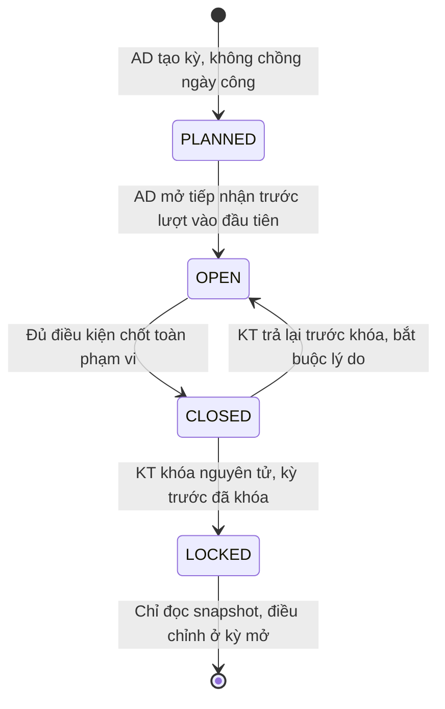

# 17. Vòng đời kỳ công và ca qua ngày chốt

Đặc tả chuẩn cho BR-01, BR-13, BR-18, FR-1.5 và FR-4.x, cập nhật ngày 17/10/2026.
Các quy tắc dưới đây thay yêu cầu cũ “khóa kỳ trước mới mở kỳ sau” và kiểm tra import chỉ
theo ngày lịch. Sơ đồ PNG SQ11, SQ2, SQ3, AD-01, AD-04 và CD-01 được lưu từ bản trước;
phần vòng đời/routing trong các ảnh đó cần đọc theo tài liệu này và nguồn Mermaid cập nhật,
không dùng điều kiện cũ trong ảnh để nghiệm thu.

## 1. Trạng thái và quyền thao tác

Kỳ công và kỳ lương độc lập về ngày, trạng thái; dùng bảng chung `business_period` với
`period_type`. Trạng thái kỳ khác trạng thái bảng công xưởng và bảng lương.

| Trạng thái | Được làm | Không được làm |
|---|---|---|
| `PLANNED` — Lập kế hoạch | AD tạo kỳ; TT lập ca/đề xuất; QĐ duyệt ca, OT cho ngày thuộc kỳ | Ghi kết quả công/lương chính thức, chốt/khóa |
| `OPEN` — Mở | Nhận và xử lý công; xử lý ngoại lệ, xác nhận tổ, chốt từng xưởng; kỳ lương được tính khi nguồn công đã khóa | Khóa khi chưa chốt/đủ điều kiện |
| `CLOSED` — Đã chốt | Xem và đối soát; KT khóa hoặc trả lại kèm lý do | Sửa công, lịch/OT ảnh hưởng công, giải trình hoặc lương trực tiếp |
| `LOCKED` — Đã khóa | Đọc snapshot; lập hồ sơ phát sinh muộn và bút toán sang kỳ đang mở | Sửa/xóa kết quả, đổi nguồn kỳ lương, trở về trạng thái trước |

- Không cần kỳ trước khóa để **tạo, lập ca hoặc mở** kỳ sau. Nhiều kỳ `OPEN` được tồn tại
  nếu khoảng **ngày công** cùng loại/phạm vi không chồng lấn.
- Khóa vẫn theo thứ tự: kỳ trước **đã tồn tại**, cùng loại/phạm vi phải `LOCKED` trước khi
  khóa kỳ sau. Kỳ đầu đánh dấu khởi tạo; không dùng điều kiện này để chặn mở kỳ.
- AD mở kỳ trước cửa sổ Vào đầu tiên, kể cả ca bắt đầu 00:00 có lượt vào từ ngày trước;
  không đợi 00:00 của `date_from` nếu lịch ca cho nhận lượt sớm. `PLANNED` nhận được log
  trong kho thô nhưng chưa sinh công; chờ AD mở, không tự chuyển trạng thái từ import.
- TT xác nhận tổ; QĐ chốt xưởng. Khi tất cả xưởng thuộc phạm vi đã chốt và thỏa §4,
  hệ thống chuyển kỳ công `OPEN → CLOSED`. Với kỳ lương, KT duyệt đủ bảng thuộc kỳ thì
  chuyển `OPEN → CLOSED`. Khóa là thao tác riêng của KT.
- Trước khóa, KT được trả kỳ `CLOSED → OPEN` có lý do/nhật ký. QĐ trả bảng xưởng cần sửa
  về nháp; sửa đầu vào hủy xác nhận của các tổ bị ảnh hưởng và kết quả đối soát liên quan.
  Phải xác nhận, chốt lại; đây không phải mở khóa kỳ `LOCKED`.
- Kỳ `OPEN` nhưng xưởng đã chốt: QĐ cũng được trả riêng xưởng đó về nháp có lý do trước
  khi sửa. TT không tự sửa công xưởng đã chốt hoặc dùng log mới để bỏ qua quyền duyệt;
  import mới chỉ đánh dấu mất hiệu lực và đưa phần bị ảnh hưởng về chờ xác nhận lại.
- Với kỳ đang `OPEN`, dữ liệu mới/sửa đổi phải làm mất hiệu lực xác nhận/chốt xưởng bị
  ảnh hưởng. Không giữ trạng thái đã xác nhận khi số liệu đã đổi.

## 2. Ngày công và cửa sổ ca

| Giá trị | Quy tắc |
|---|---|
| Múi giờ | Dựng ngày/ca theo múi giờ cơ sở; mặc định `Asia/Ho_Chi_Minh`; lưu timestamp kèm múi giờ/UTC |
| `work_date` | Ngày bắt đầu **ca trong lịch đã duyệt**, không lấy ngày lịch của lượt vào thực tế |
| Kỳ sở hữu công | Kỳ `ATTENDANCE` cùng phạm vi có `date_from ≤ work_date ≤ date_to`; không xác định bằng `punch_at` |
| Ca qua ngày | Kết thúc cộng một ngày theo `CoQuaNgay`; không suy diễn ca 24 giờ từ hai giờ bằng nhau |
| Cửa sổ Vào/Ra | Các khoảng timestamp đầy đủ; biên trước/sau cấu hình riêng, gồm cả mốc ngày |
| Ca C chuẩn | Vào 21:30–22:15 ngày T; Ra 05:45–06:30 ngày T+1, khi không có OT nối tiếp |
| Ca C có OT duyệt tới 08:00 | Giờ kết thúc kỳ vọng là 08:00 T+1; nếu biên Ra trước 15/sau 30 phút thì cửa sổ Ra 07:45–08:30 T+1 |

Cửa sổ mở rộng chỉ giúp ghép đúng lượt ra, **không tự cho hưởng OT**. Giờ thực tế đối chiếu
với khoảng đã duyệt; lượt ra khác thường không khớp vẫn giữ nguyên và đưa ngoại lệ. Không
tự nhận toàn bộ khoảng 06:00–08:00 là OT trả tiền. Một lượt chỉ được ghép vào một ca;
trùng ứng viên, nhiều cặp chưa phân biệt được hoặc thiếu lịch thì đưa ngoại lệ, không
chọn tùy ý. Mọi cửa sổ có giới hạn cấu hình rõ, không tìm lượt ra vô hạn.

Ca bắt đầu 00:00 ngày 26, vào sớm 23:45 ngày 25 vẫn thuộc **ngày công 26/kỳ mới**.
Ngược lại, ca C bắt đầu 22:00 ngày 25, ra 06:00 hoặc OT tới 08:00 ngày 26 vẫn thuộc
**ngày công 25/kỳ cũ**. Tách giờ tại 00:00/06:00/22:00 để áp loại ngày và phụ cấp như cũ;
việc tách đoạn không chuyển phần công sau nửa đêm sang kỳ mới và không đổi kỳ thuế.

## 3. Import và phân tuyến theo ca

AD chọn cơ sở và kỳ tham chiếu để kiểm tra quyền/hiển thị kết quả, **không ép mọi dòng vào
kỳ đã chọn**. Hệ thống tìm ca trong kỳ tham chiếu và các kỳ liền kề cùng cơ sở bằng cửa sổ
timestamp. Dòng ngoài phạm vi đó giữ ở vùng chờ phân tuyến; muốn xử lý thêm phải chọn đúng
phạm vi có quyền, không tự mở rộng sang cơ sở khác.

1. Kiểm tra cấu trúc, ngày giờ, mã nhân viên và cơ sở tại thời điểm nghiệp vụ. Lỗi cứng
   thì từ chối toàn lô, trả dòng lỗi và không ghi `raw_punch`.
2. Lô hợp lệ được ghi log gốc bất biến; trùng chính xác bỏ qua, không sinh lại công hoặc
   hồ sơ muộn. Khóa chống trùng là `(site_id, device_code, employee_id, punch_at)`.
3. Ghép ca theo lịch đã duyệt và xác định `work_date`, kỳ đích. Phân tuyến là dữ liệu dẫn
   xuất; `raw_punch` không sở hữu cứng một kỳ và không bị sửa khi ghép lại.
4. Kỳ đích `OPEN`: xử lý công; `PLANNED`: chờ mở; `CLOSED`: chờ KT trả lại nếu cần sửa;
   `LOCKED`: tạo hồ sơ phát sinh muộn, **không sửa công/snapshot**. Thiếu/không rõ ca hoặc
   kỳ đích: đưa ngoại lệ chờ phân tuyến. Một file có thể chứa kết quả của nhiều nhóm.
5. Trả số đã lưu, trùng, đã xử lý, chờ và phát sinh muộn **theo kỳ đích**. File có dòng
   cần xử lý nghiệp vụ là `ACCEPTED_WITH_EXCEPTIONS`, không báo toàn bộ đã tính công.

Giữ log muộn không phải ghi vào kết quả kỳ đã khóa. Hồ sơ muộn tồn tại ngoài snapshot
(`late_punch_case`); TT/QĐ cung cấp căn cứ theo phạm vi, KT xác nhận điều chỉnh vào kỳ đang
mở theo BR-42. Lưu mã kỳ/ca nguồn, log, lý do, người xử lý và chống điều chỉnh hai lần.
Không chuyển công ngày 25 sang ngày 26 chỉ để tránh trạng thái khóa.

**Ví dụ file hỗn hợp:** khi kỳ 09 (26/08–25/09) đang đối soát và kỳ 10 (26/09–25/10) đã
mở, lượt ra 26/09 06:10 của ca C ngày 25 đi về kỳ 09; lượt vào ca ngày 26 đi về kỳ 10.
Nếu kỳ 09 đã khóa, dòng thứ nhất thành hồ sơ muộn, dòng thứ hai vẫn được xử lý cho kỳ 10.

## 4. Điều kiện chốt và khóa

Ngày chốt 25 là **ngày công cuối**, không phải lệnh tự khóa lúc 23:59. Với mỗi xưởng:

- `collection_until` = thời điểm muộn nhất kết thúc cửa sổ Ra của mọi ca có `work_date`
  thuộc kỳ, gồm OT được duyệt nối tiếp; ca C ngày 25 thông thường là 26 06:30, có OT tới
  08:00 và biên sau 30 phút thì là 26 08:30. Nếu còn ca khác muộn hơn, dùng mốc muộn hơn.
- Chỉ chốt sau khi đã qua mốc này, AD xác nhận đã nhập đủ nguồn tới mốc cần thu, tác vụ
  import/ghép công liên quan đã xong, không còn dòng chờ phân tuyến có thể thuộc kỳ hoặc
  ngoại lệ BLOCKING. Dữ liệu thiếu được giải trình bằng chứng từ, không tự dựng lượt ra.
- Xác nhận đủ dữ liệu do AD cung cấp bằng file/nguồn và khoảng bao phủ, có nhật ký;
  timestamp lớn nhất trong file **không tự chứng minh** đã thu đủ dữ liệu. Không thêm kết
  nối hay giám sát thiết bị vào phạm vi dự án.
- Ca/lịch/OT thay đổi trước chốt làm tính lại `collection_until` và kiểm tra lại độ đầy
  đủ. Khi kỳ `CLOSED`, phải trả lại trước khi thay đổi đầu vào.
- KT khóa khi kỳ `CLOSED`, tất cả xưởng đủ điều kiện, kỳ trước đã tồn tại cùng loại/phạm
  vi đã khóa. Kỳ lương còn yêu cầu mọi kỳ công nguồn đã khóa và bảng lương đã duyệt.
- Khóa phạm vi trong giao dịch: đợi/kiểm tra không còn tác vụ ghi, kiểm tra `revision`,
  chốt danh sách nguồn và hash, ghi snapshot và trạng thái `LOCKED` nguyên tử. Import
  chạy đồng thời không được lọt vào sau snapshot; log đến sau đi theo luồng muộn.

Kỳ lương tham chiếu rõ một hoặc nhiều kỳ công bằng `payroll_attendance_source`, cùng cơ sở
và phạm vi nhân sự phù hợp. Lưu snapshot/hash nguồn khi tính lương, không tự chọn kỳ công
bằng tên tháng hoặc ngày chi lương. Không dùng tham chiếu kỳ công đang mở để chạy lương.

## 5. Lỗi nghiệp vụ và bằng chứng

| Mã | Hành vi |
|---|---|
| `PERIOD_OVERLAP` | Tạo kỳ chồng khoảng ngày công cùng loại/phạm vi |
| `PERIOD_NOT_OPEN` | Muốn ghi kết quả vào kỳ chưa mở; log thô có thể ở trạng thái chờ |
| `PERIOD_CLOSED` | Muốn sửa đầu vào/kết quả kỳ đã chốt; yêu cầu KT trả lại |
| `COLLECTION_INCOMPLETE` | Cửa sổ ca chưa kết thúc, nguồn chưa đủ hoặc còn tác vụ/ngoại lệ chặn chốt |
| `PERIOD_STATE_CONFLICT` | Trạng thái/revision đã thay đổi trong khi thao tác; đọc lại trước khi thử tiếp |
| `PREV_PERIOD_NOT_LOCKED` | Chỉ chặn **khóa** kỳ sau, không chặn tạo/mở kỳ |
| `PERIOD_NOT_LOCKED` | Tính lương khi một kỳ công nguồn chưa khóa |
| `PERIOD_LOCKED` | Cấm sửa kết quả kỳ đã khóa; import log muộn trả hồ sơ riêng |

Mỗi lần chuyển trạng thái lưu người, thời điểm, lý do, trạng thái trước/sau, revision và
kết quả điều kiện. Thông báo trả lại trước khóa khác với điều chỉnh sau khóa. Các ca kiểm
thử chuẩn ở [06 §11](06-thuat-toan-cham-cong-va-tinh-luong.md), nhóm TC-K và TC-A.
