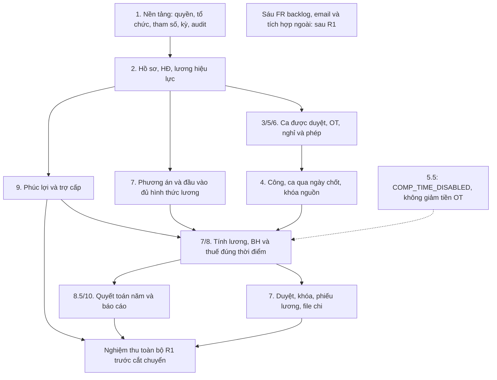

# 19. Phạm vi bản đầu R1 và ma trận nghiệm thu

Ngày chốt thiết kế: **17/10/2026**, theo yêu cầu chủ dự án chốt phạm vi bản đầu và các quyết
định DEC-01…03 tại [18](18-xac-nhan-chinh-sach-va-dau-vao-tinh-luong.md). Mã baseline:
**HRTP-R1-2026-10-17**. Đây là phạm vi mục tiêu và điều kiện nghiệm thu, không phải tuyên
bố phần mềm đã được lập trình hoặc kiểm thử đạt.

Nguồn máy đọc được: [hrtp-release-r1.json](config/hrtp-release-r1.json), liệt kê từng FR và
từng chức năng BFD. Cách kiểm tra đồng bộ: `python scripts/validate_release_scope.py`
từ thư mục gốc dự án. Khi thay phạm vi phải sửa manifest, đặc tả và ma trận này cùng nhau.

## 1. Quyết định phạm vi

Lựa chọn công nghệ đã được xác nhận tại [20 — TECH-01](20-tech-stack-va-moi-truong-phat-trien.md):
React/TypeScript + NestJS + PostgreSQL/Prisma, modular monolith và VS Code.
Quyết định kỹ thuật này giữ nguyên danh mục FR, nhóm nghiệm thu và trạng thái chưa triển khai.

- R1 giữ **10 phân hệ**, bốn tác nhân TT/QĐ/KT/AD và bốn cơ sở trong bộ dữ liệu mô phỏng.
- Tổng **158 FR**: **152 M** thuộc R1, **5 S + 1 C** ở backlog sau R1. Trong M có **151 yêu
  cầu hoạt động** và **1 yêu cầu bắt buộc kiểm tra chức năng chưa kích hoạt**, FR-5.5.1.
- BFD có **49 chức năng**: **48 hoạt động**, chức năng **5.5 chỉ có kiểm tra chưa kích
  hoạt**, không sinh quỹ và không giảm tiền/giờ OT. Bao phủ 49 ô BFD không đồng nghĩa đã
  bật quy đổi nghỉ bù.
- Giữ đủ thời gian, sản phẩm, khoán, hoa hồng, 3P; phải có phương án, nguồn/đơn giá/công
  thức và kiểm soát đầu vào như tài liệu 18. Không rút các hình thức này khỏi bản đầu.
- **Phúc lợi 9.x, dự thảo quyết toán thuế năm 8.5 và báo cáo lõi 10.x thuộc R1**. Chúng
  phải sẵn sàng trước nghiệm thu; thứ tự xây dựng sau phần lương không làm chúng thành
  phạm vi phát hành sau.
- Cấu hình mô phỏng không đổi thành quy chế doanh nghiệp thật. R1 nghiệm thu đồ án dùng
  fixture; việc vận hành doanh nghiệp/chi trả thật cần thêm bằng chứng/mẫu theo PS ở 18.

### 1.1. Phạm vi theo phân hệ

| Phân hệ | BFD | R1 phải có | Ngoại lệ / giới hạn |
|---|---|---|---|
| 1. Quản trị | 1.1–1.6 | Vai trò/phạm vi, exclusion list, cây tối đa 5 cấp, tham số/chính sách hiệu lực, kỳ, audit | Hai tiện ích tại §2 chưa làm |
| 2. Nhân sự/HĐ | 2.1–2.5 | Hồ sơ/NPT, HĐ/phụ lục, điều chuyển/lương, cảnh báo hết HĐ, chấm dứt và nguồn trợ cấp | Chưa có cảnh báo giấy tờ/nâng lương nâng cao và mẫu HĐ trộn động |
| 3. Ca | 3.1–3.4 | Ca/lịch nghỉ, xếp ca, đổi ca và duyệt theo xưởng | Chưa in/xuất lịch ca riêng; lịch đã duyệt vẫn xem được trong ứng dụng |
| 4. Công | 4.1–4.5 | Import, phân tuyến qua ngày chốt, ghép ca, ngoại lệ, xác nhận/chốt/khóa nguyên tử | Log muộn không sửa snapshot; không kết nối thiết bị |
| 5. OT | 5.1–5.5 | Đề xuất/duyệt, trần, hệ số, giờ thực tế/duyệt/tính tiền riêng | 5.5 bắt buộc trả COMP_TIME_DISABLED; không cấp quỹ nghỉ OT |
| 6. Nghỉ/chế độ | 6.1–6.5 | Loại nghỉ, phép, đơn một cấp, ốm/thai sản và tỷ lệ vắng | Nghỉ bù lễ và phép năm vẫn hoạt động, không bị cờ 5.5 vô hiệu hóa |
| 7. Lương/thưởng | 7.1–7.6 | Đủ hình thức; công thức/nguồn, tính nháp, thưởng, hồi tố, duyệt/khóa, phiếu và file chi | Dữ liệu ngạch/bậc cơ bản vẫn có; bộ quản trị thang bảng lương nâng cao để sau |
| 8. BH/thuế | 8.1–8.5 | Tham số hiệu lực, khoản đóng, tăng/giảm/điều chỉnh, C12, khấu trừ và dự thảo quyết toán năm | Không ký/nộp hồ sơ lên cổng bên ngoài |
| 9. Phúc lợi | 9.1–9.4 | Danh mục/điều kiện, cấp phát chống trùng, trợ cấp và chi phí | Thuộc nghiệm thu R1, không đẩy sau cắt chuyển |
| 10. Báo cáo | 10.1–10.4 | Công/OT, giờ tuần, biến động, quỹ lương/cost center, BH/thuế, Excel/PDF và kiểm tra quyền | Báo cáo tuần không là chứng nhận SMETA/BSCI/RBA |
| Xuyên suốt | FR-X.1–6 | Bảo mật, audit, lưu trữ/khôi phục, thông báo trong ứng dụng, kiểm thử tự động khi có mã ứng dụng | Email không thuộc R1 |

### 1.2. Yêu cầu được đưa vào M để khớp nghiệm thu

| FR | Lý do R1 cần |
|---|---|
| FR-1.1.3 | Exclusion list đã có UAT-15 và là ranh giới dữ liệu |
| FR-5.2.2 | Không huy động OT chưa duyệt; thực tế phát sinh đi luồng ngoại lệ |
| FR-5.5.1 | Nghiệm thu đúng trạng thái chưa kích hoạt DEC-01, không nghiệm thu cấp quỹ |
| FR-8.3.2, FR-8.3.3 | Điều chỉnh BH/C12 đã xuất hiện ở US-21 và cần đối soát nguồn |
| FR-10.1.2 | Giữ báo cáo giờ làm tuần theo PS-17, tách cam kết chứng nhận |
| FR-X.5 | Luồng duyệt/chốt cần thông báo trong ứng dụng; email loại khỏi bản đầu |

## 2. Những phần không thuộc R1

| Mã | Phần sau R1 | Dữ liệu/chức năng lõi vẫn phải có |
|---|---|---|
| FR-1.2.4 (S) | Tuyến báo cáo chức năng thứ hai cấp quyền xem | Tuyến quản lý tổ chức và quyền theo vai trò/phạm vi hoạt động |
| FR-1.2.5 (C) | Sơ đồ tổ chức trực quan theo ngày, kết xuất sơ đồ | Cây và truy vấn cơ cấu lịch sử vẫn có theo FR-1.2.1/2 |
| FR-2.1.6 (S) | Cảnh báo giấy tờ/nâng lương nâng cao | Hồ sơ có hiệu lực và cảnh báo hết hạn HĐ 2.4 vẫn có |
| FR-2.2.5 (S) | Trộn trường/mẫu hợp đồng động | Quản lý dữ liệu HĐ/phụ lục/chứng từ nguồn vẫn có |
| FR-3.4.3 (S) | In/xuất riêng lịch ca đã duyệt | Xếp, duyệt và xem lịch để xử lý công vẫn có |
| FR-7.1.5 (S) | Bộ quản trị thang/ngạch/bậc nâng cao | Dữ liệu vị trí/ngạch/bậc và phương án/đơn giá P1/P2 đủ dùng cho R1 |

Ngoài R1 còn có: **kích hoạt quyền nghỉ quy đổi OT**, email, ESS/kiosk/mobile, sinh trắc/GPS,
API máy chấm công, API ngân hàng/ERP, kê khai/ký số trực tiếp, SSO, bộ workflow tổng quát,
quản lý sản xuất/đánh giá KPI hoàn chỉnh và chứng nhận kiểm toán. Đây không phải lời hứa
tự triển khai ở “GĐ 3” hoặc tự bật ở lần chạy sau. Backlog sau R1 cần quyết định phạm vi mới.

## 3. Sơ đồ phạm vi và phụ thuộc R1

Nguồn chỉnh sửa: [R1-scope.mmd](../diagrams/release/R1-scope.mmd),
[BFD R1 đủ 49 chức năng](../diagrams/release/R1-bfd.mmd). BFD/PNG/Word cũ vẫn mô tả
toàn hệ thống; nhãn R1 và các nguồn mới ở 17/18/19 có ưu tiên khi xét phạm vi phát hành.

Các nhánh phúc lợi/lương/quyết toán có thể xây dựng theo vòng tăng dần nhưng phải hội tụ
trước nghiệm thu R1. Chạy song song và cắt chuyển là **giai đoạn triển khai R1**, không là
cách chuyển yêu cầu M sang phát hành khác.

## 4. Phạm vi dữ liệu

ERD bổ sung R1: [R1-data.mmd](../diagrams/release/R1-data.mmd), bổ sung các quan hệ còn thiếu
trong ảnh tổng quan gốc. Tên và chi tiết bảng theo [09](09-mo-hinh-du-lieu.md).

| Nhóm | Dữ liệu bắt buộc R1 | Điều kiện |
|---|---|---|
| Tổ chức/quyền | site, org_unit, user/role/assignment, exclusion, org_assignment, tham số/chính sách, audit | Tối đa 5 cấp, lịch sử hiệu lực; không cấp quyền tuyến chức năng thứ hai |
| Hồ sơ | employee, dependent, HĐ/phụ lục/quyết định lương, termination_decision | Đúng đoạn hiệu lực; chứng từ nguồn có quyền truy cập |
| Kỳ/công | business_period, nguồn kỳ lương, raw_punch/assignment, ca, công/đoạn giờ/ngoại lệ/xác nhận, coverage, late_punch_case, snapshot | Không ép ngày quẹt vào ngày công; đủ nguồn, khóa nguyên tử |
| OT/nghỉ | yêu cầu/chi tiết/giờ OT, trần/lũy kế, leave_type/request/balance, sickness_maternity | Giờ thực tế không bị trừ vì nghỉ bù; tách nghỉ lễ/phép |
| Đầu vào/lương | employee_pay_plan, salary/component/formula, đơn giá, lô/dòng nguồn, payroll_sheet/employee/line/adjustment, snapshot, payslip | CONFIRMED/version/hash; đủ các hình thức; thiếu không thành 0 |
| BH/thuế | rates/contributions/change/C12, tax_profile, pit_bracket, khấu trừ/ngày chi/căn cứ/miễn, annual_tax_finalization | Theo hiệu lực; năm chi trả, không ghi đè số đã khai/nộp |
| Phúc lợi/báo cáo | benefit_catalog/allocation, severance_allowance, report_run, bằng chứng đối soát | Có trong R1; chống trùng và đúng phạm vi |
| Chưa kích hoạt/dự trữ | comp_time_conversion, tuyến báo cáo loại FUNCTIONAL và thông tin dành cho sáu FR backlog | Không yêu cầu tạo dữ liệu quy đổi hoặc chức năng backlog; giữ dữ liệu lịch sử nếu có, không xóa ngầm |

Một dòng lương có thể tổng hợp nhiều dòng nguồn và một nguồn có thể tham gia nhiều cấu
phần theo công thức; `payroll_line_input` lưu liên kết nguồn/version/hash để giải thích
và chống cộng trùng. Không giả định quan hệ luôn là một dòng nguồn cho một dòng lương.

Không bắt tồn tại dữ liệu giả ở bảng chưa kích hoạt để “đủ 54 lớp”. Ngược lại, bảng phụ trợ
nguồn/phiên bản/snapshot cần cho yêu cầu M không được bỏ chỉ vì chưa xuất hiện trong ảnh
54 lớp cũ. Số lớp khái niệm không bằng số bảng triển khai.

## 5. Ma trận nghiệm thu bản đầu

Mỗi FR R1 trong manifest được gắn một nhóm dưới đây; bằng chứng phải ghi **FR, phiên bản
build/cấu hình/nguồn, test đã chạy, kết quả, lỗi và người nghiệm thu**. Hiện tất cả bắt đầu
ở `NOT_EXECUTED`, không tự đổi thành đạt vì tài liệu đã được kiểm tra liên kết.

| Mã nhóm | Phạm vi / bằng chứng phải đạt |
|---|---|
| R1-AC-01 | Tất cả M phân hệ 1; tạo/mở/chốt/khóa đúng vai trò, cây 5 cấp, exclusion, hiệu lực/audit; UAT-14/15/22/24 và TC-K |
| R1-AC-02 | Tất cả M phân hệ 2; hồ sơ/HĐ/điều chuyển/hạn HĐ/chấm dứt; UAT-21/27, không mặc định có trình trộn HĐ động |
| R1-AC-03 | Tất cả M phân hệ 3; lịch/đổi ca/duyệt và ca riêng từng cơ sở; UAT-23; không bắt in/xuất lịch riêng |
| R1-AC-04 | Tất cả M phân hệ 4; đủ nguồn/ghép/log muộn/khóa; UAT-02/04/16/19/24 và TC-A/TC-K |
| R1-AC-05 | Tất cả M phân hệ 5; OT chờ duyệt/trần/hệ số; TC-O và TC-B01…03; 5.5 bắt buộc kiểm tra chưa kích hoạt |
| R1-AC-06 | Tất cả M phân hệ 6; phép/đơn một cấp/chế độ/vắng; UAT-17/25, quỹ phép và nghỉ bù lễ không bị cờ quy đổi ảnh hưởng |
| R1-AC-07 | Tất cả M phân hệ 7; đủ hình thức và đầu vào 18; 9 fixture, TC-I/TC-P, UAT-01/10/11/13; thiếu/cộng trùng bị chặn |
| R1-AC-08 | Tất cả M phân hệ 8; C12/tăng giảm/điều chỉnh, thuế/giảm trừ/miễn theo kỳ chi, dự thảo quyết toán năm; UAT-26, TC-T, hồ sơ năm 2025/2026 |
| R1-AC-09 | Tất cả M phân hệ 9; điều kiện/cấp phát/chống trùng/trợ cấp/chi phí; UAT-27/28 và đối soát từng khoản |
| R1-AC-10 | Tất cả M phân hệ 10; báo cáo đúng vai trò, công/OT tuần, nhân sự, quỹ/cost center, BH/thuế, Excel/PDF; số tổng khớp nguồn |
| R1-AC-11 | Tất cả FR-X và 60 NFR; bảo mật, thông báo trong ứng dụng, mã hóa/audit, hiệu năng, backup/restore và các chỉ tiêu đã đặc tả |
| R1-AC-12 | Kiểm tra ranh giới: manifest khớp 07, đủ 152 M và 49 ô BFD, sáu FR sau R1 không lẫn tiêu chí bắt buộc; không tự bật 5.5/email/API; cấu hình mô phỏng không tự thành vận hành thật |

### 5.1. Điều kiện nghiệm thu

1. **152/152 M đạt** theo đúng kiểu ENABLED hoặc DISABLED_GUARD, không còn lỗi chặn; sáu
   FR sau R1 không được dùng làm lý do đánh trượt R1 hoặc lặng lẽ tính là đã bàn giao.
2. **29 dòng UAT** tại 14 (gồm UAT-05b) cùng các TC liên quan tại 06 đạt; UAT không thay
   kiểm tra từng FR M. Không chỉ chọn nhóm công/lương mà bỏ phúc lợi/quyết toán/báo cáo.
3. Hiệu năng, quyền dữ liệu, khôi phục và số học đạt theo 15; không hoãn RPO/RTO sau R1.
4. CP/XC giữ đúng mức từng mã: BLOCKING chặn, WARNING theo cơ chế xác nhận. CP-08 vẫn
   WARNING; không bật tất cả mã thành chặn hoặc hạ tất cả mã thành cảnh báo khi chạy thử.
5. Chạy đối soát tối thiểu hai kỳ liên tiếp; mỗi chênh lệch có phân loại, kết quả đúng đã
   kiểm chứng và xác nhận xử lý. Không lấy công thức Excel cũ sai làm chuẩn bắt phần mềm sai theo.
6. Phân biệt nghiệm thu đồ án bằng fixture với cho phép vận hành thật: PS còn thiếu bằng
   chứng/mẫu, hạ tầng và dữ liệu thật phải được hoàn tất trước thao tác thực tế liên quan.

## 6. Quy tắc thay đổi baseline

**AI ưu tiên trong kế hoạch:** AI-02 trợ lý nghiệp vụ theo vai trò dùng Google Gemini
cho TT/QĐ/KT/AD tại [24](24-ai-tro-ly-nghiep-vu-theo-vai-tro.md). 8 AI02-REQ/12 AC
và [manifest AI](config/hrtp-ai-features.json) quản lý riêng; baseline lõi vẫn 158 FR/
152 M, 29 UAT và 60 NFR. AI-01 giải thích lương ở 23 là hướng sau sprint. Không suy
ra AI đạt từ kết quả R1 hoặc kiểm tra tài liệu.

Tài liệu 16 điều chỉnh **thứ tự xây dựng/chạy thử/cắt chuyển**, không tự thay phạm vi R1.
Thêm/bớt FR, đổi trạng thái 5.5, bật email/tích hợp hoặc sửa ngưỡng nghiệm thu cần ghi quyết
định mới và cập nhật 07, 09, 14, manifest và sơ đồ liên quan. Script kiểm tra chỉ xác nhận
tính nhất quán hồ sơ; không thay bằng chứng cài đặt, kết quả UAT hoặc nghiệm thu sản phẩm.
