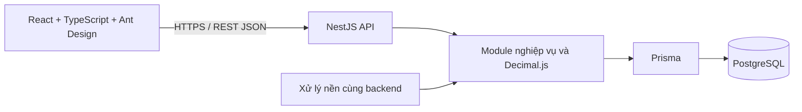

# 20. Tech stack và môi trường phát triển

**Trạng thái: ĐÃ CHỐT** theo xác nhận của chủ dự án ngày **17/10/2026**.
Mã quyết định kỹ thuật: **TECH-01**. Quyết định này cụ thể hóa kiến trúc trong
[08](08-kien-truc-he-thong.md), giữ nguyên [phạm vi R1](19-pham-vi-ban-dau-va-ma-tran-nghiem-thu.md)
và các chính sách mô phỏng tại [18](18-xac-nhan-chinh-sach-va-dau-vao-tinh-luong.md).
Đã chạy local đăng nhập, phiên, phân quyền, nhân sự, hợp đồng/phụ lục, điều chuyển,
tham số hiệu lực, tạo/mở kỳ công và danh mục/phân ca/duyệt lịch với PostgreSQL thật.
Chưa triển khai toàn bộ R1 hoặc có kết quả UAT sản phẩm. Hướng dẫn chạy tại §7.

## 1. Công nghệ đã chọn

**Chỉ triển khai website:** người dùng truy cập qua URL trên trình duyệt, không cài
ứng dụng riêng. React là giao diện website, NestJS là máy chủ xử lý của cùng hệ thống.
Không xây thêm mobile/desktop/hybrid app hoặc PWA cài đặt/offline. Responsive chỉ điều
chỉnh cùng website theo kích thước màn hình; không thay đổi stack hay quyền nghiệp vụ.

Chuẩn triển khai giao diện nằm tại [22 — UI design guide](22-ui-design-guide.md),
điểm vào cho agent là [DESIGN.md](../DESIGN.md); sử dụng chung token thay vì theme riêng từng trang.

| Thành phần | Công nghệ | Trách nhiệm |
|---|---|---|
| Frontend | React + TypeScript + Vite | Giao diện website trên trình duyệt cho TT/QĐ/KT/AD |
| Giao diện | Ant Design | Bảng công/lương, biểu mẫu, bộ lọc và thao tác duyệt |
| Dữ liệu frontend | TanStack Query | Gọi API, quản lý trạng thái tải, phân trang và làm mới sau thay đổi |
| Backend | NestJS + TypeScript trên Node.js | REST API, phân quyền, nghiệp vụ và điều phối xử lý lô |
| Cơ sở dữ liệu | PostgreSQL | Dữ liệu quan hệ, ràng buộc, lịch sử, snapshot và audit |
| Truy cập dữ liệu | Prisma | Mô hình dữ liệu, migration và giao dịch |
| Số học nghiệp vụ | Decimal.js và PostgreSQL NUMERIC/DECIMAL | Tiền, đơn giá, hệ số, giờ/công và các phép tính cần độ chính xác |
| Kiến trúc | Modular monolith | Chia module theo phân hệ đã chốt, dùng chung một backend và cơ sở dữ liệu |
| Môi trường làm việc | VS Code | Viết mã, chạy, debug, test và quản lý Git |

ASP.NET Core, Spring Boot và các công nghệ backend từng được so sánh không thuộc
stack đã chọn. Không tạo đồng thời nhiều backend bằng các framework đó.

## 2. Cấu trúc và ranh giới nghiệp vụ

Cấu trúc hiện tại; đã có auth, organization, employees, audit và health, chưa hoàn tất 10 phân hệ:

```text
enroll_and_salary/
├── frontend/       # React + TypeScript + Vite
├── backend/        # NestJS + Prisma, gồm API và xử lý nền
├── docs/           # Đặc tả và quyết định thiết kế
├── diagrams/       # Nguồn sơ đồ
└── scripts/        # Công cụ kiểm tra tài liệu
```

Backend tách module theo 10 phân hệ BFD: quản trị; nhân sự/hợp đồng; ca; chấm công;
OT; nghỉ; lương; bảo hiểm/thuế; phúc lợi; báo cáo. Năng lực dùng chung gồm phân quyền
theo đơn vị, tham số hiệu lực, công thức, audit và khóa kỳ. Không thay 10 module
logic thành 10 dịch vụ triển khai độc lập trong R1.



Nhãn API Gateway ở sơ đồ logic trong 08 biểu diễn điểm vào xác thực/phân quyền của
NestJS, không yêu cầu một sản phẩm gateway riêng. Phân quyền phải kiểm tra cả vai trò
và phạm vi dữ liệu ở backend theo [10](10-phan-quyen-va-bao-mat.md); ẩn nút trên UI
không thay thế kiểm tra quyền.

## 3. Ràng buộc triển khai

- Backend tính kết quả lương chính thức; frontend chỉ trình bày kết quả, nguồn và
  bước giải thích. Không dùng JavaScript `number`, `parseFloat` hoặc `toNumber()`
  trong chuỗi tính tiền/hệ số. Khởi tạo Decimal từ chuỗi hoặc giá trị Decimal được
  Prisma trả về; truyền số thập phân qua API bằng chuỗi có hợp đồng rõ ràng.
- Cấu hình độ chính xác Decimal và làm tròn tường minh theo ADR-11 trong 08. Kiểu
  `NUMERIC(p,s)` phải được chọn theo từng trường khi thiết kế schema; không để việc
  ép kiểu ở database tự quyết định quy tắc làm tròn nghiệp vụ.
- Công thức dùng bộ biểu thức giới hạn, có phiên bản hiệu lực và truy vết theo
  ADR-02; không dùng `eval` hoặc thực thi JavaScript tùy ý từ cấu hình.
- Khóa kỳ, kiểm tra revision, tạo snapshot/hash và audit phải có ranh giới giao dịch
  nguyên tử. Prisma không tự bảo đảm bất biến: cần ràng buộc/quyền database, kiểm soát
  cạnh tranh và migration SQL bổ sung khi cần theo 09, 10 và 17.
- Nhập tệp, tính lương và xuất báo cáo lớn chạy thành tác vụ nền có mã lô, trạng thái,
  chống chạy trùng và phục hồi sau lỗi. Tính toán nặng chạy ở worker tách khỏi luồng
  phục vụ HTTP; công nghệ hàng đợi cụ thể chọn ở bước triển khai.
- Mọi tham số pháp lý/chính sách giữ nguyên cách phân giải hiệu lực và snapshot trong
  đặc tả. Chọn TypeScript không làm thay đổi OT, thuế, nghỉ bù hoặc vòng đời kỳ.
- Prisma migrations được lưu trong Git; cập nhật schema qua migration được rà soát.
  Tính năng không biểu diễn được bằng Prisma schema phải có SQL và kiểm thử tương ứng.

## 4. Làm việc trên VS Code

| Công cụ | Cách dùng |
|---|---|
| Node.js bản LTS tương thích | Chạy Vite, NestJS và công cụ build/test; ghim phiên bản khi khởi tạo |
| npm | Quản lý dependency; commit lockfile và dùng cài đặt tái lập trong CI |
| PostgreSQL | Chạy local hoặc container; thống nhất phiên bản với môi trường kiểm thử |
| Git | Quản lý mã nguồn và thay đổi migration |
| ESLint và Prettier | Extension hỗ trợ; quy tắc nằm trong cấu hình repo khi khởi tạo |
| Terminal và debugger của VS Code | Chạy/debug frontend, backend và worker |

Docker Compose có thể dùng để chuẩn hóa môi trường; lựa chọn máy chủ nội bộ/cloud
vẫn theo 08 và các giả định hạ tầng đã ghi nhận. Không cần cài JDK hoặc bộ extension
Java để chạy stack đã chọn. Python vẫn dùng cho script kiểm tra tài liệu hiện có.

## 5. Các lựa chọn để bước triển khai cụ thể hóa

**AI-02:** module NestJS `ai-business-assistant` dùng **Google Gemini API** theo
[24](24-ai-tro-ly-nghiep-vu-theo-vai-tro.md). Provider đã chọn; model/API version/tier
và ngân sách chưa ghim. Backend lọc corpus theo quyền rồi gọi Gemini, không cấp tool
hoặc dữ liệu công/lương cho model. Không yêu cầu vector database; flag mặc định tắt
đến khi cấu hình/kiểm thử đạt. AI-01 giải thích lương ở 23 là hướng sau sprint.

Phiên bản dependency nền đã ghim trong package manifests/lockfile, runtime tại §7.
Đường chạy hiện tại dùng hash routing, cookie phiên HttpOnly với token ngẫu nhiên,
hash mật khẩu scrypt của Node.js và kiểm chứng tích hợp bằng Node test runner trên PostgreSQL thật.
Ant Design 5 dùng bản vá chính thức @ant-design/v5-patch-for-react-19 cho React 19.
Queue, đọc/ghi tệp nghiệp vụ, PDF và hạ tầng vận hành chưa triển khai; ví dụ trong trao đổi
không mặc nhiên là dependency đã cài.

Kiểm thử nghiệp vụ phải bao phủ các fixture/TC, vòng đời khóa kỳ, phân quyền và hiệu
năng trong đặc tả; kiểm tra đồng bộ tài liệu không thay thế kiểm thử phần mềm.

## 6. Tài liệu công nghệ

- [React: xây ứng dụng từ đầu với công cụ như Vite](https://react.dev/learn/build-a-react-app-from-scratch).
- [NestJS: TypeScript trên Node.js](https://docs.nestjs.com/first-steps).
- [Ant Design: bảng dữ liệu](https://ant.design/components/table/).
- [TanStack Query](https://tanstack.com/query/latest/docs/framework/react/reference).
- [Prisma: kiểu Decimal](https://docs.prisma.io/docs/orm/prisma-client/special-fields-and-types).
- [PostgreSQL: kiểu dữ liệu](https://www.postgresql.org/docs/current/datatype.html).


## 7. Chạy môi trường demo local

### 7.1. Phiên bản và phạm vi đã triển khai

- Runtime đã dùng: **Node.js 22.16.0**, **npm 10.9.2**, **PostgreSQL 18.3**.
  Node được ghi trong `.nvmrc`/`.node-version`; npm trong `packageManager`;
  dependency ghim chính xác trong package manifests và `package-lock.json`.
- Đã có React/Vite + Ant Design/TanStack Query và NestJS/Prisma. Decimal.js được cài,
  chưa có engine tính lương. Font Be Vietnam Pro đóng gói local qua Fontsource.
- Đã có migration và seed nền; đăng nhập/đăng xuất, phiên, phân quyền theo vai trò +
  cây đơn vị + hiệu lực + exclusion; danh sách/chi tiết/tạo nhân sự, cơ cấu tổ chức,
  quản trị tài khoản/quyền/mật khẩu/phiên và health. Đã bổ sung hợp đồng/phụ lục và điều chuyển theo ngày.
- Phạm vi demo hiện tại: nền tảng, tổ chức/nhân sự/hợp đồng/điều chuyển, tham số/chính sách, tạo/mở kỳ công, phân ca/duyệt lịch, nhập/ghép quẹt, đăng ký/duyệt và đối chiếu OT thực tế; **không phải toàn bộ R1**.
- Chưa có tiền OT, nghỉ/giải trình, xác nhận/chốt công, engine tính lương hoặc AI; trạng thái nghiệm thu FR/UAT/NFR của baseline lõi không tự đổi theo smoke này.
- Làm trực tiếp trên checkout demo hiện tại theo yêu cầu chủ dự án, không commit hoặc
  tự đổi nhánh. Không cho nhiều agent sửa cùng tệp.

### 7.2. Thiết lập lần đầu

Chạy từ thư mục gốc, với Node/npm và PostgreSQL 18 đã cài. Ví dụ đường dẫn PostgreSQL
trên máy phát triển hiện tại:

```powershell
npm run db:setup -- --bin "D:/PostgreSQL/bin"
npm ci
npm run db:deploy
npm run db:seed
npm run dev
```

Nếu bộ binary nằm ở nơi khác, thay giá trị `--bin`; cũng có thể đặt biến môi trường
`PG_BIN` hoặc để các lệnh PostgreSQL có trên PATH. Không cần Docker cho đường chạy này.
`db:setup` không phụ thuộc npm packages nên chạy được trước `npm ci`.

Script tạo **cụm PostgreSQL riêng** ở `.local/pgdata`, chỉ lắng nghe
`127.0.0.1:5433`, database/user `hrtp_demo`, xác thực SCRAM và mật khẩu ngẫu nhiên.
Nó ghi `backend/.env` và lưu vị trí binary trong `.local/postgres.json`.
Không đổi service PostgreSQL đã có ở cổng 5432. User tạo bởi initdb là superuser
**chỉ dành cho local demo**, không dùng cấu hình này cho môi trường vận hành.

`backend/.env`, `.local/`, node_modules và dist được loại trong `.gitignore`.
Quyền file Windows phụ thuộc ACL của tài khoản; không chia sẻ thư mục hoặc mật khẩu.
Script từ chối ghi đè `backend/.env` không do nó quản lý. Không xóa `.local/pgdata`
khi server đang chạy; dữ liệu tồn tại qua các lần stop/start.

### 7.3. Chạy lại và dừng

```powershell
npm run db:start
npm run dev
```

- Website: http://127.0.0.1:5173
- API: http://127.0.0.1:3000/api/health
- `Ctrl+C` trong terminal chạy dev để dừng frontend/backend.
- `npm run db:status`: xem trạng thái cụm demo.
- `npm run db:stop`: dừng riêng cụm demo, không dừng service Windows cũ.

`npm run dev` chạy cả hai workspace. Có thể chạy riêng bằng
`npm run dev --workspace backend` và `npm run dev --workspace frontend`.
Port bận thì dừng đúng tiến trình demo cũ; Vite không tự chuyển sang port khác.

### 7.4. Cấu hình kết nối và hợp đồng health

`backend/.env.example` mô tả `DATABASE_URL`, `HOST`, `PORT`, `HR_DATA_KEY`. Khi dùng database tự
quản lý, tạo `backend/.env` từ mẫu rồi điền thông tin thật; không chạy `db:setup` để
đụng vào database đó. Các lệnh `db:start/stop/status` chỉ dành cho cụm do script tạo.

Frontend dùng URL tương đối `/api/...`; Vite dev/preview proxy tới
`http://127.0.0.1:3000`. Nếu đổi port backend, tạo `frontend/.env` từ
`frontend/.env.example`, đổi `API_PROXY_TARGET` rồi khởi động lại Vite.
Biến này chỉ dùng phía Vite server; không đưa DATABASE_URL hoặc mật khẩu vào frontend.
Cùng origin nên không cần mở CORS. Khi triển khai thật phải có reverse proxy `/api`
và cấu hình bảo mật riêng; Vite preview không phải máy chủ production.

`GET /api/health` không yêu cầu đăng nhập, trả `Cache-Control: no-store`:

- HTTP **200**: `status=ok`, `service=hrtp-api`, `database.status=up`, `checkedAt`
  dạng ISO UTC, sau khi Prisma thực hiện thành công `SELECT 1 AS result`.
- HTTP **503**: `status=error`, `database.status=down`, cùng service/timestamp;
  không trả connection URL, mật khẩu hoặc lỗi driver thô.
- Database không kết nối được không làm API ngừng phục vụ health. Sai cấu hình hoặc
  thiếu DATABASE_URL thì backend từ chối khởi động với thông báo lỗi.
- UI phân biệt đang kiểm tra, API không phản hồi và API có phản hồi nhưng DB down;
  nút **Kiểm tra lại** gọi mới, không báo xanh từ dữ liệu cũ khi request mới thất bại.
  Request trình duyệt có thời hạn 8 giây, không tự retry. URL mẫu giới hạn kết nối/query
  của Prisma ở 3 giây; khi tự cấu hình URL cần giữ timeout phù hợp.

Để kiểm tra lỗi thật: mở website, chạy `npm run db:stop`, bấm **Kiểm tra lại** để thấy
DB down/HTTP 503; chạy `npm run db:start` và bấm lại để thấy phục hồi/HTTP 200.
Không dùng service PostgreSQL cũ làm đối tượng thử dừng.

### 7.5. Build và chạy bản build local

Dừng dev trước khi build để tránh hai compiler cùng ghi `backend/dist`.

```powershell
npm run typecheck
npm run build
npm run db:validate --workspace backend
```

Sau đó chạy trong hai terminal riêng:

```powershell
npm run start --workspace backend
npm run preview --workspace frontend
```

Bản preview ở http://127.0.0.1:4173, vẫn proxy API tới port 3000. `npm ci` tự sinh
Prisma Client; sau khi sửa schema dùng `npm run db:generate`. Migration được lưu trong
`backend/prisma/migrations`; `db:deploy` áp dụng migration đã lưu, không dùng `db push`.
Kiểm tra đặc tả độc lập bằng `python scripts/validate_release_scope.py`.

### 7.6. Tài khoản và phạm vi demo

`npm run db:seed` tạo bốn cơ sở, cây tổ chức năm cấp, bốn vai trò, năm tài khoản
và bộ 2.200 hồ sơ doanh nghiệp giả lập khi database mới (chi tiết §7.9).
Chạy lại không reset mật khẩu, phân quyền hoặc dữ liệu người dùng. Các hồ sơ seed nền
cũ chỉ được làm giàu nếu còn nguyên bộ thuộc tính ban đầu; hồ sơ đã sửa được giữ nguyên.

| Tài khoản | Tên hiển thị | Quyền demo |
|---|---|---|
| `tt.bn` | Nguyễn Văn Hùng | Đọc nhân sự/lịch sử Tổ 1 / Phân xưởng 1 Bắc Ninh; xem kỳ công bao phủ tổ |
| `qd.bn` | Trần Quang Minh | Đọc nhân sự/lịch sử Phân xưởng 1 Bắc Ninh; xem kỳ công bao phủ phân xưởng |
| `kt.bn` | Phạm Thu Hà | Xem/tạo nhân sự, quản lý hợp đồng/phụ lục và điều chuyển trong Bắc Ninh |
| `kt.all` | Lê Thị Mai Anh | Quyền KT toàn công ty, trừ hồ sơ VIP-DEMO bị exclusion |
| `ad.demo` | Đỗ Minh Tuấn | Tổ chức/tài khoản/thu hồi phiên, tham số/chính sách và tạo/mở kỳ; **không đọc nhân sự/lương** |

Năm tên đại diện không hiển thị hậu tố “(giả lập)”; đây vẫn là dữ liệu trình diễn.
Tên đăng nhập, mật khẩu, role và phạm vi không đổi. Seed chuyển các tên mẫu cũ sang
tên trên, không ghi đè tên tùy chỉnh; hai tài khoản KT khác phạm vi, không phải role thứ năm.

Mật khẩu ngẫu nhiên nằm ở `.local/demo-accounts.json`, chỉ đọc trên máy local;
không nhúng vào frontend, tài liệu hoặc commit. Công nhân không được cấp tài khoản.
Seed mặc định chỉ chấp nhận database `hrtp_demo` của cụm local đã quản lý;
database local khác cần opt-in `SEED_ALLOW_ISOLATED=true`, dành cho kiểm chứng riêng.
Không seed dữ liệu demo vào môi trường vận hành.

Phiên dùng cookie `hrtp_session` (HttpOnly, SameSite=Strict, Path=/api); database
chỉ lưu SHA-256 của token. Mặc định hết hạn sau 15 phút không hoạt động, tối đa 8 giờ;
5 lần sai liên tiếp khóa tài khoản 15 phút, có bảo vệ request đồng thời.
Mỗi request đọc lại quyền/hiệu lực/trạng thái tài khoản; đăng xuất/thu hồi xóa phiên.
Backend kiểm tra Origin cho request ghi. Cấu hình `WEB_ORIGINS`, `COOKIE_SECURE`
và `AUTH_*` tại `backend/.env.example`; HTTPS phải bật cookie Secure.
Frontend xóa query cache khi đổi tài khoản hoặc nhận 401, không giữ dữ liệu người trước.

### 7.7. API và kiểm chứng luồng nền

- `POST /api/auth/login`, `GET /api/auth/me`, `POST /api/auth/logout`.
- `GET /api/organization/context`: cơ cấu hiện hành theo quyền.
- `GET /api/employees`: tìm kiếm, lọc đơn vị/trạng thái, phân trang phía server.
- `GET /api/employees/:id`: nhân sự ngoài phạm vi/bị exclusion/không tồn tại đều trả
  `{employee:null}`; AD không có quyền nhân sự nhận 403.
- `POST /api/employees`: KT tạo hồ sơ cơ bản và phân công 100% vào đơn vị hợp lệ.
  Trùng mã trả 409; dữ liệu sai hoặc trường không hỗ trợ trả 400. Chưa nhận dữ liệu
  lương, CCCD hoặc tài khoản ngân hàng trong luồng này.
- `GET /api/auth/accounts`, `POST /api/auth/accounts/:id/revoke`: AD quản lý
  phiên trong phạm vi được cấp, không mở rộng quyền đọc nhân sự.

`npm run verify:foundation` biên dịch backend rồi tự tạo database PostgreSQL
local tách biệt, áp migration, seed lặp lại, chạy NestJS thật và gọi HTTP thật.
Lệnh kiểm tra phân quyền, exclusion, ghi/lưu hồ sơ, lỗi dữ liệu, CSRF, đa vai trò,
phạm vi Admin, logout/revoke, hiệu lực quyền, khóa tài khoản đồng thời, hết hạn phiên
và audit append-only; sau đó dừng server và xóa **chỉ database kiểm chứng do lệnh tạo**.
Cần cụm demo đang chạy và quyền tạo database (đã có trong cấu hình demo local).
Không dùng tài khoản database vận hành để chạy lệnh này.

Đã quan sát smoke UI: tạo hồ sơ và xem lại sau reload; TT không có nút tạo;
KT phân trang bằng dữ liệu thật; AD không có menu nhân sự và thu hồi phiên của chính
mình quay về đăng nhập. Ở 390px không tràn ngang toàn trang (bảng cuộn ngang riêng).
Audit axe tự động không phát hiện vi phạm ở các màn hình đã kiểm tra; một số mục cần
đánh giá thủ công, không coi đây là chứng nhận WCAG hay UAT toàn bộ sản phẩm.

### 7.8. Hợp đồng, điều chuyển và cấu hình kỳ công

- KT tạo dự thảo, kích hoạt hợp đồng và thêm/đọc phụ lục trong hồ sơ nhân sự.
  API: GET/POST `/api/employees/:id/contracts`,
  POST `/api/employees/:id/contracts/:contractId/activate` và
  POST `/api/employees/:id/contracts/:contractId/annexes`.
  Kiểm tra sàn lương vùng, thử việc 85%/30–60 ngày, giới hạn hợp đồng xác định hạn,
  chồng lấn hợp đồng đang hiệu lực. Giới hạn tối thiểu 12 tháng là ràng buộc mô phỏng
  của dự án, không tuyên bố là mức tối thiểu pháp luật cho mọi trường hợp.
- Lương và nội dung phụ lục được mã hóa AES-256-GCM; audit không chứa plaintext này.
  TT/QĐ/AD không có API đọc hợp đồng hoặc tab lương. Cờ BH theo thời hạn hợp đồng
  chỉ là đầu vào sơ bộ, chưa phải engine kết luận toàn bộ điều kiện tham gia BH.
- GET `/api/employees/:id/assignments?asOf=YYYY-MM-DD` và
  POST `/api/employees/:id/transfers`: giữ lịch sử phân công theo ngày, số/ngày
  quyết định và lý do; quyền phải hợp lệ cả hiện tại lẫn ngày yêu cầu. Điều chuyển
  xét toàn bộ khoảng phân công bị thay đổi, kể cả thay đổi cây cha giữa khoảng;
  từ chối nếu ảnh hưởng kỳ CLOSED/LOCKED của đơn vị hoặc cấp cha. Không chặn nếu
  phân công đã kết thúc trước kỳ đóng. Ngày quyết định sau ngày hiệu lực trả 400,
  không ghi dữ liệu; giao diện cập nhật hồ sơ và danh sách ngay khi lưu hợp lệ.
- AD quản lý GET/POST `/api/settings/parameters` và `/api/settings/policies`;
  tra cứu theo `asOf`. Phiên bản mới đóng khoảng mở của bản trước ở ngày liền kề,
  không ghi đè giá trị lịch sử. Tham số ưu tiên SITE → REGION → GLOBAL; chính sách
  lấy đơn vị gần nhất trong chuỗi cha. Seed ngày chốt 25 mang nhãn **SIMULATION**.
  Bảo vệ kỳ CLOSED/LOCKED theo đúng SITE/REGION/GLOBAL và khoảng ngày bị ảnh hưởng,
  không chặn tham số của cơ sở/vùng không liên quan. Nếu đóng phiên bản mở trước đó,
  xét cả phần đuôi bị cắt, không chỉ khoảng hữu hạn của phiên bản mới.
- GET `/api/periods/preview?scopeOrgUnitId=...&month=YYYY-MM` dự kiến kỳ theo
  chính sách tại ngày đầu tháng; ngày 31 tự giới hạn theo số ngày thực của tháng.
  GET/POST `/api/periods`; POST `/api/periods/:id/open` nhận `revision`.
  Chỉ có PLANNED → OPEN; từ chối chồng lấn cùng phạm vi và revision cũ. Có thể mở
  kỳ kế tiếp khi kỳ trước còn OPEN. Có thể nhập đồng thời cặp ngày riêng có thứ tự.
  Tạo/mở kỳ kiểm tra hiệu lực và quyền xuyên suốt khoảng ngày thực tế, gồm các mốc
  đổi phiên bản cây tổ chức; từ chối cả khoảng có lỗ hổng ở giữa. Khoảng tùy chỉnh
  hợp lệ phải xem được trong danh sách và mở được theo cùng quy tắc phạm vi.
  **Chưa có chốt/khóa kỳ, log chấm công, tính công, tính lương hoặc AI.** Lịch ca tại §7.10.

**Nâng cấp checkout đã có dữ liệu:** dừng backend trước khi sinh Prisma Client
(Windows có thể giữ DLL đang dùng), rồi chạy từ thư mục gốc:

```powershell
npm run db:setup -- --bin "D:/PostgreSQL/bin"
npm run db:generate
npm run db:deploy
npm run db:seed
npm run dev
```

`HR_DATA_KEY` phải được sao lưu riêng, an toàn cùng bản sao lưu database.
`db:setup` sinh khóa ngẫu nhiên 32 byte nếu chưa có và chưa tồn tại hợp đồng mã hóa;
không thay khóa đã có. Mất khóa khi đã có hợp đồng: phải khôi phục khóa gốc,
không sinh khóa thay thế; dữ liệu cũ không giải mã được bằng khóa mới.
Database tự quản lý: tạo khóa theo lệnh trong `backend/.env.example`, không dùng
script quản lý cluster demo để thay đổi database đó. Chưa có chức năng xoay khóa.

`npm run verify:hr` tạo database PostgreSQL sạch, migrate/seed, chạy HTTP thật:
quyền đọc lương, mã hóa, kích hoạt đồng thời, phụ lục, biên thử việc/hợp đồng,
điều chuyển và mất quyền sau điều chuyển, tham số lịch sử, kế thừa ngày chốt,
tháng Hai, kỳ đã khóa, chồng lấn kỳ, revision và quyền TT xem kỳ cấp cơ sở.
Lệnh chỉ xóa database kiểm chứng do chính nó tạo.
  Hồi quy bổ sung bao phủ điều chuyển qua kỳ đóng, đổi cây cha, phân công hữu hạn,
  phạm vi tham số SITE/REGION/GLOBAL và cắt phiên bản mở, kỳ tùy chỉnh trước hiệu lực
  hoặc có lỗ hổng, ngày quyết định không hợp lệ và trường hợp bằng ngày hiệu lực.
  Sau sửa lỗi: `verify:hr` 16/16, `verify:foundation` 13/13, typecheck/build đạt.
  Smoke HTTP riêng trên PostgreSQL sạch xác nhận: điều chuyển qua kỳ khóa → 409
  và giữ nguyên phân công; tham số cơ sở khác → 201; kỳ trước hiệu lực → 403,
  kỳ tùy chỉnh hợp lệ → tạo/xem/mở OPEN; ngày quyết định sau hiệu lực → 400.
  Kỳ CLOSED/LOCKED được dựng trực tiếp trong database kiểm chứng vì chưa có API chốt/khóa.
  Smoke UI sau sửa: Admin gửi kỳ có khoảng 12/2025 nhưng tháng nhãn 01/2027;
  API trả 403 và biểu mẫu hiện lỗi quyền theo ngày, không tạo kỳ mồ côi.
  Không ghi nhận lỗi runtime JavaScript; dữ liệu nghiệp vụ demo được giữ nguyên.

Smoke UI đã tạo/kích hoạt hợp đồng, thêm/đọc lại phụ lục sau khởi động lại API;
tra cứu trước/sau điều chuyển, tham số và chính sách tương lai; xem dự kiến,
tạo/mở kỳ rồi reload; nhập khoảng ngày riêng; TT chỉ xem kỳ bao phủ tổ.
Kiểm tra 390px không tràn ngang toàn trang. Đây không phải UAT toàn bộ R1.
Audit axe phát hiện thuộc tính ARIA không hợp lệ ở wrapper Select của Ant Design
trong modal tạo kỳ; chưa coi giao diện đạt chứng nhận WCAG.
Màn hình danh sách kỳ của TT tại 390px: axe không phát hiện vi phạm, bảng cuộn
ngang bằng bàn phím và không tràn toàn trang. Kỳ hiển thị tên cơ sở dù TT chỉ có
quyền ở tổ; không cấp thêm quyền xem nhân sự cấp cơ sở. Đã smoke bản build qua
Vite preview 4173 với API biên dịch, không ghi nhận lỗi runtime trình duyệt.
Build thành công nhưng Vite vẫn cảnh báo chunk UI lớn hơn 500 kB.

### 7.9. Bộ dữ liệu doanh nghiệp giả lập sát nghiệp vụ

Theo yêu cầu chủ dự án khi chưa có dữ liệu doanh nghiệp thật, seed mặc định dùng
`backend/prisma/seed-realistic.cjs`, ảnh chụp nghiệp vụ **18/10/2026**. Doanh nghiệp
**Công ty TNHH Điện tử HRTP** là doanh nghiệp mô phỏng, không đại diện doanh nghiệp
hay cá nhân thật. Tên công ty trên giao diện và đường dẫn đơn vị không gắn hậu tố
“(giả lập)”; seed nâng cấp tên mẫu cũ nhưng giữ nguyên tên do người dùng tùy chỉnh.

| Cơ sở | Tổng nhân sự mẫu | Trực tiếp | Gián tiếp |
|---|---:|---:|---:|
| Hà Nội | 180 | 0 | 180 |
| Bắc Ninh | 1.100 | 900 | 200 |
| Hà Nam | 600 | 500 | 100 |
| Nghệ An | 320 | 270 | 50 |
| **Tổng** | **2.200** | **1.670** | **530** |

- 89 đơn vị, gồm 29 phòng ban/phân xưởng: SMT, lắp ráp, QC, đóng gói, cuộn dây,
  cơ khí, kỹ thuật, kho vận, an toàn, nhân sự và văn phòng. Có cost center và TK 622/642.
- Tên Việt Nam đa dạng, ngày sinh/tuyển dụng có thứ tự; ngạch A–F và chức danh tương ứng.
  Email dùng miền dành riêng `example.invalid`; điện thoại để trống, không tạo số có thể
  liên hệ nhầm người thật. Mã nhân sự mới: HN/BN/HNA/NA + 5 chữ số.
- 2.200 hợp đồng đang hiệu lực, 42 dự thảo gia hạn; xác định hạn, không xác định hạn,
  thử việc công nhân/kỹ thuật. Lương tháng giả lập từ 5.525.000 đến 67.000.000 VND,
  có kiểm tra sàn vùng, tỷ lệ/ngày thử việc và kỳ hạn theo tham số đang lưu.
  Đây là giá trị dựng để trình diễn, **không phải khảo sát lương thị trường**.
- Lương/phụ lục dùng chung mã hóa AES-256-GCM với API, giữ nguyên `HR_DATA_KEY`.
  Có 32 phụ lục và 17 lịch sử điều chuyển mẫu, hai khoảng phân công nối ngày, tổng 100%.
- Tám kỳ công mẫu: tháng 10 OPEN, tháng 11 PLANNED theo ngày chốt đang cấu hình.
  Không tạo kỳ chốt/khóa hoặc kết quả công/lương khi các engine đó chưa triển khai.
- Ngày tuyển dụng có thể từ 2020; dữ liệu quản lý phân công/hợp đồng bắt đầu từ
  01/01/2026 hoặc ngày tuyển dụng nếu muộn hơn. Không bịa lịch sử trước mốc quản lý.

**Dọn nhãn hiển thị:** theo yêu cầu chủ dự án, bỏ chữ “giả lập” khỏi nội dung giao diện
và dữ liệu đang trình bày, gồm tên đại diện/công ty, 4 địa chỉ cơ sở, 17 lý do điều
chuyển và 32 nội dung phụ lục. Seed chỉ nâng cấp đúng nội dung mẫu cũ; không ghi đè
nội dung đã tùy chỉnh. Phụ lục tiếp tục mã hóa bằng khóa hiện có; không đổi mã, ngày,
phân công hoặc mức lương. Snapshot lịch và audit append-only được giữ nguyên; giao
diện lịch sử dùng tên tài khoản hiện tại, không in lại hậu tố cũ. Đây vẫn là dữ liệu
trình diễn, không phải dữ liệu doanh nghiệp thật. Sao lưu trước khi dọn tại
`.local/backups/hrtp-visible-labels-before-1792310598150.json` (không chứa khóa ứng dụng).
Đã đối chiếu nội dung trước/sau, seed lặp lại không thay dữ liệu, hồi quy nền 13/13
và build frontend đạt; đã mở phụ lục, lịch sử điều chuyển, lịch ca cũ và trang Hệ thống
trên trình duyệt để kiểm tra nội dung hiển thị.

**Bảo toàn dữ liệu:** mã/ID seed ổn định; giữ hai hồ sơ nhập qua UI, hợp đồng/phụ lục,
lịch sử điều chuyển, kỳ công, mật khẩu, phạm vi tài khoản và tham số/chính sách đã có.
Giữ mã đơn vị nền đã được tham chiếu, không đổi danh tính hoặc tạo alias:
HQ-HN-D1/D2 là Tài chính/CNTT; NM-BN-D1/D2 là SMT/Lắp ráp; NM-HNA-D1/D2 là
Cuộn dây/Mô-đun; NM-NA-D1/D2 là Cơ khí/Hoàn thiện. Các đơn vị mở rộng dùng mã ở tài liệu 03.
Nếu mã seed mới đã thuộc bản ghi khác, seed dừng và rollback thay vì ghi đè.
Các phiên bản đơn vị đã sửa tên hoặc đã đóng hiệu lực không bị viết lại.

Chạy `npm run db:seed` để bổ sung bộ mẫu, không cần reset/migrate thêm. Sau lần nhập
hiện tại có **2.202 nhân sự**, **2.243 hợp đồng**, 33 phụ lục, 20 điều chuyển và 10 kỳ
do giữ các bản ghi demo đã nhập. Tổng có thể tăng khi người dùng thêm dữ liệu.
Chạy lại đã kiểm chứng không tạo trùng hoặc khôi phục dữ liệu đã sửa.
Các bộ kiểm thử đặt `SEED_DATASET=foundation` để dựng fixture nhỏ, độc lập;
`verify:foundation` còn chạy seed realistic hai lần để kiểm tra bảo toàn dữ liệu thực.

Đã sao lưu database trước khi nhập tại
`.local/backups/hrtp-demo-before-realistic-2026-10-18T04-01-12.375Z.dump`,
kiểm tra archive đọc được bằng pg_restore. Bản dump không chứa khóa ứng dụng;
tiếp tục sao lưu riêng `HR_DATA_KEY` trong môi trường an toàn.
Smoke kiểm tra 2.242 hợp đồng seed, phân quyền TT/QĐ/KT/AD và dữ liệu cũ qua HTTP thật;
UI đã tra cứu nhân sự, mở hồ sơ và đọc hợp đồng/lương. Không phải nghiệm thu toàn bộ R1.

### 7.10. Danh mục ca, phân ca và duyệt lịch

Mở **Ca & phân ca** trên menu. Ba chế độ: **Danh mục ca**, **Lập & duyệt**,
**Chính thức**. React gọi API NestJS, lưu PostgreSQL; không lấy dữ liệu lịch từ seed UI.

- AD khai báo ca hành chính/ngày/đêm theo đơn vị; đơn vị con kế thừa danh mục cấp cha.
  Nhập HH:mm, cờ qua ngày, vị trí/thời lượng nghỉ và nghỉ có tính giờ làm hay không.
  Ca đã có lượt phân công không sửa nội dung; tạo mã mới, hoặc ngừng dùng để chặn lịch mới.
- TT chọn tổ/phòng có nhân sự trực thuộc, thêm ngày và ca; chọn toàn bộ nhân sự đủ
  điều kiện theo ngày hoặc chọn từng người. Tối đa 31 dòng nhập, 5.000 lượt/lịch.
  Thành viên được chốt khi lưu; gửi/duyệt kiểm tra lại phân công chính, ngày tuyển dụng,
  hiệu lực đơn vị/quyền, phạm vi hiện tại lẫn ngày công và exclusion.
- Người lập sửa lịch DRAFT/RETURNED và gửi PENDING. QĐ khác người lập duyệt APPROVED
  hoặc trả lại RETURNED kèm lý do. Người lập có thể hủy DRAFT/RETURNED/PENDING kèm
  lý do thành CANCELLED. Không sửa/hủy lịch đã duyệt qua các API này.
- Chỉ APPROVED xuất hiện ở **Chính thức**. Ngày công là ngày bắt đầu ca, mốc giờ cố
  định Việt Nam (+07:00); ca 22:00–06:00 gắn ngày T, kết thúc sáng T+1.
- Chặn trùng ngày/chồng giờ, nghỉ chuyển ca dưới 12 giờ, vượt 8 giờ/ngày hoặc
  48 giờ/tuần thứ Hai–Chủ nhật. DRAFT/PENDING/APPROVED đều giữ chỗ; RETURNED/CANCELLED
  không giữ chỗ. Nghỉ giữa ca từ 6 giờ: 30 phút, có giờ đêm: 45 phút.
  Năm tham số SHIFT_* phân giải SITE → REGION → GLOBAL theo ngày; không cho nới
  lỏng giới hạn. Hai đầu khoảng chuyển ca và mọi ngày trong tuần dùng giới hạn chặt hơn.
- Chặn tạo/sửa/chuyển trạng thái nếu ngày công thuộc kỳ CLOSED/LOCKED của đơn vị
  hoặc cấp cha theo cây hiệu lực; sửa lịch kiểm tra cả ngày cũ bị xóa và ngày mới.
  Ca qua nửa đêm xét ngày bắt đầu, không chặn chỉ vì ngày kết thúc thuộc kỳ kế tiếp.
  Điều chuyển bị chặn nếu làm sai phân công có lịch PENDING/APPROVED trong khoảng ảnh hưởng.
- Mỗi thao tác ghi actor, thời điểm, trạng thái trước/sau, revision, lý do và snapshot
  đầy đủ trong cùng transaction với audit. History append-only ở PostgreSQL; quyền
  đọc lịch sử vẫn xét người đã bị bỏ khỏi lịch sau sửa/điều chuyển. Revision cũ hoặc
  ghi/duyệt đồng thời trả 409; batch lỗi rollback toàn bộ.

**API:**

| Hành động | Endpoint |
|---|---|
| Xem/tạo ca | GET/POST /api/shifts/definitions |
| Sửa/ngừng dùng ca | POST /api/shifts/definitions/:id/update, /:id/active |
| Nhân sự theo ngày | GET /api/shifts/members?orgUnitId=UUID&workDate=YYYY-MM-DD |
| Xem/tạo lịch | GET/POST /api/shifts/plans |
| Chi tiết/lịch sử | GET /api/shifts/plans/:id |
| Sửa/gửi/duyệt/trả lại/hủy | POST /api/shifts/plans/:id/{update,submit,approve,return,cancel} |
| Lịch chính thức | GET /api/shifts/official |

GET plans/official yêu cầu dateFrom/dateTo, tối đa 93 ngày; lọc teamOrgUnitId và
status khi xem danh sách. Các lệnh sửa/chuyển trạng thái nhận revision; return/cancel
bắt buộc reason. POST plans nhận teamOrgUnitId, title, slots[{workDate,shiftId,employeeIds?}];
bỏ employeeIds để lấy toàn bộ thành viên hợp lệ, không gửi mảng rỗng.

**Nâng cấp và bằng chứng:** migration 20261018120000_shift_scheduling đã áp lên demo,
không reset dữ liệu; backup trước nâng cấp tại
.local/backups/hrtp-demo-before-shifts-1792297243965.dump. Danh mục demo có A/B/C/HC,
được tạo bằng UI/API; lịch “DEMO - Ca đêm SMT-1 18/10/2026” có một người và đã duyệt,
sáu phiên bản CREATE → SUBMIT → RETURN → UPDATE → SUBMIT → APPROVE. Đây là dữ liệu
kiểm chứng giả lập, không phải lịch sản xuất của doanh nghiệp thật.

npm run verify:shifts tạo database cách ly, migrate/seed, chạy HTTP thật rồi tự xóa
chỉ database do lệnh tạo: 13 tình huống + parent = **14/14 đạt**. Bao phủ biên 12/48 giờ,
ngày qua đêm, phân quyền/exclusion/lịch sử sau điều chuyển, batch atomic, revision,
đồng thời tạo/duyệt, ca ngừng dùng, khóa ngày cũ và chính sách theo ngày ở hai đầu ca.
Typecheck/build và kiểm tra đồng bộ phạm vi đạt; Vite còn cảnh báo chunk UI >500 kB.
Smoke browser thật đã lập/lưu/reload, gửi/trả lại/sửa/gửi lại/duyệt, đọc sáu phiên bản,
reload lịch chính thức và chặn ca sáng nối ca đêm. Ở 390px không tràn ngang toàn trang;
bảng cuộn riêng, axe không phát hiện vi phạm tự động trên màn hình chính thức
(vẫn có mục cần kiểm tra thủ công; không tuyên bố chứng nhận WCAG/UAT toàn bộ).

Module phân ca chưa sinh chu kỳ xoay ca tự động hoặc yêu cầu đổi ca đã duyệt.
Lịch APPROVED là đầu vào cho engine ghép quẹt tại mục 7.11 dưới đây.

### 7.11. Nhập tệp, ghép lượt quẹt và bảng công

Mở **Chấm công** trên menu hoặc `#/attendance`. AD chọn **Nhà máy Bắc Ninh**,
kỳ **GL-CC-2026-10-BN**, tab **Nhập tệp**. TT/QĐ/KT/AD đọc bảng công trong phạm vi;
chỉ AD có `attendance.import` được nhập, xử lý lại, xem lịch sử/log gốc và lưu cấu hình.
Không có tài khoản công nhân hoặc dữ liệu lương ở đây.

**Định dạng:** CSV/TXT/XLSX, tối đa 10 MiB và 20.000 dòng. Mẫu chuẩn không tiêu đề:
mã nhân viên, ngày YYYY-MM-DD, giờ HH:mm:ss, mã thiết bị, IN/OUT/AUTO. Giờ tệp là giờ
Việt Nam. CSV/TXT mặc định UTF-8, dấu phẩy. Cấu hình lưu thêm được vị trí cột (UI đếm
từ 1), dấu phân cách, UTF-16LE/Windows-1258, dòng bỏ qua, DD/MM/YYYY và HH:mm.
XLSX đọc sheet đầu, hỗ trợ ô ngày/giờ Excel, không tính công thức.

- Sai một dòng thì từ chối toàn lô, trả số dòng/mã lỗi/nội dung, không lưu riêng các
  lượt hợp lệ. Lỗi định dạng toàn tệp trả 400. Kiểm tra hiệu lực phân công và phạm vi.
- Lô nhập lưu người nhập, thời điểm, SHA-256, cấu hình tại lần nhập, tổng dòng và kết
  quả. Log gốc lưu nguồn cột/dòng/lô; PostgreSQL chặn UPDATE/DELETE. Trùng chính xác
  cơ sở/nhân viên/thời điểm/thiết bị/chiều không chèn lại. Lô trùng vẫn có lịch sử riêng,
  không tính lại ngày công. Trạng thái lô là tại lần nhập; log phản ánh lần xử lý gần nhất.
- Chỉ ghép lịch APPROVED. Ngày công là ngày bắt đầu ca, không phải ngày quẹt ra.
  Khử lượt liên tiếp trong cửa sổ 5 phút: giữ IN đầu/OUT cuối; giữ log bị loại để truy
  vết. Không tự suy ra giờ ra khi thiếu lượt hoặc nhiều lịch cùng khớp.
- Cắt giờ làm trong ca; bỏ phần chồng nghỉ không lương, giữ nghỉ có tính giờ. Tách
  đoạn ở 00:00/06:00/22:00 Việt Nam. Công = thời lượng thực tế/thời lượng ca, tối đa 1.
  Ca 22:00–06:00 nghỉ có lương là 480 phút đêm, hai đoạn ngày lịch nhưng cùng ngày
  công. Không tự ghi OT; đi muộn/về sớm ghi số phút/cờ, không trừ lương.
- Năm tham số PUNCH_* phân giải theo ngày/phạm vi bằng bộ tham số hiện có. Biên vào
  trước/sau mặc định 30/15 phút, ra trước/sau 15/30 phút; biên ghép không phải miễn muộn.
- Kỳ tham chiếu chọn vùng xử lý và các kỳ kề; từng ca tìm kỳ đích theo ngày bắt đầu.
  Một tệp có thể vào nhiều kỳ. Kỳ PLANNED/chưa có kỳ hoặc lịch chưa duyệt giữ log chờ.
  Sau mở kỳ/duyệt lịch, AD bấm **Xử lý lượt quẹt chờ**.
- Chỉ OPEN được ghi công. CLOSED/LOCKED giữ log muộn kèm lý do, không sửa công cũ;
  trigger database và khóa giao dịch dùng chung với mở kỳ/lập lịch/điều chuyển.
  Chưa có API chốt/khóa kỳ; hồi quy dùng trạng thái fixture cách ly.
- Bảng công/ngoại lệ lọc kỳ, đơn vị, mã/tên. Phân trang/tổng hợp dùng cùng điều kiện
  quyền: hiện tại lẫn ngày công, phân công chính và exclusion. Nhân sự chuyển ngoài
  phạm vi không bị lộ qua chi tiết hoặc tổng số. Bấm ngày công xem đoạn giờ/lượt ghép;
  bấm lượt gốc xem lô, dòng và dữ liệu nguồn.

**API:**

| Hành động | Endpoint |
|---|---|
| Cơ sở/đơn vị/kỳ/cấu hình được phép | GET /api/attendance/context |
| Lưu cấu hình cột mới | POST /api/attendance/profiles |
| Nhập tệp | POST /api/attendance/imports, multipart file/siteId/referencePeriodId/profileId? |
| Lịch sử/chi tiết lô | GET /api/attendance/imports?siteId=UUID, GET /api/attendance/imports/:id |
| Xử lý lại | POST /api/attendance/process, JSON siteId/referencePeriodId |
| Bảng công/ngoại lệ | GET /api/attendance/board?periodId=UUID&orgUnitId=UUID&search=...&exceptionsOnly=true |
| Chi tiết ngày | GET /api/attendance/days/:id |
| Log gốc | GET /api/attendance/punches?siteId=UUID&state=... |

Danh sách nhận page/pageSize (tối đa 100). Cấu hình lưu bất biến; đổi thì tạo mới.

**Nâng cấp:** `npm run db:deploy` áp migration `20261018160000_attendance_import`
và thêm tham số ghép, không reset. Backup demo trước nâng cấp:
`.local/backups/hrtp-demo-before-attendance-1792312626825.dump`. Giữ nguyên nhân sự,
hợp đồng, lịch đã duyệt, mật khẩu và khóa mã hóa.

**Kiểm chứng:** `npm run verify:attendance` đạt **21/21**: 5 parser, 8 engine,
7 tình huống HTTP/PostgreSQL + parent. Database riêng, migrate/seed rồi xóa đúng
database do lệnh tạo. Bao phủ lỗi dòng/ngoài cơ sở, nhập trùng, log bất biến, ca đêm,
nghỉ có/không lương, thiếu quẹt, muộn/sớm, lịch chưa duyệt, qua ngày chốt, kỳ chưa mở/
đã khóa, exclusion và điều chuyển. Typecheck/build đạt; Vite vẫn cảnh báo chunk thư
viện UI >500 kB. Không phải nghiệm thu toàn bộ R1.

Đã nhập trên browser thật 4 log BN00004 cho lịch đêm 18/10: ghép 21:58–06:04, giới hạn
công trong ca 22:00–06:00, 8 giờ đêm/1 công, giữ hai lượt bị loại. Nhập lại không thêm
log; tệp có mã lạ/ngày sai bị từ chối cả lô; lưu/dùng cấu hình MAY01 - 5 cột chuẩn,
xem lịch sử và nguồn. Ở 390px bảng cuộn riêng, không tràn ngang toàn trang; axe không
phát hiện lỗi tự động ở bảng công/lịch sử đã kiểm tra (vẫn có mục cần kiểm tra thủ công).

Chưa triển khai nghỉ phép/giải trình, xác nhận/chốt công, tính lương hoặc AI. Đăng ký/duyệt
OT xem §7.12, đối chiếu OT thực tế xem §7.13; kết quả ở đây chưa phải bảng công chốt.

Hồi quy liên phân hệ sau tích hợp: nền **13/13**, nhân sự **16/16**, phân ca **14/14**.
Đã đăng nhập TT trên browser để xem công/ngoại lệ, sau tích hợp có thêm tab OT thực tế;
bộ lọc giới hạn NM-BN-D1-T1, không có chức năng nhập tệp của AD.
Reload vẫn đọc được kết quả đã lưu; nguồn lượt ghép không mang lý do chờ giả.

### 7.12. Đăng ký và duyệt OT

Subtask này chỉ triển khai **giờ đăng ký và quy trình phê duyệt**, không ghi đè bảng công,
không suy ra OT thực tế từ lượt quẹt và không tính tiền OT. Migration
`20261018200000_overtime_registration` bổ sung đề nghị, thành viên và lịch sử append-only.

**Luồng trên website:** mở **Tăng ca (OT)** hoặc `/#/overtime`.

1. TT có `overtime.plan` chọn đơn vị/ngày, nhập tiêu đề, lý do và khoảng giờ tương lai;
   chọn nhân sự theo tổ/ngày. Mỗi người phải có mã tham chiếu chứng từ đồng ý làm thêm.
2. Lưu nháp rồi **Gửi duyệt**. Đề nghị trả lại được sửa thành nháp và gửi lại; revision cũ
   bị từ chối. TT hủy đề nghị với lý do khi trạng thái cho phép, không xóa lịch sử.
3. QĐ có `overtime.approve` xem hạn mức từng người, duyệt hoặc trả lại/từ chối có lý do.
   Gửi/duyệt kiểm tra lại quyền, phạm vi, thời gian, lịch và hạn mức trong transaction.
4. Tab **Lịch sử** → **Xem bản ghi** mở snapshot tại lần thao tác; **Về bản hiện tại**
   quay lại trạng thái mới nhất. Reload giữ dữ liệu. KT có `overtime.read` chỉ xem đúng
   phạm vi; AD không có quyền OT.

Ngày công và input giờ dùng **Asia/Ho_Chi_Minh / UTC+07:00**. API nhận ISO có offset
`+07:00`, chính xác phút; sửa đề nghị không làm lệch 7 giờ. Ca qua nửa đêm giữ ngày
đăng ký; tổng tháng/năm được tách tại nửa đêm Việt Nam.

**Ràng buộc:** chứng từ từng người; thuộc tổ tại ngày OT và còn quyền hiện tại; không
trùng lịch chính thức hoặc đề nghị đang giữ chỗ; hai khoảng chạm đầu mút không trùng.
Gửi/duyệt không hồi tố. Đề nghị PENDING/APPROVED chặn phân ca/điều chuyển xung đột.
Kỳ CLOSED/LOCKED của đơn vị hoặc tổ tiên chặn ghi; lịch sử không sửa/xóa được ở database.
Khóa nhân viên theo thứ tự ổn định bảo vệ duyệt đồng thời và kiểm tra hạn mức.

Hạn mức theo tham số hiệu lực `WORK_DATE`, ưu tiên cơ sở → vùng → toàn cục:

| Tham số | Giá trị mặc định / giới hạn |
|---|---|
| `OT_DAILY_MAX_RATIO` | 0,5 × giờ ca đã duyệt; thiếu lịch dùng `SHIFT_MAX_DAILY_MINUTES` (480 phút) |
| `OT_MONTH_MAX_MINUTES` | 2.400 phút (40 giờ); từ 90% hiển thị cảnh báo số giờ còn lại |
| `OT_YEAR_MAX_MINUTES` | 12.000 phút (200 giờ); tối đa 18.000 phút khi có căn cứ 300 giờ hợp lệ |

Trần trên 200 giờ cần cả `OT_300_NOTICE_REFERENCE` (chuỗi căn cứ) và
`OT_300_NOTICE_DATE` (`YYYY-MM-DD`) ở scope `SITE:<siteId>`, `subjectType=ALL`,
`applicationBasis=WORK_DATE`, có hiệu lực tại ngày OT; ngày thông báo không sau ngày OT.
Cấu hình tại API quản trị tham số, không mặc định bật 300 giờ. Tổng sử dụng lấy các
đề nghị **APPROVED**, không cộng lặp đề nghị đang xem; lúc duyệt luôn tính lại.

| Hành động | Endpoint |
|---|---|
| Phạm vi và quyền | `GET /api/overtime/context` |
| Nhân sự theo tổ/ngày | `GET /api/overtime/members?teamOrgUnitId=UUID&workDate=YYYY-MM-DD` |
| Danh sách/chi tiết | `GET /api/overtime/requests`, `GET /api/overtime/requests/:id` |
| Tạo/sửa | `POST /api/overtime/requests`, `POST /api/overtime/requests/:id/update` |
| Gửi/duyệt/trả lại/từ chối/hủy | `POST /api/overtime/requests/:id/{submit,approve,return,reject,cancel}` |

Tạo/sửa gửi `teamOrgUnitId`, `title`, `workDate`, `startAt`, `endAt`, `reason`,
`members: [{ employeeId, consentReference }]`; sửa/chuyển trạng thái có `revision`.
Trả lại/từ chối/hủy bắt buộc `reason`. Lỗi nghiệp vụ không ghi dở một phần nhóm.

**Kiểm chứng đã chạy:** `npm run verify:overtime` đạt **7/7** với PostgreSQL cách ly
và HTTP thật; hồi quy toàn bộ backend sau tích hợp **71/71**, typecheck và build đạt.
Bao phủ chứng từ/phạm vi, trả lại/sửa, revision, duyệt đồng thời, snapshot bất biến,
trùng/tiếp giáp giờ, trần ngày/tháng/năm, căn cứ 300 giờ, ca qua tháng/năm, khóa kỳ
và chặn điều chuyển/phân ca khi có OT chờ duyệt.

Trên browser thật: `tt.bn` lập BN00004 ngày `2026-10-25`, `17:00–20:00`, gửi;
`qd.bn` trả lại; TT sửa/gửi lại; QĐ duyệt. Reload giữ trạng thái **Đã duyệt**, lịch sử
mở được snapshot cũ; `kt.bn` chỉ có quyền đọc. Desktop và 390px đã xem; bảng cuộn
riêng, modal cuộn đến được phần lịch sử, không tràn ngang toàn trang. Axe không
phát hiện lỗi tự động ở modal sau sửa, còn ba mục cần đánh giá thủ công.
Không thay trạng thái nghiệm thu R1 và không commit/đổi nhánh.


### 7.13. Đối chiếu OT thực tế

Nâng cấp bằng `npm run db:deploy`: migration `20261018220000_overtime_actual` thêm
bảng `overtime_actual`, ràng buộc phút và guard ghi/xóa khi kỳ không OPEN hoặc tổ tiên
đã CLOSED/LOCKED. Không reset nhân sự, lượt quẹt, lịch hoặc đăng ký OT.

**Luồng:** AD nhập tệp hoặc bấm **Xử lý lượt quẹt chờ** trong Chấm công; cùng transaction
cập nhật công thường và kết quả OT. TT/QĐ/KT/AD có `attendance.read` mở tab **OT thực tế**
để lọc kỳ/đơn vị/nhân viên/ngoại lệ, xem tổng và **Chi tiết**. AD vẫn không được lập/duyệt
OT; TT/QĐ/KT không có chức năng nhập/xử lý của AD. Sau đổi lịch/đăng ký, AD xử lý lại
log; GET chỉ đọc kết quả đã lưu, không âm thầm tính lại.

| Chỉ số | Căn cứ |
|---|---|
| Đề nghị | Tổng phút DRAFT/PENDING/RETURNED/APPROVED; không cộng REJECTED/CANCELLED |
| Đã duyệt | Hợp các khoảng APPROVED, không cộng lặp phần chồng nhau |
| Thực tế | Khoảng có cặp quẹt hợp lệ, bỏ toàn bộ khoảng ca thường; nghỉ không tính giờ trong ca không biến thành OT |
| Đủ điều kiện | Giao chính xác giữa khoảng thực tế ngoài ca và khoảng APPROVED; không chỉ lấy min hai tổng |
| Đủ ĐK ngày/đêm | Phần đủ điều kiện tách tại 00:00, 06:00, 22:00 giờ Việt Nam |
| Ngoài duyệt / đã duyệt chưa làm | Phần thực tế không được duyệt / phần duyệt không có đủ bằng chứng thực tế |

OT nối tiếp ca đêm mở rộng tâm cửa sổ Ra đến cuối khoảng duyệt, không kéo dài phút
công thường. Ngày công/kỳ vẫn theo ngày bắt đầu ca hoặc ngày công đăng ký; phân đoạn
có **ngày lịch riêng**, kể cả qua tháng/năm. Quẹt không rõ/missing vẫn là ngoại lệ,
không tự bù checkout. Không có đăng ký được duyệt chỉ có thể ghi nhận hiện diện từ
cặp IN–OUT tường minh, liền kề, không tranh nguồn, tối đa 24 giờ; **đủ điều kiện = 0**.
Chưa có quẹt cho khoảng tương lai hiển thị chờ, không kết luận vắng trước thời hạn.

Chi tiết giữ snapshot đăng ký/trạng thái/revision/chứng từ đồng ý, cặp ghép, ID lịch,
phân đoạn đủ/không đủ điều kiện, lượt gốc/thiết bị/lô/dòng và tham số ghép kèm ID phiên
bản. Danh sách, tổng và chi tiết đều kiểm tra phạm vi/exclusion hiện tại, ngày công
và các ngày lịch nguồn. Log muộn vẫn được lưu nhưng không ghi đè kết quả kỳ đóng/khóa,
kể cả khóa tổ tiên ở ngày ra qua đêm. Đây là **giờ đối soát, chưa tính tiền OT**.

API: `GET /api/attendance/overtime-actuals?periodId=UUID&orgUnitId=UUID&search=...&exceptionsOnly=true&page=1&pageSize=20`;
`GET /api/attendance/overtime-actuals/:id`. Các bộ lọc tùy chọn, phân trang tối đa 100.
Xử lý dùng endpoint nhập/process hiện có, không thêm API chỉnh tay kết quả.

**Kiểm chứng:** `npm run verify:overtime-actual` đạt **20/20**; engine và HTTP/PostgreSQL
cách ly bao phủ ca đêm nối OT, giao khoảng, duyệt chồng, thiếu quẹt, chưa duyệt, nghỉ
không tính giờ, nguồn mơ hồ, nhiều phiên không nối qua khoảng nghỉ, qua năm, phạm vi
và guard kỳ ở cả ngày nguồn. Toàn backend chạy tuần tự đạt **91/91**:
`node --test --test-concurrency=1 backend/test/*.test.cjs` sau build. Chạy tuần tự tránh
tranh tài nguyên khi nhiều test cùng tạo/xóa database; lần chạy đồng thời đã gặp
timeout dọn database dù các tình huống nghiệp vụ đều đạt.

Browser thật đã nhập CSV mẫu BN00004 ngày 25/10/2026, 17:00–19:50, đối chiếu đề nghị
17:00–20:00 đã duyệt: đề nghị/duyệt **180 phút**, thực tế/đủ điều kiện **170 phút**,
thiếu **10 phút**. BN00009 chưa đăng ký làm 10:00–12:00: thực tế **120**, đủ điều kiện
**0**, cờ ngoài duyệt. Đây là dữ liệu mô phỏng, không phải công thực tế doanh nghiệp.
Desktop và 390px xem được bảng/drawer; cuộn ngang nằm trong bảng, vùng cuộn có điểm
focus bàn phím. Axe không phát hiện lỗi tự động trên bảng/drawer đã kiểm tra, vẫn còn
mục cần đánh giá thủ công. Không thay nghiệm thu R1, không commit/đổi nhánh.
TT đã đăng nhập lại, chỉ có ba tab đọc công/ngoại lệ/OT thực tế, không có nút xử lý;
reload trang rồi chọn lại kỳ vẫn đọc đúng 170 phút và chứng từ gốc đã lưu.

### 7.14. Admin, tài khoản và phân quyền

Nâng cấp bằng `npm run db:deploy`: migration `20261019090000_account_management`
thêm revision tài khoản, cờ mật khẩu tạm, ngày đổi mật khẩu và lịch sử hash mật khẩu.
Không đổi mật khẩu, vai trò, nhân sự hoặc trạng thái của các tài khoản đã có;
chu kỳ hạn đổi của tài khoản cũ bắt đầu tại thời điểm nâng cấp.

**Chốt luồng:** Admin có `accounts.manage` → **Tài khoản → Tạo tài khoản** → nhập
username/tên hiển thị, liên kết nhân sự nếu cần → gán từng vai trò/phạm vi/ngày hiệu lực
→ thêm loại trừ nếu cần → nhập mật khẩu tạm và lý do → lưu. Không có đăng ký công khai;
không kiểm tra tên `ad.demo` trong logic cấp quyền. Admin đầu tiên vẫn do seed thiết lập;
các tài khoản tiếp theo được tạo qua API/UI. Nhân sự thông thường không tự có tài khoản.

- TT chỉ ở TEAM, QĐ ở DEPARTMENT, AD ở COMPANY/SITE; KT nhận phạm vi được cấp.
  Có thể cấp nhiều bản ghi theo đơn vị/ngày. Ngày kết thúc bao gồm cả ngày đã chọn;
  ngày nghiệp vụ theo Asia/Ho_Chi_Minh. Quyền tương lai/chấm dứt chưa/không được dùng.
- Admin chỉ cấp trong cây đơn vị mình quản lý và toàn khoảng hiệu lực của quyền.
  Kiểm tra cả thay đổi cơ cấu/quyền Admin đã lên lịch. Tài khoản có quyền hiện tại
  hoặc tương lai ngoài phạm vi bị ẩn, không cho sửa một phần để giành quyền còn lại.
  Ngữ cảnh liên kết/loại trừ chỉ trả ID, mã, tên nhân sự trong phạm vi; không mở quyền
  đọc hồ sơ/lương cho AD. Danh tính liên kết/loại trừ ngoài phạm vi cũng không bị lộ.
- Khoảng cùng vai trò/đơn vị hoặc cùng nhân sự loại trừ không chồng lấn. Không thêm
  quyền/loại trừ hồi tố. Dòng đã kết thúc phải giữ nguyên; bỏ dòng còn hiệu lực từ
  trước hôm nay sẽ kết thúc nó ở hôm qua, không xóa lịch sử. Username không đổi.
- Mọi cập nhật dùng revision; bản cũ trả 409 và cần tải lại. Thay đổi tài khoản/quyền,
  khóa, mở khóa, reset mật khẩu hoặc thu hồi phiên đều xóa phiên tại server. Admin
  không tự sửa quyền/trạng thái/reset mật khẩu của mình; dùng menu cá nhân để đổi
  mật khẩu. Có bảo vệ Admin công ty cuối cùng và khoảng trống quản trị tương lai.
- **Mở khóa** dùng cho tài khoản vô hiệu hoặc đang khóa tạm do đăng nhập sai; xóa
  số lần sai/lockedUntil và không khôi phục phiên cũ. Nhân sự đã TERMINATED hoặc
  tới ngày terminationDate không đăng nhập được. Khi quản lý điều chuyển/nghỉ việc,
  Admin phải đặt ngày kết thúc quyền theo quyết định; không tự cấp quyền mới từ chức danh.
- Tài khoản mới/reset nhận mật khẩu tạm, buộc đổi trước mọi API nghiệp vụ. Chỉ
  `me`, `logout`, `password-policy`, `change-password` được phép trong phiên này.
  Người dùng đổi bằng mật khẩu hiện tại; đổi xong mọi phiên kết thúc, phải đăng nhập
  lại. Mật khẩu hết hạn cũng bị giới hạn như vậy. Lịch sử chống dùng lại mật khẩu;
  audit giữ người thao tác, trước/sau, lý do, IP, số phiên thu hồi; không giữ mật khẩu,
  hash mật khẩu hoặc token. Không có API xóa tài khoản/audit.

**Chính sách cấu hình backend** (khởi động lại API sau sửa .env):

| Biến | Mặc định / giới hạn |
|---|---|
| AUTH_PASSWORD_MIN_LENGTH | 12; 8–128 ký tự, tối đa mật khẩu 128 |
| AUTH_PASSWORD_REQUIRE_UPPERCASE / LOWERCASE / NUMBER / SYMBOL | true cho từng biến đầy đủ tiền tố AUTH_PASSWORD_REQUIRE_; chữ Unicode hoa/thường, số 0–9, ký tự đặc biệt không phải khoảng trắng |
| AUTH_PASSWORD_HISTORY_COUNT | 5; 1–24 mật khẩu gần nhất, gồm mật khẩu hiện tại |
| AUTH_PASSWORD_MAX_AGE_DAYS | 90; 0 tắt hạn, tối đa 3650 ngày |

Các cờ nhận true/false hoặc 1/0. Cấu hình sai bị từ chối khi khởi động thay vì âm thầm
hạ chính sách. Xem tên biến đầy đủ trong backend/.env.example. Giá trị hiện hành được
cung cấp qua API chính sách; UI không tự quyết định quyền truy cập.

| API | Hợp đồng |
|---|---|
| GET /api/auth/accounts/context | asOf, units, roles, employees tối thiểu, policy |
| GET /api/auth/accounts | items gồm revision, quyền/loại trừ có ngày, trạng thái mật khẩu và số phiên |
| POST /api/auth/accounts | username, displayName, employeeId tùy chọn, password, assignments, exclusions, reason → account |
| POST /api/auth/accounts/:id/update | revision, displayName, employeeId hoặc null, assignments, exclusions, reason; thay thế đầy đủ và giữ lịch sử |
| POST /api/auth/accounts/:id/status | revision, status ACTIVE/DISABLED, reason → account |
| POST /api/auth/accounts/:id/password | revision, password tạm mới, reason → account |
| POST /api/auth/accounts/:id/revoke | thu hồi tất cả phiên → ok |
| GET /api/auth/password-policy | policy; cần phiên, kể cả phiên buộc đổi mật khẩu |
| POST /api/auth/change-password | currentPassword, newPassword → ok; xóa cookie và toàn bộ phiên |

assignments: roleCode, scopeOrgUnitId, effectiveFrom YYYY-MM-DD, effectiveTo hoặc null.
exclusions: employeeId, effectiveFrom, effectiveTo hoặc null. Các response dùng ngày
YYYY-MM-DD cho hiệu lực; timestamp có timezone. Lỗi phạm vi không lộ tài khoản ngoài quyền.

**Kiểm chứng đã chạy:** typecheck/build; hồi quy backend tuần tự **102/102**, trong đó
suite tài khoản **11/11** gồm container và 10 tình huống HTTP/PostgreSQL cách ly.
Browser đã tạo/sửa tài khoản TT, đổi mật khẩu bắt buộc rồi đăng nhập lại, thêm loại trừ
BN00004 (không còn trả về, BN00009 cùng tổ vẫn thấy), reset, khóa tạm/mở khóa và vô hiệu.
Phiên cũ sau thay quyền/reset trả 401, TT gọi quản trị trả 403. Reload giữ thay đổi.
Desktop/390px xem được bảng và form; sửa tràn Select trong form và giữ aria-required
đúng trên combobox. Axe không phát hiện lỗi tự động trên bảng/form/màn đổi mật khẩu
đã kiểm tra, vẫn có mục cần đánh giá thủ công ở một số màn. Tài khoản smoke được vô hiệu
sau kiểm chứng, giữ audit. Chưa phải nghiệm thu toàn bộ R1; không commit/đổi nhánh.

### 7.15. Giải trình và điều chỉnh chấm công

Nâng cấp bằng `npm run db:deploy` và `npm run db:generate`, sau đó build/khởi động lại
API. Migration `20261019100000_attendance_corrections` thêm hồ sơ, từng ngày công,
bằng chứng, lịch sử và liên kết nguồn điều chỉnh vào công/OT. Bổ sung
`attendance.explain` cho TT và `attendance.review` cho QĐ; giữ nguyên lượt quẹt gốc.

**Luồng UI:** vào **Chấm công**, chọn cơ sở và kỳ → tab **Giải trình**. TT chọn
**Lập giải trình**, ngày công và người trong phạm vi → chọn giải trình hoặc điều
chỉnh giờ công → lý do, tham chiếu/tệp bằng chứng → lưu nháp hoặc lưu và gửi.
Điều chỉnh nhập khoảng vào–ra thực tế, kể cả qua ngày; không nhập số phút muốn hưởng.
Chọn nhiều người chỉ trong cùng tổ/ngày, phải có mã sự việc chung; mỗi yêu cầu tối
đa 100 người. Một người không hợp lệ làm toàn bộ thao tác thất bại, không lưu nửa lô.

- QĐ xem drawer trước/sau, nguồn và bằng chứng rồi **Duyệt**, **Trả lại** hoặc
  **Từ chối**. Trả lại/từ chối bắt buộc lý do. Không tự duyệt hồ sơ mình lập.
  Nháp/trả lại được người lập sửa; hồ sơ đã duyệt/từ chối không sửa trực tiếp.
- Gửi duyệt phải có lý do và tham chiếu bằng chứng hoặc tệp PDF/PNG/JPEG/TXT
  tối đa 5 MB. Tệp lưu trong PostgreSQL cùng SHA-256; tải qua endpoint kiểm tra
  quyền, không có URL công khai. Việc tạo/cập nhật/gửi/quyết định/tải tệp có audit.
- Chỉ **APPROVED** áp dụng. Điều chỉnh thay khoảng hiện diện hiệu lực, tính lại
  công thường và OT trong cùng transaction; không tạo/sửa quẹt gốc. OT đủ điều kiện
  vẫn phải nằm trong khoảng OT đã duyệt, không tự phát sinh tiền hoặc quyền OT.
  Xử lý công lại giữ điều chỉnh; giải trình bổ sung không xóa khoảng đã được duyệt.
- Giải trình chỉ miễn muộn/sớm khi từng giá trị dương nhỏ hơn 15 phút theo BR21;
  không tự miễn trường hợp từ 15 phút trở lên, thiếu quẹt hoặc vắng.
- Kiểm tra phạm vi hiện tại và ngày công/ngày nguồn, loại trừ nhân sự, kỳ đích
  **OPEN** và mọi kỳ cấp cha/ngày nguồn không **CLOSED/LOCKED**, kể cả ca qua đêm.
  Truy kỳ dùng toàn cây tổ chức theo hiệu lực, không cắt cấp cha theo quyền người duyệt.
- Revision cũ, cạnh tranh quyết định hoặc nguồn thay đổi sau khi gửi trả **409**.
  Khi nguồn đổi, QĐ trả lại để TT sửa/gửi lại; không duyệt trên snapshot lỗi thời.
  Snapshot trước/sau và lịch sử giữ người thao tác, thời gian, lý do và thứ tự áp dụng.

| API | Hợp đồng |
|---|---|
| GET /api/attendance/corrections | periodId; lọc orgUnitId, status, employeeId, search, page, pageSize |
| GET /api/attendance/corrections/targets | periodId, workDate; orgUnitId/search/phân trang để chọn ngày công trong quyền |
| GET /api/attendance/corrections/:id | Hồ sơ, người lập/quyết định, từng ngày công, snapshot, bằng chứng và lịch sử |
| POST /api/attendance/corrections | periodId, kind EXPLANATION/CORRECTION, reason, evidenceReference?, incidentReference?, items |
| POST /api/attendance/corrections/:id/update | Nội dung mới và revision; chỉ nháp/trả lại |
| POST /api/attendance/corrections/:id/submit | revision; giữ snapshot/hash nguồn lúc gửi |
| POST /api/attendance/corrections/:id/approve, /return, /reject | revision, reason theo thao tác; áp dụng nguyên tử khi duyệt |
| POST /api/attendance/corrections/:id/evidence | multipart file, chỉ nháp/trả lại của người lập |
| GET /api/attendance/corrections/:id/evidence/:evidenceId | Nội dung tải về sau kiểm tra toàn phạm vi hồ sơ |

Mỗi item có employeeId, orgUnitId, workDate YYYY-MM-DD, intervals (null cho
giải trình; mảng startAt/endAt ISO có timezone cho điều chỉnh), excuseLateEarly
chỉ cho giải trình. Ngày công/giờ địa phương dùng Asia/Ho_Chi_Minh.

**Kiểm chứng:** `npm run verify:corrections` đạt **7/7** trên PostgreSQL cách ly và
HTTP thật: quyền/loại trừ/hết hiệu lực, upload/download bảo mật, khóa ngày nguồn
qua đêm, bulk nguyên tử, trả lại/sửa/gửi lại/từ chối, duyệt cạnh tranh đúng một lần,
nguồn thay đổi, tính lại công/OT và quẹt gốc không đổi. Browser TT lập/gửi, QĐ duyệt
ca đêm BN00004 ngày 18/10/2026: hiệu lực 22:00–06:00, công 480 phút, OT thực tế từ
6 xuống 0 phút, trạng thái APPROVED giữ sau reload; drawer desktop/390px không tràn
trang. Axe không phát hiện lỗi tự động trên chi tiết đã kiểm tra; còn mục cần đánh
giá thủ công. Không phải nghiệm thu toàn bộ R1; chưa chốt công/tính lương.
Typecheck hai workspace, build backend/frontend, Prisma validate và kiểm tra đồng
bộ đặc tả R1 đều đạt. Hồi quy toàn backend tuần tự **115/115**; build frontend còn
cảnh báo chunk UI lớn hơn 500 kB, không chặn build.

### 7.16. Loại nghỉ, chính sách và quỹ phép năm

Phạm vi mục này: danh mục/chính sách và quỹ phép. Luồng **lập/sửa/gửi đơn nghỉ** ở
§7.17, **duyệt/trả lại/từ chối/hủy** ở §7.18; tích hợp sử dụng/hoàn phép, công và
ngày lễ ở §7.19. Chế độ BHXH và thanh toán phép khi nghỉ việc chưa triển khai.

- Chạy `npm run db:deploy` trước khi khởi động API mới. Migration
  `20261019110000_leave_catalog` bổ sung quyền và bootstrap loại nghỉ/chính sách công ty
  cho demo hiện hữu; không yêu cầu xóa dữ liệu hoặc seed lại toàn doanh nghiệp.
  Seed lặp không ghi đè cấu hình tự tạo, phiên bản hay sổ quỹ.
- AD được tạo danh mục/chính sách và phiên bản kế tiếp trong toàn khoảng quyền có hiệu lực;
  không có quyền đọc quỹ cá nhân. KT quản lý quỹ; TT/QĐ chỉ đọc quỹ trong phạm vi.
  Kiểm tra cả quyền hiện tại, lịch sử phân công/cây tổ chức, vai trò và loại trừ
  trong các tháng xác nhận, kể cả loại trừ được bổ sung sau lần tính trước.
- Loại nghỉ lưu trạng thái áp dụng, hưởng lương, tính công, trừ phép năm, BHXH,
  chứng từ, số ngày tối đa và ký hiệu công. BHXH chi trả không đồng thời là công ty
  trả lương; ngừng loại nghỉ vẫn giữ các thuộc tính và lịch sử cũ. Danh mục không
  đồng nghĩa đã có engine tính quyền lợi BHXH hoặc tác động bảng công.
- Chính sách có định mức bình thường/nặng nhọc/đặc biệt tối thiểu **12/14/16** ngày,
  giới hạn chuyển, ngày hết hạn chuyển và giới hạn ứng. Công ty là nguồn kế thừa,
  chính sách cơ sở gần nhất có hiệu lực được ưu tiên. Dữ liệu mặc định mang nhãn
  **SIMULATION**, tham chiếu DEC03: 12/14/16, chuyển tối đa 5 đến 31/3 năm đích, ứng 3.
  Nhãn này không phải xác nhận chính sách thực tế; AD phải có quyết định/tham chiếu
  khi xác nhận nghiệp vụ. Phiên bản mới không hồi tố trước hôm nay hoặc ghi đè cấu hình cũ.
- KT tự xác nhận các tháng đủ điều kiện theo tiêu chí 50%; không chọn mặc định hoặc
  tự suy từ dữ liệu quẹt chưa đầy đủ. Hỗ trợ danh sách rỗng, cần xác nhận rõ 0 tháng.
  Tháng phải giao thời gian làm việc và không sau ngày tính. Mỗi tháng dùng chính sách
  tại cuối tháng, giới hạn bởi ngày tính/ngày nghỉ việc; điều kiện làm việc do KT xác nhận.
  Thâm niên cộng 1 ngày mỗi 5 năm hoàn thành tại ngày tính hoặc ngày nghỉ việc nếu sớm hơn.
  Tổng các phần `(định mức tháng + ngày thâm niên) / 12`, chỉ làm tròn tổng HALF_UP
  đến 2 chữ số thập phân. Đây là độ chính xác kỹ thuật, không thay quy tắc làm tròn
  nghiệp vụ chưa được xác nhận. Snapshot giữ đầu vào, tháng, chính sách và tham chiếu.
- Tính lại ghi chênh lệch với quyền đã cấp, không cộng thêm toàn định mức. Cùng đầu vào
  không thêm bút toán hoặc tăng revision; vẫn giữ operation/requestId để gửi lại an toàn.
  Thay snapshot dù chênh lệch 0 vẫn truy vết được bằng bút toán tính lại. Điều chỉnh
  chỉ ghi quỹ phép năm, không giả lập ngày nghỉ; số âm không được tiêu phần đã chuyển/ứng
  hoặc làm âm khả dụng tại các ngày sau ngày ghi lùi.
- Chuyển năm N → N+1 chỉ từ phép năm tự có; không tái chuyển phép chuyển hoặc phép ứng.
  Ngày giao dịch thuộc năm đích, không tương lai, không sau hạn chuyển theo chính sách
  năm đích. Ghi đối ứng `CARRY_OUT` / `CARRY_IN` cùng transaction và kiểm tra cả hai revision.
  Hạn dùng bao gồm ngày cuối; sau hạn loại khỏi phép chuyển khả dụng nhưng giữ sổ/đối soát.
  Số phép năm cũ còn lại cũng được đánh dấu đối soát, không tự xóa.
- Ứng ghi `ADVANCE_IN` ở năm nguồn và `ADVANCE_OUT` giảm quỹ năm sau; nợ được bù khi
  năm sau được tính quỹ. Không ứng vượt trần hoặc khi đã biết nghỉ việc trước năm sau.
  Phép khả dụng không hiển thị âm; nợ năm sau vẫn hiện riêng, không bị xóa.
- Mỗi thao tác có UUID `requestId`, revision, ngày, lý do và tham chiếu. Gửi lại đúng
  requestId/nội dung không ghi trùng; dùng lại với nội dung khác hoặc revision cũ trả **409**.
  Operation/ledger không sửa/xóa; catalog và quỹ có audit trong transaction. Snapshot cũ
  không thay theo chính sách mới. Không có API xóa lịch sử hoặc reset quỹ.

| API | Hợp đồng |
|---|---|
| GET /api/leave/context, /types, /policies | Phạm vi, danh mục và lịch sử; lọc orgUnitId, asOf, search |
| POST /api/leave/types, /policies | Cấu hình mới có ngày hiệu lực, trạng thái, reason và decisionReference |
| POST /api/leave/types/:id/versions, /policies/:id/versions | Phiên bản kế tiếp, thêm revision |
| GET /api/leave/employees | year, đơn vị, tìm kiếm và phân trang; chọn người chưa có quỹ |
| GET /api/leave/balances, /balances/:employeeId/:year | Quỹ theo year/asOf và lịch sử phát sinh; GET quỹ chưa có không ghi dữ liệu |
| POST /api/leave/balances/:employeeId/:year/recalculate | requestId, revision, effectiveDate, workingCondition, eligibleMonths, reason, reference |
| POST /api/leave/balances/:employeeId/:year/adjust | Các trường chung và days có dấu, khác 0 |
| POST /api/leave/balances/:employeeId/:year/carry, /advance | Các trường chung, days dương và targetRevision của năm sau |

**Kiểm chứng:** `npm run verify:leave` đạt **20/20**, gồm phép tính và HTTP/PostgreSQL
cách ly: định mức/thâm niên/tỷ lệ, 0 tháng, thay snapshot chênh 0, quyền giữa tháng
và snapshot cũ, phiên bản/hết quyền, idempotency, cạnh tranh revision, chuyển/hết hạn,
ứng/nợ năm sau, rollback hai quỹ, trigger bất biến và seed lặp an toàn. Toàn backend
tuần tự **135/135**; typecheck hai workspace, build backend/frontend, Prisma validate
và kiểm tra đồng bộ đặc tả R1 đều đạt. Build frontend còn cảnh báo chunk UI >500 kB.

Browser AD tạo loại nghỉ/chính sách cùng phiên bản ngày 20/10/2026, giữ bản cũ ngày
19/10; KT tính BN00004 năm 2026 với tháng 1–9: **9,75** ngày, điều chỉnh **+0,25**,
ứng **1**, khả dụng **11,00**. GET năm 2027 xác nhận nợ **1,00**, quỹ năm **−1,00**,
khả dụng **0,00**; AD đọc quỹ bị **403**. Đây là dữ liệu **mô phỏng** được giữ để truy vết.
Drawer desktop/390px không tràn trang, thanh thao tác mobile xuống dòng; bảng cuộn
được bằng ArrowRight sau khi focus bằng bàn phím. Axe không có lỗi tự động trên các
drawer đã kiểm tra, còn mục cần đánh giá thủ công. Không phải nghiệm thu toàn R1.
Kiểm tra cuối toàn màn danh mục/quỹ và picker nhân sự trên desktop/390px cũng có
0 lỗi axe tự động (còn mục đánh giá thủ công). Sau reload, quỹ BN00004 vẫn có
3 bút toán, revision 3 và 11,00 ngày khả dụng. Gửi lại thao tác không đổi quỹ giữ
cùng operationId/requestId, không tăng revision/sổ; đổi nội dung cùng requestId trả 409.
Sau chuẩn hóa tiêu đề và nhãn bộ lọc, kiểm tra toàn trang với drawer tổng quan/sổ
quỹ ở 390px và sổ quỹ desktop đều có 0 lỗi axe tự động; không thay đánh giá thủ công.

### 7.17. Lập, sửa và gửi đơn nghỉ

- Migration `20261019120000_leave_requests`: bảng `leave_request`, lịch sử
  `leave_request_history` bất biến và quyền `leave.request` cho TT. Chạy
  `npm run db:deploy`; không cần reset hoặc seed lại database demo.
- UI `#/leave` → **Đơn nghỉ**. TT chọn nhân sự trong phạm vi, loại nghỉ có hiệu lực,
  lý do và tham chiếu chứng từ; lưu nháp, sửa nháp, gửi sang `PENDING` (Chờ duyệt).
  QĐ/KT/AD chỉ xem đơn theo quyền `leave.read`, không có nút hay quyền lập/sửa/gửi.
- `DAY`: khoảng ngày công, tối đa 366 ngày; chỉ tính ngày có đúng một ca đã duyệt.
  Ngày không có ca được bỏ qua kèm cảnh báo; không có ca nào thì chặn.
  `HALF`: một ngày công, nửa đầu hoặc nửa cuối thời lượng làm việc trong ca.
  `HOUR`: một ngày công, startAt/endAt tròn phút có múi giờ, nằm trong ca đã duyệt.
  UI nhập giờ Việt Nam; ca đêm nhập cả ngày lịch thực tế của giờ kết thúc.
  Nghỉ giữa ca không hưởng lương không cộng vào số phút nghỉ.
- Kiểm tra phân công/vai trò/cây tổ chức/loại trừ hiện tại và **mọi ngày** trong
  khoảng nghỉ; ngày ngoài thời gian làm việc, loại nghỉ không áp dụng/ngừng hiệu lực,
  quá maxDays, đơn trùng thời gian hoặc kỳ CLOSED/LOCKED đều bị chặn.
- Nháp cho phép thiếu chứng từ hoặc thiếu số dư nhưng hiển thị cảnh báo. Khi gửi,
  đọc lại nguồn và kiểm tra bắt buộc; số dư tính tại từng ngày nghỉ theo từng năm,
  không tự tính định mức thay xác nhận tháng của KT. Chưa giữ chỗ/trừ quỹ cho đơn
  nháp/chờ duyệt; lúc duyệt kiểm tra lại và ghi USE theo §7.18–7.19.
- Sửa/gửi phải có revision hiện hành. Nháp/đơn trả lại được sửa/gửi; đơn đang chờ
  duyệt phải trả lại trước khi sửa. Mỗi lần lưu giữ snapshot thời lượng, nguồn ca,
  phiên bản loại nghỉ, người thao tác và audit. Quyết định xem §7.18.
- API: `GET /api/leave/requests?search=&status=&page=&pageSize=`, `GET /:id`;
  `POST /preview` kiểm tra đơn mới; `POST /` tạo; `POST /:id/update` sửa;
  `POST /:id/submit` gửi. DTO tạo gồm employeeId, leaveTypeId, dateFrom/dateTo,
  unit DAY/HALF/HOUR, half FIRST/SECOND khi HALF, startAt/endAt khi HOUR, reason
  và documentReference tùy loại. Update thêm revision; submit chỉ nhận revision.
- **Phạm vi hiện tại:** duyệt/trả lại/từ chối/hủy ở §7.18, trừ/hoàn quỹ và tích hợp
  ngày lễ/bảng công ở §7.19; chưa tính chế độ BHXH hoặc thanh toán phép khi nghỉ việc.
  Thời lượng đơn theo ca; số trừ quỹ loại trừ ngày lễ và loại nghỉ không trừ phép năm.

Mốc phần 1: `npm run verify:leave-requests` đạt 8/8; hồi quy backend 143/143.
Browser lập BN00004 ngày công 18/10/2026, sửa ngày → nửa ngày → theo giờ 23:00
18/10 đến 01:00 19/10, gửi Chờ duyệt, 120 phút/0,25 ngày và revision 4. Mốc phần 2
cùng đơn, luồng quyết định và bằng chứng hiện hành bên dưới.

### 7.18. Duyệt, trả lại, từ chối và hủy đơn nghỉ

- Migration `20261019130000_leave_decisions` mở rộng CHECK trạng thái và thêm
  from_status/reason vào lịch sử. Chạy `npm run db:deploy` trước API mới; không
  reset hay seed lại demo. Lịch sử cũ không sửa; hai trường mới null ở bản ghi cũ.
- TT có `leave.request` xử lý trong phạm vi hiện tại **và từng ngày nghỉ**; chỉ
  một cấp duyệt, không thêm cấp QĐ. Phạm vi và loại trừ được đọc lại mỗi thao tác.
  Chống tự xử lý bằng liên kết employeeId của tài khoản. TT được duyệt đơn đã ghi
  nhận thay công nhân khác; không được lập/sửa/gửi/duyệt/trả lại/từ chối/hủy đơn của
  chính mình. QĐ/KT và người chỉ có leave.read không được gọi API ghi.
- Mọi quyết định nhận revision hiện hành; RETURN/REJECT/CANCEL bắt buộc lý do
  không trắng, tối đa 2.000 ký tự; APPROVE cho ghi chú tùy chọn. Mỗi quyết định
  tăng revision đúng một lần và ghi actor, thời điểm, action, from_status, reason,
  snapshot trạng thái sau và audit trong cùng transaction. Lịch sử cấm sửa/xóa.
  Quyết định cạnh tranh chỉ một bên thành công; bên còn lại nhận 409, không tự retry.

| Thao tác | Trạng thái nguồn | Trạng thái đích |
|---|---|---|
| Gửi | DRAFT, RETURNED | PENDING |
| Sửa | DRAFT, RETURNED | DRAFT; xóa submittedAt hiện tại, giữ thời điểm gửi cũ trong lịch sử |
| Duyệt | PENDING | APPROVED |
| Trả lại | PENDING | RETURNED |
| Từ chối | PENDING | REJECTED |
| Hủy | DRAFT, RETURNED, PENDING, APPROVED | CANCELLED |

- Duyệt đọc lại loại nghỉ/hiệu lực, ca đã duyệt, chứng từ, giới hạn ngày, trùng giờ
  và số dư quỹ tại từng ngày nghỉ. Nguồn dòng ca/loại nghỉ khác snapshot khi gửi
  thì chặn 409, yêu cầu trả lại và gửi lại; không âm thầm duyệt thời lượng mới.
  PostgreSQL JSONB không giữ thứ tự key: so sánh snapshot theo giá trị, không so
  chuỗi JSON. Thiếu quỹ/chứng từ hoặc lịch không còn được duyệt cũng chặn.
- CLOSED/LOCKED chặn mọi quyết định, kể cả hủy; cần xử lý kỳ theo quy trình riêng.
  Trả lại/từ chối/hủy không đòi lịch hay loại nghỉ còn hợp lệ, để rút/điều chỉnh đơn
  khi đầu vào đã thay đổi. Tuy nhiên vẫn bắt buộc quyền và kỳ chưa chốt/khóa.
- REJECTED/CANCELLED là trạng thái kết thúc, không sửa/gửi/mở lại và không chặn
  đơn mới cùng thời gian. DRAFT/RETURNED/PENDING/APPROVED vẫn tham gia kiểm tra trùng.
  Chi tiết lịch sử kiểm tra quyền cả nhân sự/ngày trong các snapshot cũ, tránh lộ
  hồ sơ đã bị đổi ra ngoài phạm vi hoặc thêm vào danh sách loại trừ.
- API dưới `/api/leave/requests`: `POST /:id/approve`, `/:id/return`,
  `/:id/reject`, `/:id/cancel`; body `{revision, reason?}`. GET list lọc
  status theo cả sáu trạng thái. Update/submit và response item giữ hợp đồng §7.17;
  history thêm fromStatus/reason nullable, trạng thái đích ở snapshot.status.
- UI `#/leave` → **Đơn nghỉ** có bộ lọc sáu trạng thái. Chi tiết hiện thao tác
  theo quyền/trạng thái; modal xác nhận và lý do; đơn trả lại có Sửa đơn trả lại và
  Gửi đơn nghỉ. Đơn kết thúc không có thao tác ghi. Lịch sử mở rộng hiển thị trạng
  thái trước–sau và lý do xử lý, độc lập với lý do nghỉ của công nhân.
- **Mốc phần 2:** khi mới triển khai, APPROVED/CANCELLED chỉ ghi trạng thái/lịch sử.
  Giới hạn đó đã được thay bằng tích hợp nguyên tử USE/REFUND và công ở §7.19;
  không giữ chỗ quỹ cho nháp/chờ duyệt và không tuyên bố nghiệm thu toàn R1.

Kiểm chứng phần 2: `npm run verify:leave-requests` đạt **13/13** trên HTTP và
PostgreSQL riêng; toàn backend đạt **148/148**. Bao gồm đầy đủ chu trình trả lại →
sửa/gửi → duyệt → hủy; từ chối/đơn kết thúc; lý do; quyền theo ngày/phạm vi/loại trừ;
chống tự xử lý; cạnh tranh quyết định; ca đổi và số dư bị điều chỉnh sau khi gửi;
kỳ chốt; snapshot/lý do/audit bất biến; không thay đổi ledger hoặc bảng công.
Typecheck hai workspace, build backend/frontend, Prisma validate và kiểm tra đồng
bộ đặc tả R1 đều đạt. Frontend vẫn cảnh báo chunk UI >500 kB, không chặn build.

Browser TT đã xử lý BN00004 ngày công 18/10: trả lại từ revision 4, sửa/gửi lại,
duyệt revision 8, hủy revision 9; giữ 120 phút/0,25 ngày và đủ 9 phiên bản. Đơn mới
cùng khoảng giờ sau hủy được gửi rồi từ chối, revision 3 và giữ nguyên sau reload.
QĐ mở được lịch sử theo phạm vi và không có nút ghi. Modal/drawer desktop và
390px đã kiểm tra có **0 lỗi axe tự động**, còn mục cần đánh giá thủ công; chiều
rộng trang mobile giữ 390px. Đây là bằng chứng local, không thay nghiệm thu R1.
Biên kỳ chốt đã tái hiện và sửa: đơn trả lại ở kỳ CLOSED không được đổi ngày sang
kỳ mở để né bảo vệ dữ liệu cũ; sửa kiểm tra cả khoảng ngày cũ và khoảng ngày mới.
Hồi quy HTTP tương ứng thất bại trước sửa (201 thay vì 409), đạt sau sửa; bộ đơn
nghỉ vẫn 13/13. Bộ lọc UI Đã hủy đã kiểm tra chỉ còn đơn CANCELLED, loại đơn REJECTED.
Bộ lọc trạng thái dùng option thật (`virtual=false`) và popup nằm trong landmark
của bộ lọc, không để rc-select phát sinh aria-selected trên wrapper vô danh.
Dropdown mở ở desktop/390px và trang sau lọc Đã hủy đều có 0 lỗi axe tự động.

### 7.19. Tích hợp đơn nghỉ với quỹ và bảng công

- Chạy `npm run db:generate`, `npm run db:deploy`, build rồi khởi động lại API.
  Migration `20261019140000_leave_integration` thêm JSON integration/leave, FK
  từ leave_operation sang leave_request và hình dạng USE/REFUND vào CHECK ledger.
  Không reset/seed lại dữ liệu. Migration **chặn nếu còn đơn APPROVED từ phần 2**:
  phải đối soát/rút các đơn đó bằng bản API cũ trước cutover; không tự tạo bút toán
  quá khứ thiếu xác nhận. Demo được kiểm tra có 0 APPROVED trước khi áp dụng.
- TT vẫn duyệt một cấp, không cần leave.balance.manage. Duyệt/hủy đã duyệt giữ
  transaction serializable cùng khóa lịch, quỹ và lịch lễ: trạng thái, revision,
  bút toán, công, lịch sử và audit cùng thành công hoặc rollback. Revision cũ,
  duyệt/hủy lặp và tranh số dư bị chặn, không phát sinh dùng/hoàn trùng.
- Chỉ dòng deductsAnnualQuota và không phải ngày lễ mới tạo USE âm theo **ngày
  công/năm quỹ**. Mỗi dòng làm tròn HALF_UP 2 chữ số như sổ quỹ; tổng số trừ là
  tổng các dòng này. Ưu tiên CARRY còn hạn (hạn sớm trước), ADVANCE, ANNUAL; kiểm tra
  cả số dư các mốc phát sinh về sau để không chiếm lại nguồn đã dùng/chuyển.
  Thiếu bất kỳ nguồn nào rollback cả đơn, không tự ứng hay tự tính định mức.
- Hủy APPROVED tạo REFUND dương đối ứng **từng USE**: cùng quỹ, bucket, ngày hiệu
  lực và expiresAt, snapshot trỏ sourceEntryId. Vì giữ nguyên hạn nên không hồi
  sinh phép chuyển đã hết hạn. Bút toán gốc và lịch sử không sửa/xóa; hủy các
  trạng thái chưa duyệt không sinh hoàn phép. CLOSED/LOCKED vẫn chặn hủy.
- HOLIDAY_CALENDAR là LegalParameter JSON `{dates:["YYYY-MM-DD"],status,reference}`
  theo phạm vi cơ sở/vùng/toàn cục, subject ALL, basis WORK_DATE, có hiệu lực như
  resolver tham số hiện hữu. status là SIMULATION hoặc BUSINESS_CONFIRMED; dates
  phải hợp lệ/không trùng, reference không trắng. Thiếu/sai lịch tại ngày nghỉ thì
  chặn thay vì mặc định không có lễ. Nguồn lịch thay đổi sau gửi yêu cầu trả lại
  và gửi lại trước duyệt; nguồn đã duyệt giữ snapshot khi chạy lại công.
- Migration cấp **lịch demo 2026 SIMULATION**, không phải lịch đã xác nhận pháp lý:
  01/01, 16–20/02, 26/04, 30/04, 01/05, 01–02/09. Cơ sở phải xác nhận lịch chính
  thức/nghỉ bù qua phiên bản tham số, cấu hình lịch cho năm tiếp theo; hệ thống
  không tự suy đoán ngày nghỉ bù. Dòng nghỉ rơi vào ngày lễ theo ngày công được
  ký hiệu **L**, có lương/tính công và không trừ phép năm; ngày không có ca đã
  duyệt không bị biến thành thời lượng nghỉ. Ca đêm giữ ngày công bắt đầu ca.
- Nếu có kỳ OPEN phù hợp, quyết định tính lại công/OT từ quẹt gốc và giải trình
  đã duyệt trong transaction; không sửa quẹt, không tạo giờ OT hoặc giờ làm giả.
  `daily_attendance.leave` chứa minutes, paidMinutes, countedUnits, symbols và
  sources (requestId/revision, khoảng giờ, ca/đơn vị, typeVersionId, holidayParameterId).
  Phút nghỉ/công nghỉ tách khỏi workedMinutes/dayMinutes/nightMinutes/segments.
  Phần đã làm trùng giờ nghỉ không được cộng công hai lần, có LEAVE_WORK_OVERLAP.
- Nghỉ đủ ca bỏ báo vắng/thiếu vào–ra; nghỉ nửa ca đổi cửa sổ ghép quẹt và chỉ
  tính muộn/sớm trên phần còn phải làm. Không giấu lỗi ghép mơ hồ/sai cặp. Lịch
  khác snapshot phát cờ LEAVE_SCHEDULE_CHANGED, không tự quy đổi đơn sang ca mới.
  Ngày tương lai nghỉ một phần chưa có quẹt dùng AWAITING_SHIFT, chưa gán vắng mặt.
- Chưa có kỳ hoặc kỳ PLANNED: quỹ vẫn ghi nhận, integration.attendance ghi
  WAITING_PERIOD, không dựng bản công giả. Khi mở kỳ và xử lý/import công bình
  thường, nguồn APPROVED tự được đọc lại. GET chi tiết đơn đối chiếu công hiện tại
  để trả UPDATED/WAITING_PROCESS/WAITING_PERIOD; lịch sử giữ trạng thái lúc quyết định.
  Nếu kỳ mở nhưng không thể áp dụng do nguồn giải trình ẩn hoặc kỳ nguồn đóng/khóa,
  quyết định thất bại và rollback, không báo thành công cập nhật công giả.
- Chạy lại công/nhập thêm quẹt/duyệt giải trình đều giữ nguồn nghỉ APPROVED. Hủy
  tính lại từ các nguồn còn hiệu lực, chỉ bỏ nguồn của đơn bị hủy. Hai đơn nửa ca
  liền kề không làm mất nguồn của nhau. Loại không trừ phép năm không có USE/REFUND,
  nhưng ký hiệu/lương/công vẫn theo phiên bản loại nghỉ. Chưa tính chế độ BHXH,
  chi trả phép hoặc engine tiền lương.
- UI Đơn nghỉ hiện số USE/REFUND, ngày công và trạng thái đồng bộ; cảnh báo chờ xử
  lý không bị tô thành đã cập nhật. Bảng công có cột nghỉ, drawer truy vết nguồn
  đơn/phiên bản/loại nghỉ/lịch lễ; sổ quỹ theo đúng ngày chốt đã chọn.

Kiểm chứng HTTP/PostgreSQL cách ly: bộ đơn nghỉ **19/19**, toàn backend **154/154**.
Bao gồm 5 ngày có 1 lễ chỉ trừ 4 ngày và ghi P/L; chia nguồn CARRY/ADVANCE/ANNUAL;
hoàn đúng hạn đúng nguồn một lần; nửa đầu ca nghỉ + quẹt 13:00–17:00 giữ 240 phút
làm thực tế và tổng 1 công; chạy lại không mất nguồn; chờ kỳ mở rồi đồng bộ; hủy
riêng một trong hai nửa ca; tranh số dư và chặn hủy/hoàn khi kỳ đã chốt.

Browser TT: BN00004 ngày công 18/10, phép 23:00–01:00 (120 phút/0,25 ngày), duyệt
revision 3 tạo 1 USE, hủy revision 4 tạo 1 REFUND. Sổ quỹ hiển thị đã dùng/hoàn
0,25; khoản cấp tạm phục vụ kiểm chứng được đối ứng, khả dụng trở về 11 ngày.
Ca đêm đang có đủ quẹt/giải trình vẫn giữ 480 phút thực tế/1 công; lúc duyệt có
ngoại lệ trùng giờ làm/nghỉ và 0 phút công nghỉ cộng thêm, sau hủy nguồn nghỉ rỗng
và cờ trùng được gỡ. Drawer đơn nghỉ/quỹ/nguồn công đã xem ở desktop và 390px;
drawer đơn và nguồn công có **0 lỗi axe tự động** sau sửa thứ bậc heading/focus,
còn mục cần đánh giá thủ công. Đây là bằng chứng local, không thay UAT toàn R1.
Build frontend vẫn cảnh báo chunk UI >500 kB; không che hoặc tăng ngưỡng cảnh báo.
