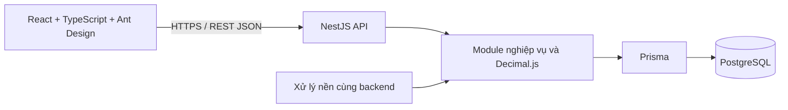

# 20. Tech stack và môi trường phát triển

**Trạng thái: ĐÃ CHỐT** theo xác nhận của chủ dự án ngày **17/10/2026**.
Mã quyết định kỹ thuật: **TECH-01**. Quyết định này cụ thể hóa kiến trúc trong
[08](08-kien-truc-he-thong.md), giữ nguyên [phạm vi R1](19-pham-vi-ban-dau-va-ma-tran-nghiem-thu.md)
và các chính sách mô phỏng tại [18](18-xac-nhan-chinh-sach-va-dau-vao-tinh-luong.md).
Đã chạy local đăng nhập, phiên, phân quyền, nhân sự, hợp đồng/phụ lục, điều chuyển,
tham số hiệu lực, tạo/mở kỳ công và danh mục/phân ca/duyệt lịch với PostgreSQL thật.
Chưa triển khai toàn bộ R1 hoặc có kết quả UAT sản phẩm. Hướng dẫn chạy tại §7.

## 1. Công nghệ đã chọn

**Chỉ triển khai website:** người dùng truy cập qua URL trên trình duyệt, không cài
ứng dụng riêng. React là giao diện website, NestJS là máy chủ xử lý của cùng hệ thống.
Không xây thêm mobile/desktop/hybrid app hoặc PWA cài đặt/offline. Responsive chỉ điều
chỉnh cùng website theo kích thước màn hình; không thay đổi stack hay quyền nghiệp vụ.

Chuẩn triển khai giao diện nằm tại [22 — UI design guide](22-ui-design-guide.md),
điểm vào cho agent là [DESIGN.md](../DESIGN.md); sử dụng chung token thay vì theme riêng từng trang.

| Thành phần | Công nghệ | Trách nhiệm |
|---|---|---|
| Frontend | React + TypeScript + Vite | Giao diện website trên trình duyệt cho TT/QĐ/KT/AD |
| Giao diện | Ant Design | Bảng công/lương, biểu mẫu, bộ lọc và thao tác duyệt |
| Dữ liệu frontend | TanStack Query | Gọi API, quản lý trạng thái tải, phân trang và làm mới sau thay đổi |
| Backend | NestJS + TypeScript trên Node.js | REST API, phân quyền, nghiệp vụ và điều phối xử lý lô |
| Cơ sở dữ liệu | PostgreSQL | Dữ liệu quan hệ, ràng buộc, lịch sử, snapshot và audit |
| Truy cập dữ liệu | Prisma | Mô hình dữ liệu, migration và giao dịch |
| Số học nghiệp vụ | Decimal.js và PostgreSQL NUMERIC/DECIMAL | Tiền, đơn giá, hệ số, giờ/công và các phép tính cần độ chính xác |
| Kiến trúc | Modular monolith | Chia module theo phân hệ đã chốt, dùng chung một backend và cơ sở dữ liệu |
| Môi trường làm việc | VS Code | Viết mã, chạy, debug, test và quản lý Git |

ASP.NET Core, Spring Boot và các công nghệ backend từng được so sánh không thuộc
stack đã chọn. Không tạo đồng thời nhiều backend bằng các framework đó.

## 2. Cấu trúc và ranh giới nghiệp vụ

Cấu trúc hiện tại; đã có auth, organization, employees, audit và health, chưa hoàn tất 10 phân hệ:

```text
enroll_and_salary/
├── frontend/       # React + TypeScript + Vite
├── backend/        # NestJS + Prisma, gồm API và xử lý nền
├── docs/           # Đặc tả và quyết định thiết kế
├── diagrams/       # Nguồn sơ đồ
└── scripts/        # Công cụ kiểm tra tài liệu
```

Backend tách module theo 10 phân hệ BFD: quản trị; nhân sự/hợp đồng; ca; chấm công;
OT; nghỉ; lương; bảo hiểm/thuế; phúc lợi; báo cáo. Năng lực dùng chung gồm phân quyền
theo đơn vị, tham số hiệu lực, công thức, audit và khóa kỳ. Không thay 10 module
logic thành 10 dịch vụ triển khai độc lập trong R1.



Nhãn API Gateway ở sơ đồ logic trong 08 biểu diễn điểm vào xác thực/phân quyền của
NestJS, không yêu cầu một sản phẩm gateway riêng. Phân quyền phải kiểm tra cả vai trò
và phạm vi dữ liệu ở backend theo [10](10-phan-quyen-va-bao-mat.md); ẩn nút trên UI
không thay thế kiểm tra quyền.

## 3. Ràng buộc triển khai

- Backend tính kết quả lương chính thức; frontend chỉ trình bày kết quả, nguồn và
  bước giải thích. Không dùng JavaScript `number`, `parseFloat` hoặc `toNumber()`
  trong chuỗi tính tiền/hệ số. Khởi tạo Decimal từ chuỗi hoặc giá trị Decimal được
  Prisma trả về; truyền số thập phân qua API bằng chuỗi có hợp đồng rõ ràng.
- Cấu hình độ chính xác Decimal và làm tròn tường minh theo ADR-11 trong 08. Kiểu
  `NUMERIC(p,s)` phải được chọn theo từng trường khi thiết kế schema; không để việc
  ép kiểu ở database tự quyết định quy tắc làm tròn nghiệp vụ.
- Công thức dùng bộ biểu thức giới hạn, có phiên bản hiệu lực và truy vết theo
  ADR-02; không dùng `eval` hoặc thực thi JavaScript tùy ý từ cấu hình.
- Khóa kỳ, kiểm tra revision, tạo snapshot/hash và audit phải có ranh giới giao dịch
  nguyên tử. Prisma không tự bảo đảm bất biến: cần ràng buộc/quyền database, kiểm soát
  cạnh tranh và migration SQL bổ sung khi cần theo 09, 10 và 17.
- Nhập tệp, tính lương và xuất báo cáo lớn chạy thành tác vụ nền có mã lô, trạng thái,
  chống chạy trùng và phục hồi sau lỗi. Tính toán nặng chạy ở worker tách khỏi luồng
  phục vụ HTTP; công nghệ hàng đợi cụ thể chọn ở bước triển khai.
- Mọi tham số pháp lý/chính sách giữ nguyên cách phân giải hiệu lực và snapshot trong
  đặc tả. Chọn TypeScript không làm thay đổi OT, thuế, nghỉ bù hoặc vòng đời kỳ.
- Prisma migrations được lưu trong Git; cập nhật schema qua migration được rà soát.
  Tính năng không biểu diễn được bằng Prisma schema phải có SQL và kiểm thử tương ứng.

## 4. Làm việc trên VS Code

| Công cụ | Cách dùng |
|---|---|
| Node.js bản LTS tương thích | Chạy Vite, NestJS và công cụ build/test; ghim phiên bản khi khởi tạo |
| npm | Quản lý dependency; commit lockfile và dùng cài đặt tái lập trong CI |
| PostgreSQL | Chạy local hoặc container; thống nhất phiên bản với môi trường kiểm thử |
| Git | Quản lý mã nguồn và thay đổi migration |
| ESLint và Prettier | Extension hỗ trợ; quy tắc nằm trong cấu hình repo khi khởi tạo |
| Terminal và debugger của VS Code | Chạy/debug frontend, backend và worker |

Docker Compose có thể dùng để chuẩn hóa môi trường; lựa chọn máy chủ nội bộ/cloud
vẫn theo 08 và các giả định hạ tầng đã ghi nhận. Không cần cài JDK hoặc bộ extension
Java để chạy stack đã chọn. Python vẫn dùng cho script kiểm tra tài liệu hiện có.

## 5. Các lựa chọn để bước triển khai cụ thể hóa

**AI-02:** module NestJS `ai-business-assistant` dùng **Google Gemini API** theo
[24](24-ai-tro-ly-nghiep-vu-theo-vai-tro.md). Provider đã chọn; model/API version/tier
và ngân sách chưa ghim. Backend lọc corpus theo quyền rồi gọi Gemini, không cấp tool
hoặc dữ liệu công/lương cho model. Không yêu cầu vector database; flag mặc định tắt
đến khi cấu hình/kiểm thử đạt. AI-01 giải thích lương ở 23 là hướng sau sprint.

Phiên bản dependency nền đã ghim trong package manifests/lockfile, runtime tại §7.
Đường chạy hiện tại dùng hash routing, cookie phiên HttpOnly với token ngẫu nhiên,
hash mật khẩu scrypt của Node.js và kiểm chứng tích hợp bằng Node test runner trên PostgreSQL thật.
Ant Design 5 dùng bản vá chính thức @ant-design/v5-patch-for-react-19 cho React 19.
Queue, đọc/ghi tệp nghiệp vụ, PDF và hạ tầng vận hành chưa triển khai; ví dụ trong trao đổi
không mặc nhiên là dependency đã cài.

Kiểm thử nghiệp vụ phải bao phủ các fixture/TC, vòng đời khóa kỳ, phân quyền và hiệu
năng trong đặc tả; kiểm tra đồng bộ tài liệu không thay thế kiểm thử phần mềm.

## 6. Tài liệu công nghệ

- [React: xây ứng dụng từ đầu với công cụ như Vite](https://react.dev/learn/build-a-react-app-from-scratch).
- [NestJS: TypeScript trên Node.js](https://docs.nestjs.com/first-steps).
- [Ant Design: bảng dữ liệu](https://ant.design/components/table/).
- [TanStack Query](https://tanstack.com/query/latest/docs/framework/react/reference).
- [Prisma: kiểu Decimal](https://docs.prisma.io/docs/orm/prisma-client/special-fields-and-types).
- [PostgreSQL: kiểu dữ liệu](https://www.postgresql.org/docs/current/datatype.html).


## 7. Chạy môi trường demo local

### 7.1. Phiên bản và phạm vi đã triển khai

- Runtime đã dùng: **Node.js 22.16.0**, **npm 10.9.2**, **PostgreSQL 18.3**.
  Node được ghi trong `.nvmrc`/`.node-version`; npm trong `packageManager`;
  dependency ghim chính xác trong package manifests và `package-lock.json`.
- Đã có React/Vite + Ant Design/TanStack Query và NestJS/Prisma. Decimal.js được cài,
  chưa có engine tính lương. Font Be Vietnam Pro đóng gói local qua Fontsource.
- Đã có migration và seed nền; đăng nhập/đăng xuất, phiên, phân quyền theo vai trò +
  cây đơn vị + hiệu lực + exclusion; danh sách/chi tiết/tạo nhân sự, cơ cấu tổ chức,
  quản trị thu hồi phiên và health. Đã bổ sung hợp đồng/phụ lục, điều chuyển theo ngày,
  phiên bản tham số/chính sách chốt, tạo/mở kỳ công và ca/phân ca/duyệt lịch; **không phải toàn bộ R1**.
- Chưa có engine chấm công, tính lương, chấm dứt hợp đồng hoặc AI; trạng thái nghiệm thu
  FR/UAT/NFR của baseline lõi không tự đổi theo smoke này.
- Làm trực tiếp trên checkout demo hiện tại theo yêu cầu chủ dự án, không commit hoặc
  tự đổi nhánh. Không cho nhiều agent sửa cùng tệp.

### 7.2. Thiết lập lần đầu

Chạy từ thư mục gốc, với Node/npm và PostgreSQL 18 đã cài. Ví dụ đường dẫn PostgreSQL
trên máy phát triển hiện tại:

```powershell
npm run db:setup -- --bin "D:/PostgreSQL/bin"
npm ci
npm run db:deploy
npm run db:seed
npm run dev
```

Nếu bộ binary nằm ở nơi khác, thay giá trị `--bin`; cũng có thể đặt biến môi trường
`PG_BIN` hoặc để các lệnh PostgreSQL có trên PATH. Không cần Docker cho đường chạy này.
`db:setup` không phụ thuộc npm packages nên chạy được trước `npm ci`.

Script tạo **cụm PostgreSQL riêng** ở `.local/pgdata`, chỉ lắng nghe
`127.0.0.1:5433`, database/user `hrtp_demo`, xác thực SCRAM và mật khẩu ngẫu nhiên.
Nó ghi `backend/.env` và lưu vị trí binary trong `.local/postgres.json`.
Không đổi service PostgreSQL đã có ở cổng 5432. User tạo bởi initdb là superuser
**chỉ dành cho local demo**, không dùng cấu hình này cho môi trường vận hành.

`backend/.env`, `.local/`, node_modules và dist được loại trong `.gitignore`.
Quyền file Windows phụ thuộc ACL của tài khoản; không chia sẻ thư mục hoặc mật khẩu.
Script từ chối ghi đè `backend/.env` không do nó quản lý. Không xóa `.local/pgdata`
khi server đang chạy; dữ liệu tồn tại qua các lần stop/start.

### 7.3. Chạy lại và dừng

```powershell
npm run db:start
npm run dev
```

- Website: http://127.0.0.1:5173
- API: http://127.0.0.1:3000/api/health
- `Ctrl+C` trong terminal chạy dev để dừng frontend/backend.
- `npm run db:status`: xem trạng thái cụm demo.
- `npm run db:stop`: dừng riêng cụm demo, không dừng service Windows cũ.

`npm run dev` chạy cả hai workspace. Có thể chạy riêng bằng
`npm run dev --workspace backend` và `npm run dev --workspace frontend`.
Port bận thì dừng đúng tiến trình demo cũ; Vite không tự chuyển sang port khác.

### 7.4. Cấu hình kết nối và hợp đồng health

`backend/.env.example` mô tả `DATABASE_URL`, `HOST`, `PORT`, `HR_DATA_KEY`. Khi dùng database tự
quản lý, tạo `backend/.env` từ mẫu rồi điền thông tin thật; không chạy `db:setup` để
đụng vào database đó. Các lệnh `db:start/stop/status` chỉ dành cho cụm do script tạo.

Frontend dùng URL tương đối `/api/...`; Vite dev/preview proxy tới
`http://127.0.0.1:3000`. Nếu đổi port backend, tạo `frontend/.env` từ
`frontend/.env.example`, đổi `API_PROXY_TARGET` rồi khởi động lại Vite.
Biến này chỉ dùng phía Vite server; không đưa DATABASE_URL hoặc mật khẩu vào frontend.
Cùng origin nên không cần mở CORS. Khi triển khai thật phải có reverse proxy `/api`
và cấu hình bảo mật riêng; Vite preview không phải máy chủ production.

`GET /api/health` không yêu cầu đăng nhập, trả `Cache-Control: no-store`:

- HTTP **200**: `status=ok`, `service=hrtp-api`, `database.status=up`, `checkedAt`
  dạng ISO UTC, sau khi Prisma thực hiện thành công `SELECT 1 AS result`.
- HTTP **503**: `status=error`, `database.status=down`, cùng service/timestamp;
  không trả connection URL, mật khẩu hoặc lỗi driver thô.
- Database không kết nối được không làm API ngừng phục vụ health. Sai cấu hình hoặc
  thiếu DATABASE_URL thì backend từ chối khởi động với thông báo lỗi.
- UI phân biệt đang kiểm tra, API không phản hồi và API có phản hồi nhưng DB down;
  nút **Kiểm tra lại** gọi mới, không báo xanh từ dữ liệu cũ khi request mới thất bại.
  Request trình duyệt có thời hạn 8 giây, không tự retry. URL mẫu giới hạn kết nối/query
  của Prisma ở 3 giây; khi tự cấu hình URL cần giữ timeout phù hợp.

Để kiểm tra lỗi thật: mở website, chạy `npm run db:stop`, bấm **Kiểm tra lại** để thấy
DB down/HTTP 503; chạy `npm run db:start` và bấm lại để thấy phục hồi/HTTP 200.
Không dùng service PostgreSQL cũ làm đối tượng thử dừng.

### 7.5. Build và chạy bản build local

Dừng dev trước khi build để tránh hai compiler cùng ghi `backend/dist`.

```powershell
npm run typecheck
npm run build
npm run db:validate --workspace backend
```

Sau đó chạy trong hai terminal riêng:

```powershell
npm run start --workspace backend
npm run preview --workspace frontend
```

Bản preview ở http://127.0.0.1:4173, vẫn proxy API tới port 3000. `npm ci` tự sinh
Prisma Client; sau khi sửa schema dùng `npm run db:generate`. Migration được lưu trong
`backend/prisma/migrations`; `db:deploy` áp dụng migration đã lưu, không dùng `db push`.
Kiểm tra đặc tả độc lập bằng `python scripts/validate_release_scope.py`.

### 7.6. Tài khoản và phạm vi demo

`npm run db:seed` tạo bốn cơ sở, cây tổ chức năm cấp, bốn vai trò, năm tài khoản
và bộ 2.200 hồ sơ doanh nghiệp giả lập khi database mới (chi tiết §7.9).
Chạy lại không reset mật khẩu, phân quyền hoặc dữ liệu người dùng. Các hồ sơ seed nền
cũ chỉ được làm giàu nếu còn nguyên bộ thuộc tính ban đầu; hồ sơ đã sửa được giữ nguyên.

| Tài khoản | Tên hiển thị | Quyền demo |
|---|---|---|
| `tt.bn` | Nguyễn Văn Hùng | Đọc nhân sự/lịch sử Tổ 1 / Phân xưởng 1 Bắc Ninh; xem kỳ công bao phủ tổ |
| `qd.bn` | Trần Quang Minh | Đọc nhân sự/lịch sử Phân xưởng 1 Bắc Ninh; xem kỳ công bao phủ phân xưởng |
| `kt.bn` | Phạm Thu Hà | Xem/tạo nhân sự, quản lý hợp đồng/phụ lục và điều chuyển trong Bắc Ninh |
| `kt.all` | Lê Thị Mai Anh | Quyền KT toàn công ty, trừ hồ sơ VIP-DEMO bị exclusion |
| `ad.demo` | Đỗ Minh Tuấn | Tổ chức/tài khoản/thu hồi phiên, tham số/chính sách và tạo/mở kỳ; **không đọc nhân sự/lương** |

Năm tên đại diện không hiển thị hậu tố “(giả lập)”; đây vẫn là dữ liệu trình diễn.
Tên đăng nhập, mật khẩu, role và phạm vi không đổi. Seed chuyển các tên mẫu cũ sang
tên trên, không ghi đè tên tùy chỉnh; hai tài khoản KT khác phạm vi, không phải role thứ năm.

Mật khẩu ngẫu nhiên nằm ở `.local/demo-accounts.json`, chỉ đọc trên máy local;
không nhúng vào frontend, tài liệu hoặc commit. Công nhân không được cấp tài khoản.
Seed mặc định chỉ chấp nhận database `hrtp_demo` của cụm local đã quản lý;
database local khác cần opt-in `SEED_ALLOW_ISOLATED=true`, dành cho kiểm chứng riêng.
Không seed dữ liệu demo vào môi trường vận hành.

Phiên dùng cookie `hrtp_session` (HttpOnly, SameSite=Strict, Path=/api); database
chỉ lưu SHA-256 của token. Mặc định hết hạn sau 15 phút không hoạt động, tối đa 8 giờ;
5 lần sai liên tiếp khóa tài khoản 15 phút, có bảo vệ request đồng thời.
Mỗi request đọc lại quyền/hiệu lực/trạng thái tài khoản; đăng xuất/thu hồi xóa phiên.
Backend kiểm tra Origin cho request ghi. Cấu hình `WEB_ORIGINS`, `COOKIE_SECURE`
và `AUTH_*` tại `backend/.env.example`; HTTPS phải bật cookie Secure.
Frontend xóa query cache khi đổi tài khoản hoặc nhận 401, không giữ dữ liệu người trước.

### 7.7. API và kiểm chứng luồng nền

- `POST /api/auth/login`, `GET /api/auth/me`, `POST /api/auth/logout`.
- `GET /api/organization/context`: cơ cấu hiện hành theo quyền.
- `GET /api/employees`: tìm kiếm, lọc đơn vị/trạng thái, phân trang phía server.
- `GET /api/employees/:id`: nhân sự ngoài phạm vi/bị exclusion/không tồn tại đều trả
  `{employee:null}`; AD không có quyền nhân sự nhận 403.
- `POST /api/employees`: KT tạo hồ sơ cơ bản và phân công 100% vào đơn vị hợp lệ.
  Trùng mã trả 409; dữ liệu sai hoặc trường không hỗ trợ trả 400. Chưa nhận dữ liệu
  lương, CCCD hoặc tài khoản ngân hàng trong luồng này.
- `GET /api/auth/accounts`, `POST /api/auth/accounts/:id/revoke`: AD quản lý
  phiên trong phạm vi được cấp, không mở rộng quyền đọc nhân sự.

`npm run verify:foundation` biên dịch backend rồi tự tạo database PostgreSQL
local tách biệt, áp migration, seed lặp lại, chạy NestJS thật và gọi HTTP thật.
Lệnh kiểm tra phân quyền, exclusion, ghi/lưu hồ sơ, lỗi dữ liệu, CSRF, đa vai trò,
phạm vi Admin, logout/revoke, hiệu lực quyền, khóa tài khoản đồng thời, hết hạn phiên
và audit append-only; sau đó dừng server và xóa **chỉ database kiểm chứng do lệnh tạo**.
Cần cụm demo đang chạy và quyền tạo database (đã có trong cấu hình demo local).
Không dùng tài khoản database vận hành để chạy lệnh này.

Đã quan sát smoke UI: tạo hồ sơ và xem lại sau reload; TT không có nút tạo;
KT phân trang bằng dữ liệu thật; AD không có menu nhân sự và thu hồi phiên của chính
mình quay về đăng nhập. Ở 390px không tràn ngang toàn trang (bảng cuộn ngang riêng).
Audit axe tự động không phát hiện vi phạm ở các màn hình đã kiểm tra; một số mục cần
đánh giá thủ công, không coi đây là chứng nhận WCAG hay UAT toàn bộ sản phẩm.

### 7.8. Hợp đồng, điều chuyển và cấu hình kỳ công

- KT tạo dự thảo, kích hoạt hợp đồng và thêm/đọc phụ lục trong hồ sơ nhân sự.
  API: GET/POST `/api/employees/:id/contracts`,
  POST `/api/employees/:id/contracts/:contractId/activate` và
  POST `/api/employees/:id/contracts/:contractId/annexes`.
  Kiểm tra sàn lương vùng, thử việc 85%/30–60 ngày, giới hạn hợp đồng xác định hạn,
  chồng lấn hợp đồng đang hiệu lực. Giới hạn tối thiểu 12 tháng là ràng buộc mô phỏng
  của dự án, không tuyên bố là mức tối thiểu pháp luật cho mọi trường hợp.
- Lương và nội dung phụ lục được mã hóa AES-256-GCM; audit không chứa plaintext này.
  TT/QĐ/AD không có API đọc hợp đồng hoặc tab lương. Cờ BH theo thời hạn hợp đồng
  chỉ là đầu vào sơ bộ, chưa phải engine kết luận toàn bộ điều kiện tham gia BH.
- GET `/api/employees/:id/assignments?asOf=YYYY-MM-DD` và
  POST `/api/employees/:id/transfers`: giữ lịch sử phân công theo ngày, số/ngày
  quyết định và lý do; quyền phải hợp lệ cả hiện tại lẫn ngày yêu cầu. Điều chuyển
  xét toàn bộ khoảng phân công bị thay đổi, kể cả thay đổi cây cha giữa khoảng;
  từ chối nếu ảnh hưởng kỳ CLOSED/LOCKED của đơn vị hoặc cấp cha. Không chặn nếu
  phân công đã kết thúc trước kỳ đóng. Ngày quyết định sau ngày hiệu lực trả 400,
  không ghi dữ liệu; giao diện cập nhật hồ sơ và danh sách ngay khi lưu hợp lệ.
- AD quản lý GET/POST `/api/settings/parameters` và `/api/settings/policies`;
  tra cứu theo `asOf`. Phiên bản mới đóng khoảng mở của bản trước ở ngày liền kề,
  không ghi đè giá trị lịch sử. Tham số ưu tiên SITE → REGION → GLOBAL; chính sách
  lấy đơn vị gần nhất trong chuỗi cha. Seed ngày chốt 25 mang nhãn **SIMULATION**.
  Bảo vệ kỳ CLOSED/LOCKED theo đúng SITE/REGION/GLOBAL và khoảng ngày bị ảnh hưởng,
  không chặn tham số của cơ sở/vùng không liên quan. Nếu đóng phiên bản mở trước đó,
  xét cả phần đuôi bị cắt, không chỉ khoảng hữu hạn của phiên bản mới.
- GET `/api/periods/preview?scopeOrgUnitId=...&month=YYYY-MM` dự kiến kỳ theo
  chính sách tại ngày đầu tháng; ngày 31 tự giới hạn theo số ngày thực của tháng.
  GET/POST `/api/periods`; POST `/api/periods/:id/open` nhận `revision`.
  Chỉ có PLANNED → OPEN; từ chối chồng lấn cùng phạm vi và revision cũ. Có thể mở
  kỳ kế tiếp khi kỳ trước còn OPEN. Có thể nhập đồng thời cặp ngày riêng có thứ tự.
  Tạo/mở kỳ kiểm tra hiệu lực và quyền xuyên suốt khoảng ngày thực tế, gồm các mốc
  đổi phiên bản cây tổ chức; từ chối cả khoảng có lỗ hổng ở giữa. Khoảng tùy chỉnh
  hợp lệ phải xem được trong danh sách và mở được theo cùng quy tắc phạm vi.
  **Chưa có chốt/khóa kỳ, log chấm công, tính công, tính lương hoặc AI.** Lịch ca tại §7.10.

**Nâng cấp checkout đã có dữ liệu:** dừng backend trước khi sinh Prisma Client
(Windows có thể giữ DLL đang dùng), rồi chạy từ thư mục gốc:

```powershell
npm run db:setup -- --bin "D:/PostgreSQL/bin"
npm run db:generate
npm run db:deploy
npm run db:seed
npm run dev
```

`HR_DATA_KEY` phải được sao lưu riêng, an toàn cùng bản sao lưu database.
`db:setup` sinh khóa ngẫu nhiên 32 byte nếu chưa có và chưa tồn tại hợp đồng mã hóa;
không thay khóa đã có. Mất khóa khi đã có hợp đồng: phải khôi phục khóa gốc,
không sinh khóa thay thế; dữ liệu cũ không giải mã được bằng khóa mới.
Database tự quản lý: tạo khóa theo lệnh trong `backend/.env.example`, không dùng
script quản lý cluster demo để thay đổi database đó. Chưa có chức năng xoay khóa.

`npm run verify:hr` tạo database PostgreSQL sạch, migrate/seed, chạy HTTP thật:
quyền đọc lương, mã hóa, kích hoạt đồng thời, phụ lục, biên thử việc/hợp đồng,
điều chuyển và mất quyền sau điều chuyển, tham số lịch sử, kế thừa ngày chốt,
tháng Hai, kỳ đã khóa, chồng lấn kỳ, revision và quyền TT xem kỳ cấp cơ sở.
Lệnh chỉ xóa database kiểm chứng do chính nó tạo.
  Hồi quy bổ sung bao phủ điều chuyển qua kỳ đóng, đổi cây cha, phân công hữu hạn,
  phạm vi tham số SITE/REGION/GLOBAL và cắt phiên bản mở, kỳ tùy chỉnh trước hiệu lực
  hoặc có lỗ hổng, ngày quyết định không hợp lệ và trường hợp bằng ngày hiệu lực.
  Sau sửa lỗi: `verify:hr` 16/16, `verify:foundation` 13/13, typecheck/build đạt.
  Smoke HTTP riêng trên PostgreSQL sạch xác nhận: điều chuyển qua kỳ khóa → 409
  và giữ nguyên phân công; tham số cơ sở khác → 201; kỳ trước hiệu lực → 403,
  kỳ tùy chỉnh hợp lệ → tạo/xem/mở OPEN; ngày quyết định sau hiệu lực → 400.
  Kỳ CLOSED/LOCKED được dựng trực tiếp trong database kiểm chứng vì chưa có API chốt/khóa.
  Smoke UI sau sửa: Admin gửi kỳ có khoảng 12/2025 nhưng tháng nhãn 01/2027;
  API trả 403 và biểu mẫu hiện lỗi quyền theo ngày, không tạo kỳ mồ côi.
  Không ghi nhận lỗi runtime JavaScript; dữ liệu nghiệp vụ demo được giữ nguyên.

Smoke UI đã tạo/kích hoạt hợp đồng, thêm/đọc lại phụ lục sau khởi động lại API;
tra cứu trước/sau điều chuyển, tham số và chính sách tương lai; xem dự kiến,
tạo/mở kỳ rồi reload; nhập khoảng ngày riêng; TT chỉ xem kỳ bao phủ tổ.
Kiểm tra 390px không tràn ngang toàn trang. Đây không phải UAT toàn bộ R1.
Audit axe phát hiện thuộc tính ARIA không hợp lệ ở wrapper Select của Ant Design
trong modal tạo kỳ; chưa coi giao diện đạt chứng nhận WCAG.
Màn hình danh sách kỳ của TT tại 390px: axe không phát hiện vi phạm, bảng cuộn
ngang bằng bàn phím và không tràn toàn trang. Kỳ hiển thị tên cơ sở dù TT chỉ có
quyền ở tổ; không cấp thêm quyền xem nhân sự cấp cơ sở. Đã smoke bản build qua
Vite preview 4173 với API biên dịch, không ghi nhận lỗi runtime trình duyệt.
Build thành công nhưng Vite vẫn cảnh báo chunk UI lớn hơn 500 kB.

### 7.9. Bộ dữ liệu doanh nghiệp giả lập sát nghiệp vụ

Theo yêu cầu chủ dự án khi chưa có dữ liệu doanh nghiệp thật, seed mặc định dùng
`backend/prisma/seed-realistic.cjs`, ảnh chụp nghiệp vụ **18/10/2026**. Doanh nghiệp
**Công ty TNHH Điện tử HRTP** là doanh nghiệp mô phỏng, không đại diện doanh nghiệp
hay cá nhân thật. Tên công ty trên giao diện và đường dẫn đơn vị không gắn hậu tố
“(giả lập)”; seed nâng cấp tên mẫu cũ nhưng giữ nguyên tên do người dùng tùy chỉnh.

| Cơ sở | Tổng nhân sự mẫu | Trực tiếp | Gián tiếp |
|---|---:|---:|---:|
| Hà Nội | 180 | 0 | 180 |
| Bắc Ninh | 1.100 | 900 | 200 |
| Hà Nam | 600 | 500 | 100 |
| Nghệ An | 320 | 270 | 50 |
| **Tổng** | **2.200** | **1.670** | **530** |

- 89 đơn vị, gồm 29 phòng ban/phân xưởng: SMT, lắp ráp, QC, đóng gói, cuộn dây,
  cơ khí, kỹ thuật, kho vận, an toàn, nhân sự và văn phòng. Có cost center và TK 622/642.
- Tên Việt Nam đa dạng, ngày sinh/tuyển dụng có thứ tự; ngạch A–F và chức danh tương ứng.
  Email dùng miền dành riêng `example.invalid`; điện thoại để trống, không tạo số có thể
  liên hệ nhầm người thật. Mã nhân sự mới: HN/BN/HNA/NA + 5 chữ số.
- 2.200 hợp đồng đang hiệu lực, 42 dự thảo gia hạn; xác định hạn, không xác định hạn,
  thử việc công nhân/kỹ thuật. Lương tháng giả lập từ 5.525.000 đến 67.000.000 VND,
  có kiểm tra sàn vùng, tỷ lệ/ngày thử việc và kỳ hạn theo tham số đang lưu.
  Đây là giá trị dựng để trình diễn, **không phải khảo sát lương thị trường**.
- Lương/phụ lục dùng chung mã hóa AES-256-GCM với API, giữ nguyên `HR_DATA_KEY`.
  Có 32 phụ lục và 17 lịch sử điều chuyển mẫu, hai khoảng phân công nối ngày, tổng 100%.
- Tám kỳ công mẫu: tháng 10 OPEN, tháng 11 PLANNED theo ngày chốt đang cấu hình.
  Không tạo kỳ chốt/khóa hoặc kết quả công/lương khi các engine đó chưa triển khai.
- Ngày tuyển dụng có thể từ 2020; dữ liệu quản lý phân công/hợp đồng bắt đầu từ
  01/01/2026 hoặc ngày tuyển dụng nếu muộn hơn. Không bịa lịch sử trước mốc quản lý.

**Dọn nhãn hiển thị:** theo yêu cầu chủ dự án, bỏ chữ “giả lập” khỏi nội dung giao diện
và dữ liệu đang trình bày, gồm tên đại diện/công ty, 4 địa chỉ cơ sở, 17 lý do điều
chuyển và 32 nội dung phụ lục. Seed chỉ nâng cấp đúng nội dung mẫu cũ; không ghi đè
nội dung đã tùy chỉnh. Phụ lục tiếp tục mã hóa bằng khóa hiện có; không đổi mã, ngày,
phân công hoặc mức lương. Snapshot lịch và audit append-only được giữ nguyên; giao
diện lịch sử dùng tên tài khoản hiện tại, không in lại hậu tố cũ. Đây vẫn là dữ liệu
trình diễn, không phải dữ liệu doanh nghiệp thật. Sao lưu trước khi dọn tại
`.local/backups/hrtp-visible-labels-before-1792310598150.json` (không chứa khóa ứng dụng).
Đã đối chiếu nội dung trước/sau, seed lặp lại không thay dữ liệu, hồi quy nền 13/13
và build frontend đạt; đã mở phụ lục, lịch sử điều chuyển, lịch ca cũ và trang Hệ thống
trên trình duyệt để kiểm tra nội dung hiển thị.

**Bảo toàn dữ liệu:** mã/ID seed ổn định; giữ hai hồ sơ nhập qua UI, hợp đồng/phụ lục,
lịch sử điều chuyển, kỳ công, mật khẩu, phạm vi tài khoản và tham số/chính sách đã có.
Giữ mã đơn vị nền đã được tham chiếu, không đổi danh tính hoặc tạo alias:
HQ-HN-D1/D2 là Tài chính/CNTT; NM-BN-D1/D2 là SMT/Lắp ráp; NM-HNA-D1/D2 là
Cuộn dây/Mô-đun; NM-NA-D1/D2 là Cơ khí/Hoàn thiện. Các đơn vị mở rộng dùng mã ở tài liệu 03.
Nếu mã seed mới đã thuộc bản ghi khác, seed dừng và rollback thay vì ghi đè.
Các phiên bản đơn vị đã sửa tên hoặc đã đóng hiệu lực không bị viết lại.

Chạy `npm run db:seed` để bổ sung bộ mẫu, không cần reset/migrate thêm. Sau lần nhập
hiện tại có **2.202 nhân sự**, **2.243 hợp đồng**, 33 phụ lục, 20 điều chuyển và 10 kỳ
do giữ các bản ghi demo đã nhập. Tổng có thể tăng khi người dùng thêm dữ liệu.
Chạy lại đã kiểm chứng không tạo trùng hoặc khôi phục dữ liệu đã sửa.
Các bộ kiểm thử đặt `SEED_DATASET=foundation` để dựng fixture nhỏ, độc lập;
`verify:foundation` còn chạy seed realistic hai lần để kiểm tra bảo toàn dữ liệu thực.

Đã sao lưu database trước khi nhập tại
`.local/backups/hrtp-demo-before-realistic-2026-10-18T04-01-12.375Z.dump`,
kiểm tra archive đọc được bằng pg_restore. Bản dump không chứa khóa ứng dụng;
tiếp tục sao lưu riêng `HR_DATA_KEY` trong môi trường an toàn.
Smoke kiểm tra 2.242 hợp đồng seed, phân quyền TT/QĐ/KT/AD và dữ liệu cũ qua HTTP thật;
UI đã tra cứu nhân sự, mở hồ sơ và đọc hợp đồng/lương. Không phải nghiệm thu toàn bộ R1.

### 7.10. Danh mục ca, phân ca và duyệt lịch

Mở **Ca & phân ca** trên menu. Ba chế độ: **Danh mục ca**, **Lập & duyệt**,
**Chính thức**. React gọi API NestJS, lưu PostgreSQL; không lấy dữ liệu lịch từ seed UI.

- AD khai báo ca hành chính/ngày/đêm theo đơn vị; đơn vị con kế thừa danh mục cấp cha.
  Nhập HH:mm, cờ qua ngày, vị trí/thời lượng nghỉ và nghỉ có tính giờ làm hay không.
  Ca đã có lượt phân công không sửa nội dung; tạo mã mới, hoặc ngừng dùng để chặn lịch mới.
- TT chọn tổ/phòng có nhân sự trực thuộc, thêm ngày và ca; chọn toàn bộ nhân sự đủ
  điều kiện theo ngày hoặc chọn từng người. Tối đa 31 dòng nhập, 5.000 lượt/lịch.
  Thành viên được chốt khi lưu; gửi/duyệt kiểm tra lại phân công chính, ngày tuyển dụng,
  hiệu lực đơn vị/quyền, phạm vi hiện tại lẫn ngày công và exclusion.
- Người lập sửa lịch DRAFT/RETURNED và gửi PENDING. QĐ khác người lập duyệt APPROVED
  hoặc trả lại RETURNED kèm lý do. Người lập có thể hủy DRAFT/RETURNED/PENDING kèm
  lý do thành CANCELLED. Không sửa/hủy lịch đã duyệt qua các API này.
- Chỉ APPROVED xuất hiện ở **Chính thức**. Ngày công là ngày bắt đầu ca, mốc giờ cố
  định Việt Nam (+07:00); ca 22:00–06:00 gắn ngày T, kết thúc sáng T+1.
- Chặn trùng ngày/chồng giờ, nghỉ chuyển ca dưới 12 giờ, vượt 8 giờ/ngày hoặc
  48 giờ/tuần thứ Hai–Chủ nhật. DRAFT/PENDING/APPROVED đều giữ chỗ; RETURNED/CANCELLED
  không giữ chỗ. Nghỉ giữa ca từ 6 giờ: 30 phút, có giờ đêm: 45 phút.
  Năm tham số SHIFT_* phân giải SITE → REGION → GLOBAL theo ngày; không cho nới
  lỏng giới hạn. Hai đầu khoảng chuyển ca và mọi ngày trong tuần dùng giới hạn chặt hơn.
- Chặn tạo/sửa/chuyển trạng thái nếu ngày công thuộc kỳ CLOSED/LOCKED của đơn vị
  hoặc cấp cha theo cây hiệu lực; sửa lịch kiểm tra cả ngày cũ bị xóa và ngày mới.
  Ca qua nửa đêm xét ngày bắt đầu, không chặn chỉ vì ngày kết thúc thuộc kỳ kế tiếp.
  Điều chuyển bị chặn nếu làm sai phân công có lịch PENDING/APPROVED trong khoảng ảnh hưởng.
- Mỗi thao tác ghi actor, thời điểm, trạng thái trước/sau, revision, lý do và snapshot
  đầy đủ trong cùng transaction với audit. History append-only ở PostgreSQL; quyền
  đọc lịch sử vẫn xét người đã bị bỏ khỏi lịch sau sửa/điều chuyển. Revision cũ hoặc
  ghi/duyệt đồng thời trả 409; batch lỗi rollback toàn bộ.

**API:**

| Hành động | Endpoint |
|---|---|
| Xem/tạo ca | GET/POST /api/shifts/definitions |
| Sửa/ngừng dùng ca | POST /api/shifts/definitions/:id/update, /:id/active |
| Nhân sự theo ngày | GET /api/shifts/members?orgUnitId=UUID&workDate=YYYY-MM-DD |
| Xem/tạo lịch | GET/POST /api/shifts/plans |
| Chi tiết/lịch sử | GET /api/shifts/plans/:id |
| Sửa/gửi/duyệt/trả lại/hủy | POST /api/shifts/plans/:id/{update,submit,approve,return,cancel} |
| Lịch chính thức | GET /api/shifts/official |

GET plans/official yêu cầu dateFrom/dateTo, tối đa 93 ngày; lọc teamOrgUnitId và
status khi xem danh sách. Các lệnh sửa/chuyển trạng thái nhận revision; return/cancel
bắt buộc reason. POST plans nhận teamOrgUnitId, title, slots[{workDate,shiftId,employeeIds?}];
bỏ employeeIds để lấy toàn bộ thành viên hợp lệ, không gửi mảng rỗng.

**Nâng cấp và bằng chứng:** migration 20261018120000_shift_scheduling đã áp lên demo,
không reset dữ liệu; backup trước nâng cấp tại
.local/backups/hrtp-demo-before-shifts-1792297243965.dump. Danh mục demo có A/B/C/HC,
được tạo bằng UI/API; lịch “DEMO - Ca đêm SMT-1 18/10/2026” có một người và đã duyệt,
sáu phiên bản CREATE → SUBMIT → RETURN → UPDATE → SUBMIT → APPROVE. Đây là dữ liệu
kiểm chứng giả lập, không phải lịch sản xuất của doanh nghiệp thật.

npm run verify:shifts tạo database cách ly, migrate/seed, chạy HTTP thật rồi tự xóa
chỉ database do lệnh tạo: 13 tình huống + parent = **14/14 đạt**. Bao phủ biên 12/48 giờ,
ngày qua đêm, phân quyền/exclusion/lịch sử sau điều chuyển, batch atomic, revision,
đồng thời tạo/duyệt, ca ngừng dùng, khóa ngày cũ và chính sách theo ngày ở hai đầu ca.
Typecheck/build và kiểm tra đồng bộ phạm vi đạt; Vite còn cảnh báo chunk UI >500 kB.
Smoke browser thật đã lập/lưu/reload, gửi/trả lại/sửa/gửi lại/duyệt, đọc sáu phiên bản,
reload lịch chính thức và chặn ca sáng nối ca đêm. Ở 390px không tràn ngang toàn trang;
bảng cuộn riêng, axe không phát hiện vi phạm tự động trên màn hình chính thức
(vẫn có mục cần kiểm tra thủ công; không tuyên bố chứng nhận WCAG/UAT toàn bộ).

Module phân ca chưa sinh chu kỳ xoay ca tự động hoặc yêu cầu đổi ca đã duyệt.
Lịch APPROVED là đầu vào cho engine ghép quẹt tại mục 7.11 dưới đây.

### 7.11. Nhập tệp, ghép lượt quẹt và bảng công

Mở **Chấm công** trên menu hoặc `#/attendance`. AD chọn **Nhà máy Bắc Ninh**,
kỳ **GL-CC-2026-10-BN**, tab **Nhập tệp**. TT/QĐ/KT/AD đọc bảng công trong phạm vi;
chỉ AD có `attendance.import` được nhập, xử lý lại, xem lịch sử/log gốc và lưu cấu hình.
Không có tài khoản công nhân hoặc dữ liệu lương ở đây.

**Định dạng:** CSV/TXT/XLSX, tối đa 10 MiB và 20.000 dòng. Mẫu chuẩn không tiêu đề:
mã nhân viên, ngày YYYY-MM-DD, giờ HH:mm:ss, mã thiết bị, IN/OUT/AUTO. Giờ tệp là giờ
Việt Nam. CSV/TXT mặc định UTF-8, dấu phẩy. Cấu hình lưu thêm được vị trí cột (UI đếm
từ 1), dấu phân cách, UTF-16LE/Windows-1258, dòng bỏ qua, DD/MM/YYYY và HH:mm.
XLSX đọc sheet đầu, hỗ trợ ô ngày/giờ Excel, không tính công thức.

- Sai một dòng thì từ chối toàn lô, trả số dòng/mã lỗi/nội dung, không lưu riêng các
  lượt hợp lệ. Lỗi định dạng toàn tệp trả 400. Kiểm tra hiệu lực phân công và phạm vi.
- Lô nhập lưu người nhập, thời điểm, SHA-256, cấu hình tại lần nhập, tổng dòng và kết
  quả. Log gốc lưu nguồn cột/dòng/lô; PostgreSQL chặn UPDATE/DELETE. Trùng chính xác
  cơ sở/nhân viên/thời điểm/thiết bị/chiều không chèn lại. Lô trùng vẫn có lịch sử riêng,
  không tính lại ngày công. Trạng thái lô là tại lần nhập; log phản ánh lần xử lý gần nhất.
- Chỉ ghép lịch APPROVED. Ngày công là ngày bắt đầu ca, không phải ngày quẹt ra.
  Khử lượt liên tiếp trong cửa sổ 5 phút: giữ IN đầu/OUT cuối; giữ log bị loại để truy
  vết. Không tự suy ra giờ ra khi thiếu lượt hoặc nhiều lịch cùng khớp.
- Cắt giờ làm trong ca; bỏ phần chồng nghỉ không lương, giữ nghỉ có tính giờ. Tách
  đoạn ở 00:00/06:00/22:00 Việt Nam. Công = thời lượng thực tế/thời lượng ca, tối đa 1.
  Ca 22:00–06:00 nghỉ có lương là 480 phút đêm, hai đoạn ngày lịch nhưng cùng ngày
  công. Không tự ghi OT; đi muộn/về sớm ghi số phút/cờ, không trừ lương.
- Năm tham số PUNCH_* phân giải theo ngày/phạm vi bằng bộ tham số hiện có. Biên vào
  trước/sau mặc định 30/15 phút, ra trước/sau 15/30 phút; biên ghép không phải miễn muộn.
- Kỳ tham chiếu chọn vùng xử lý và các kỳ kề; từng ca tìm kỳ đích theo ngày bắt đầu.
  Một tệp có thể vào nhiều kỳ. Kỳ PLANNED/chưa có kỳ hoặc lịch chưa duyệt giữ log chờ.
  Sau mở kỳ/duyệt lịch, AD bấm **Xử lý lượt quẹt chờ**.
- Chỉ OPEN được ghi công. CLOSED/LOCKED giữ log muộn kèm lý do, không sửa công cũ;
  trigger database và khóa giao dịch dùng chung với mở kỳ/lập lịch/điều chuyển.
  Chưa có API chốt/khóa kỳ; hồi quy dùng trạng thái fixture cách ly.
- Bảng công/ngoại lệ lọc kỳ, đơn vị, mã/tên. Phân trang/tổng hợp dùng cùng điều kiện
  quyền: hiện tại lẫn ngày công, phân công chính và exclusion. Nhân sự chuyển ngoài
  phạm vi không bị lộ qua chi tiết hoặc tổng số. Bấm ngày công xem đoạn giờ/lượt ghép;
  bấm lượt gốc xem lô, dòng và dữ liệu nguồn.

**API:**

| Hành động | Endpoint |
|---|---|
| Cơ sở/đơn vị/kỳ/cấu hình được phép | GET /api/attendance/context |
| Lưu cấu hình cột mới | POST /api/attendance/profiles |
| Nhập tệp | POST /api/attendance/imports, multipart file/siteId/referencePeriodId/profileId? |
| Lịch sử/chi tiết lô | GET /api/attendance/imports?siteId=UUID, GET /api/attendance/imports/:id |
| Xử lý lại | POST /api/attendance/process, JSON siteId/referencePeriodId |
| Bảng công/ngoại lệ | GET /api/attendance/board?periodId=UUID&orgUnitId=UUID&search=...&exceptionsOnly=true |
| Chi tiết ngày | GET /api/attendance/days/:id |
| Log gốc | GET /api/attendance/punches?siteId=UUID&state=... |

Danh sách nhận page/pageSize (tối đa 100). Cấu hình lưu bất biến; đổi thì tạo mới.

**Nâng cấp:** `npm run db:deploy` áp migration `20261018160000_attendance_import`
và thêm tham số ghép, không reset. Backup demo trước nâng cấp:
`.local/backups/hrtp-demo-before-attendance-1792312626825.dump`. Giữ nguyên nhân sự,
hợp đồng, lịch đã duyệt, mật khẩu và khóa mã hóa.

**Kiểm chứng:** `npm run verify:attendance` đạt **21/21**: 5 parser, 8 engine,
7 tình huống HTTP/PostgreSQL + parent. Database riêng, migrate/seed rồi xóa đúng
database do lệnh tạo. Bao phủ lỗi dòng/ngoài cơ sở, nhập trùng, log bất biến, ca đêm,
nghỉ có/không lương, thiếu quẹt, muộn/sớm, lịch chưa duyệt, qua ngày chốt, kỳ chưa mở/
đã khóa, exclusion và điều chuyển. Typecheck/build đạt; Vite vẫn cảnh báo chunk thư
viện UI >500 kB. Không phải nghiệm thu toàn bộ R1.

Đã nhập trên browser thật 4 log BN00004 cho lịch đêm 18/10: ghép 21:58–06:04, giới hạn
công trong ca 22:00–06:00, 8 giờ đêm/1 công, giữ hai lượt bị loại. Nhập lại không thêm
log; tệp có mã lạ/ngày sai bị từ chối cả lô; lưu/dùng cấu hình MAY01 - 5 cột chuẩn,
xem lịch sử và nguồn. Ở 390px bảng cuộn riêng, không tràn ngang toàn trang; axe không
phát hiện lỗi tự động ở bảng công/lịch sử đã kiểm tra (vẫn có mục cần kiểm tra thủ công).

Chưa triển khai đăng ký/duyệt OT, nghỉ phép/giải trình, xác nhận/chốt công, tính lương
hoặc AI. Kết quả ghép quẹt ở đây chưa phải bảng công chốt.

Hồi quy liên phân hệ sau tích hợp: nền **13/13**, nhân sự **16/16**, phân ca **14/14**.
Đã đăng nhập TT trên browser, chỉ có hai tab đọc công/ngoại lệ và bộ lọc đơn vị
NM-BN-D1-T1; xem được ca đêm trong tổ, không có chức năng nhập tệp của AD.
Reload vẫn đọc được kết quả đã lưu; nguồn lượt ghép không mang lý do chờ giả.
