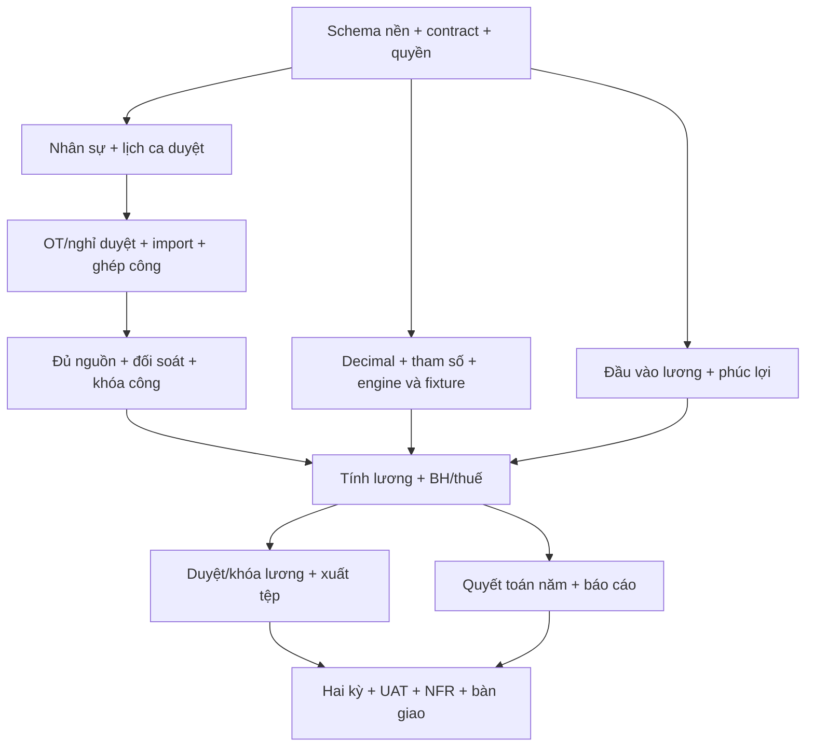

# 21. Roadmap triển khai 5 ngày với Codex, Claude Code và Antigravity

Kế hoạch đề xuất theo yêu cầu chủ dự án; **Ngày 1–5 tính từ lúc bắt đầu triển khai**,
không gắn với ngày lịch. Stack theo [TECH-01](20-tech-stack-va-moi-truong-phat-trien.md),
phạm vi theo [baseline R1](19-pham-vi-ban-dau-va-ma-tran-nghiem-thu.md).

## 1. Mục tiêu và giả định thời gian

**AI ưu tiên đã xác nhận: AI-02 — [Trợ lý hướng dẫn nghiệp vụ theo vai trò](24-ai-tro-ly-nghiep-vu-theo-vai-tro.md)**
dùng Google Gemini cho TT/QĐ/KT/AD. Chuẩn bị từ ngày 1–3, tích hợp ngày 4, kiểm thử
ngày 5 sau gate nền quyền/corpus/navigation; không chờ engine lương để làm hướng dẫn.
AI-02 có 12 AC riêng ngoài 29 UAT lõi, không làm giảm 152 M. AI-01 giải thích lương
chỉ KT chuyển sang hướng sau sprint. Nếu trễ, ghi rõ AI-02 chưa hoàn thành.

**Phạm vi nền tảng:** chỉ triển khai website dùng qua trình duyệt. Frontend React và
backend NestJS phục vụ cùng website; không giao task xây ứng dụng mobile/desktop,
hybrid hoặc PWA cài đặt/offline. Kiểm tra responsive là kiểm tra website trên các viewport.

Mục tiêu là bản ứng viên R1 chạy xuyên suốt trên dữ liệu mô phỏng, có bằng chứng kiểm
thử và danh sách phần còn thiếu. **5 ngày là timebox gấp, không phải cam kết 152 FR
sẽ đạt**. Nghiệm thu R1 vẫn yêu cầu đủ 152 M, 29 dòng UAT, TC/NFR và hai kỳ đối soát
theo 19. Demo thành công không tự chuyển trạng thái thành nghiệm thu đạt.

Giả định mỗi ngày có 8–10 giờ làm việc tập trung, ba luồng agent có thể hoạt động
song song, chủ dự án dành thời gian quyết định và kiểm tra kết quả ít nhất ba lần/ngày.
AI vẫn có thời gian chờ, giới hạn sử dụng và lỗi; số agent không nhân tuyến tính năng suất.
Không dùng dữ liệu nhân sự thật trong sprint này.

- Giữ tất cả M trong kế hoạch, gồm các hình thức lương, phúc lợi, quyết toán năm và báo cáo.
- Không dành thời gian cho sáu FR backlog, email, ESS, tích hợp trực tiếp hoặc bật nghỉ bù OT.
- Rút ngắn bằng giao diện thống nhất, dữ liệu seed và hợp đồng rõ; không bỏ phân quyền,
  tính chính xác, audit hoặc khóa kỳ để kịp ngày cuối.
- Nếu hết ngày 5 chưa đủ điều kiện, bàn giao bản ứng viên kèm phần thiếu và kế hoạch
  bổ sung. Thay đổi phạm vi chỉ thực hiện bằng quyết định mới của chủ dự án.

## 2. Phân công và quyền sở hữu

Frontend tuân theo [UI guide 22](22-ui-design-guide.md), [DESIGN.md](../DESIGN.md) và
[token chuẩn](config/hrtp-ui-tokens.json). Antigravity triển khai theme/component dùng
chung từ ngày 1; Codex/Claude cung cấp contract quyền, trạng thái và dữ liệu tương ứng.

Đây là phân công cho sprint, không phải xếp hạng năng lực các sản phẩm. Có thể đổi
người thực hiện nhưng luôn giữ một chủ sở hữu cho mỗi phần dùng chung.

| Người/công cụ | Trách nhiệm chính | Phần sở hữu |
|---|---|---|
| Chủ dự án | Chốt contract, ưu tiên lỗi, kiểm tra demo và quyết định ghép mã | Quyết định phạm vi và xác nhận kết quả |
| Codex | Nền tảng, schema/migration, module 1–4, kỳ/snapshot/audit; API báo cáo và ghép backend | `backend/prisma/`, nền tảng, tổ chức/nhân sự/ca/công, báo cáo, cấu hình build/CI |
| Claude Code | Lõi OT/nghỉ/lương/BH/thuế/phúc lợi, module 5–9; kiểm thử số học | Các module nghiệp vụ 5–9 và unit test liên quan |
| Antigravity | Frontend, nối API, kiểm tra luồng qua trình duyệt và E2E | `frontend/`, test E2E và bằng chứng giao diện |

Codex review độc lập công thức và test của Claude; Claude review khóa kỳ, schema và
quyền dữ liệu của Codex; Antigravity tái hiện luồng trên build đã ghép. Chủ dự án kiểm
tra các ca tiền lương quan trọng bằng fixture gốc, không chỉ dựa báo cáo của agent.

Claude gửi đề nghị thay schema/contract cho Codex thay vì sửa cùng file. Antigravity
không sửa backend để làm UI chạy được; lỗi được giao lại đúng chủ sở hữu. Với báo cáo,
Claude cung cấp công thức/tổng nguồn, Codex thực hiện API, Antigravity thực hiện UI.

## 3. Chuẩn bị trong 2 giờ đầu Ngày 1

1. Đọc 19/20, sau đó 04/06/09/10/14/15/17/18 theo phần việc. Chạy
   `python scripts/validate_release_scope.py` để kiểm tra baseline.
2. Rà soát và lưu checkpoint các thay đổi tài liệu hiện có trước khi tách nhánh.
   Mỗi agent dùng branch/worktree hoặc bản clone riêng từ **cùng commit đã thống nhất**;
   không để ba công cụ sửa cùng checkout.
3. Chốt phiên bản Node/PostgreSQL/package tương thích, npm lockfile, cấu trúc module,
   cách chạy/test, xác thực/phiên và worker. Đây là việc triển khai TECH-01, không đổi stack.
4. Chốt contract API/DTO/OpenAPI: prefix, ID, phân trang, mã lỗi, quyền, ngày công/ngày
   chi trả, Decimal truyền chuỗi và trạng thái kỳ. Backend sở hữu contract; UI dùng mock
   theo contract chỉ trong phát triển, có nhãn và không tính là hoàn thành API.
5. Codex tạo khung NestJS, Prisma, migration nền và hook/module stub có chủ sở hữu;
   Antigravity tạo khung React. Sau lần ghép nền tảng đầu, cả ba cập nhật cùng commit.
6. Lập bảng tiến độ từng FR từ manifest; mỗi dòng có owner, task, API/UI/test/bằng
   chứng và lỗi. Giữ manifest nghiệm thu ở NOT_EXECUTED đến khi có kết quả thật.

Mỗi worktree cần database/schema phát triển, cổng và tệp `.env` riêng; không dùng
chung database có dữ liệu test rồi chạy seed/reset song song. Không commit `.env`.

## 4. Roadmap theo ngày

| Ngày | Codex | Claude Code | Antigravity | Kết quả kiểm tra cuối ngày |
|---|---|---|---|---|
| **1 — Nền tảng và một luồng thật** | Khởi tạo backend/database, migration, seed bốn cơ sở/bốn vai trò; auth và phạm vi đơn vị; tổ chức, nhân sự, tham số/kỳ nền; CI | Cùng review schema; xây Decimal adapter, resolver hiệu lực, engine biểu thức giới hạn và fixture OT/thuế/lương; gửi đề nghị schema cho ngày 2–4 | Khung React/Ant Design, đăng nhập, điều hướng, danh sách/chi tiết nhân sự; nối API thật đầu tiên | Tạo database sạch → migrate/seed → đăng nhập đúng vai trò → đọc/tạo nhân sự → lưu thật; truy cập ngoài đơn vị bị từ chối; build/typecheck chạy được |
| **2 — Ca, OT, nghỉ và công** | Hoàn thiện HĐ/điều chuyển, ca/lịch duyệt; import CSV/XLSX/TXT theo contract; ghép cặp, ngày công, ngoại lệ và coverage | OT đề xuất/duyệt, thực tế/được duyệt/được trả; trần OT; quỹ phép và đơn nghỉ theo giờ/nửa ngày, hủy hoàn phép; thử engine bằng fixture | Màn hình nhân sự/HĐ, ca, OT/nghỉ, upload và bảng công; trạng thái lỗi/đang xử lý; test duyệt theo vai trò | Lịch duyệt + OT/nghỉ → import → ngày công đúng; ca 25→26 không mất OUT; nhập lại không tăng trùng; nghỉ bù OT vẫn tắt |
| **3 — Khóa công và tính lương xuyên suốt** | Vòng trạng thái kỳ đầy đủ, xác nhận/chốt/khóa atomic, snapshot/hash; log muộn; API đầu vào và quyền nền theo schema thống nhất | Phương án lương đủ hình thức, đơn giá/nguồn CONFIRMED; engine lương/BH/thuế theo ngày trả; phúc lợi; gross-up/hồi tố; tích hợp nguồn công khóa | Luồng chốt công; nhập đầu vào/đơn giá, xem bảng lương và giải thích; giao diện phúc lợi và BH/thuế; ghép API thật | Từ dữ liệu nguồn → khóa công → lương dự thảo → giải thích dòng; chín fixture và TC OT/thuế đạt theo phạm vi đã làm; thiếu nguồn bị chặn |
| **4 — Hoàn thiện các phân hệ và đầu ra** | Duyệt/khóa lương, quyền tải tệp; API báo cáo 10.x, phiếu lương/file chi; worker bền vững, audit, thông báo trong ứng dụng; bảo mật và backup | Hoàn thiện module 5–9: C12, tăng/giảm/điều chỉnh BH, quyết toán năm/dữ liệu chi trả, phúc lợi/trợ cấp; review báo cáo và số tổng | Hoàn thiện các trang còn lại và xuất tệp; nối toàn bộ API; E2E theo vai trò; kiểm tra console/network, lỗi và trạng thái rỗng | Có đường chạy cho từng FR M và danh sách FR chưa xong; phiếu lương/Excel/PDF có dữ liệu thật và quyền đúng; quyết toán/phúc lợi/báo cáo không chỉ là màn hình |
| **5 — Kiểm thử, sửa lỗi và bàn giao** | Dựng từ checkout sạch; migration/seed; lỗi concurrency/quyền; benchmark 3.000 người, backup/restore và đóng gói | Đối chiếu độc lập fixture, hai kỳ liên tiếp và hồi tố; sửa sai lương/BH/thuế; review audit/hash và kiểm thử thiếu/trùng đầu vào | Chạy 29 dòng UAT/E2E trên build cố định, tái hiện lỗi, kiểm tra lại sau sửa; ảnh/video demo và hướng dẫn sử dụng | Báo cáo từng FR/TC/UAT/NFR có build và bằng chứng; chỉ xác nhận R1 đạt khi đáp ứng 19; nếu chưa đủ thì bàn giao candidate + lỗi/phần thiếu |

Mỗi ngày dành khoảng 5–6 giờ triển khai, 2 giờ ghép/kiểm thử và 1–2 giờ sửa lỗi/dự phòng;
ba luồng hoạt động trong cùng khung giờ, không cộng thành 24–30 giờ chờ tuần tự.
Cuối ngày 4 đóng băng tính năng; ngày 5 dành cho lỗi và phần bắt buộc còn thiếu.

## 5. Phụ thuộc và điểm ghép

### 5.1. Nhánh AI-02: Trợ lý hướng dẫn nghiệp vụ theo vai trò

Ngày 1–2 Codex chốt contract/quyền/route registry, Claude Code chuẩn bị corpus/Q&A
có nguồn/quyền, Antigravity thiết kế nút/drawer/gợi ý. Ngày 3 kiểm tra nền quyền và
hướng dẫn tĩnh. Ngày 4 Codex nối Gemini/endpoint/flag/quota/audit, Claude triển khai
retrieval/validator, Antigravity nối API thật. Ngày 5 chạy AC-AI02-01…12 và ít nhất 22
câu Q&A theo [24](24-ai-tro-ly-nghiep-vu-theo-vai-tro.md). Provider đã chọn Google
Gemini; model/tier chưa ghim. AI lỗi có fallback và không chặn công/lương. Không giao
task AI-01 trong ngày 4–5; truy vết lương thông thường vẫn thuộc lõi.

### 5.2. Luồng phụ thuộc lõi



UI và engine thuần có thể làm song song ngay sau contract. Tính lương chính thức chỉ
dùng nguồn công đã khóa; màn hình demo có mock không vượt qua điều kiện này. Quyết
toán năm cần fixture năm 2025/2026 và thời điểm chi, không dùng riêng hai kỳ công để
chứng minh đúng cả năm.

- **Đầu ngày, 15–30 phút:** xem FR chưa đạt, chốt task và commit nền mà cả ba dùng.
- **Giữa ngày, 30 phút:** ghép một lô nhỏ đã review, chạy test và cập nhật contract.
- **Cuối ngày, 60–90 phút:** demo trên build đã ghép; chạy hồi quy; lưu lỗi, bằng chứng
  và checkpoint. Không chờ đến ngày 5 mới ghép frontend/backend.
- Codex điều phối việc ghép về nhánh tích hợp; mỗi thay đổi có review từ agent khác.
  Chủ dự án quyết định chấp nhận kết quả; không để nhiều agent merge cùng lúc.
- Chỉ Codex thay schema/migration, cấu hình CI và lockfile dùng chung. Agent khác gửi
  yêu cầu dependency trước khi thêm; frontend có lockfile riêng do Antigravity quản lý.

## 6. Cổng chất lượng và bộ dữ liệu

| Nhóm | Kiểm tra bắt buộc và bằng chứng |
|---|---|
| Build và môi trường | Checkout sạch, cài theo lockfile, migrate/seed, build/typecheck/lint; API và UI chạy từ hướng dẫn |
| Số học | Chín fixture trong 18; TC-O/TC-T/TC-I/TC-P và TC khác liên quan trong 06; expected lấy từ đặc tả đã đối chiếu, không sao chép công thức đang test |
| Công và kỳ | TC-A/TC-K, ca đêm qua ngày chốt, trùng tệp, log muộn, đủ nguồn, hai tiến trình cùng khóa và log đến đúng lúc khóa |
| OT/nghỉ | TC-B, kiểm tra chưa bật 5.5; nghỉ theo giờ/nửa ngày có khoảng giờ/buổi rõ, hủy hoàn phép không trùng và chống chồng lấn |
| Nguồn lương | Đủ hình thức; thiếu khác 0; CONFIRMED/version/hash; chống cộng trùng; chỉnh nguồn sau khóa tạo điều chỉnh liên kết |
| Quyền/bảo mật | Gọi thẳng API và tải tệp ngoài phạm vi bị chặn; audit, mã hóa theo 10; khóa kỳ không thể bị sửa trực tiếp bằng quyền ứng dụng |
| Hai kỳ liên tiếp | Ca 25→26, mở kỳ mới trước khóa kỳ trước, khóa đúng thứ tự, log muộn/hồi tố và đối soát snapshot không đổi |
| Hiệu năng | Dataset 3.000 nhân sự/bốn cơ sở với log/ca/OT/nghỉ và nguồn lương thực tế mô phỏng; đo chỉ tiêu trong 15, gồm lương ≤15 phút; ghi cấu hình máy |
| Sao lưu/khôi phục | Restore sang database khác; đối chiếu số liệu/hash, quyền và tệp; ghi thời gian, kiểm tra RPO/RTO trong 15. Có lịch backup đơn thuần chưa chứng minh restore đạt |
| Nghiệm thu | 152 M, 29 UAT, 60 NFR và từng TC theo 19; không gộp PASS build thành PASS sản phẩm |

Chuẩn bị dataset nhỏ 20–30 người cho debug; dataset hai kỳ cho đối soát; dataset
3.000 người cho hiệu năng; fixture năm cho quyết toán. Tạo dữ liệu theo seed tái lập,
không chỉnh database thủ công để che lỗi. Đo thử hiệu năng từ ngày 3 khi có pipeline;
ngày 5 đo lại trên build bàn giao.

Các chỗ mô phỏng đã được chấp nhận trong 18 tiếp tục ghi nhãn. Khoảng trống mô hình
nghỉ theo giờ/hủy và kiểu Float ở sơ đồ cũ được cụ thể hóa trong schema/contract trước
khi viết module; không trì hoãn quyết định bắt buộc cho một API hoạt động đúng.

## 7. Mẫu giao việc cho mỗi agent

```text
Task: [mã công việc] — [FR/AC/TC cần đáp ứng]
Baseline: HRTP-R1-2026-10-17; TECH-01; chính sách SIMULATION.
Đọc: docs/19, docs/20, docs/21 và đặc tả nghiệp vụ liên quan.
Commit nền: [commit đã ghép]; branch/worktree: [tên và đường dẫn].
Chỉ sửa: [thư mục/file thuộc quyền sở hữu của task].
Phụ thuộc: [schema, API contract, nguồn nào đã sẵn sàng].
Đầu ra: [API/UI/engine], migration qua chủ schema nếu cần, test và hướng dẫn chạy.
Điều kiện đạt: [hành vi quan sát được + expected từ fixture/TC].
Không đổi phạm vi/chính sách; không tính mock/stub là triển khai hoàn thành.
Nếu cần đổi contract/schema, gửi đề nghị và tiếp tục phần việc không bị phụ thuộc.
Bàn giao: commit/diff, file thay đổi, lệnh test + kết quả, lỗi và FR chưa hoàn thành.
Không tự đánh PASS khi chưa thực sự chạy kiểm tra.
```

Mỗi bàn giao ghi: task/FR, người thực hiện/reviewer, commit, phiên bản seed/cấu hình,
lệnh kiểm tra, kết quả, đường dẫn bằng chứng và vấn đề còn lại. Tiến độ triển khai
có thể dùng TODO/IN_PROGRESS/IMPLEMENTED/VERIFIED/BLOCKED; các trạng thái này không
tự ghi đè schema trạng thái nghiệm thu hiện hành trong manifest.

## 8. Khi tiến độ không đạt

| Mốc bị trễ | Điều chỉnh kế hoạch |
|---|---|
| Hết ngày 1 chưa có login → nhân sự → database | Dừng mở rộng UI; Codex và Claude xử lý nền/contract, Antigravity chuẩn bị test/khung trang |
| Hết ngày 2 ca/import/ngày công chưa đúng | Dồn người xử lý pipeline công; engine lương chỉ tiếp tục test thuần, không giả vờ nguồn đã khóa |
| Hết ngày 3 chưa có công khóa → lương đúng fixture | Đánh dấu nguy cơ trễ R1; giữ phạm vi, dùng ngày 4 sửa luồng chính và ghi rõ các M chưa xong |
| Ngày 4 thiếu phúc lợi/quyết toán/báo cáo hoặc NFR nền | Giao task cụ thể, ưu tiên chức năng hơn trang trí; xác định có cần kéo dài trước khi hứa nghiệm thu |
| Hết ngày 5 còn lỗi chặn hoặc thiếu bằng chứng bắt buộc | Bàn giao candidate, danh sách lỗi/phần thiếu và ước lượng bổ sung; không gọi là R1 đã nghiệm thu |

## 9. Bộ bàn giao cuối sprint

1. Mã frontend/backend/worker, schema/migration, seed, lockfile và cấu hình môi trường mẫu.
2. Hướng dẫn chạy local/VS Code, tài khoản demo, cấu hình triển khai và cách phục hồi.
3. Contract API và ma trận FR → mã nguồn → test/bằng chứng.
4. Báo cáo test/29 UAT/60 NFR, đối soát hai kỳ, fixture năm, benchmark và restore.
5. Ảnh/video luồng demo, danh sách lỗi/giới hạn và các quyết định còn mô phỏng.

Hiện đây là kế hoạch; chưa tạo ứng dụng, khởi chạy agent khác, tách worktree hay xác
nhận bất kỳ test sản phẩm nào. Các thao tác đó thuộc bước thực hiện roadmap.

## 10. Tham khảo công cụ

- [Claude Code: chạy các phiên song song bằng worktree](https://code.claude.com/docs/en/common-workflows#run-parallel-sessions-with-worktrees).
- [Antigravity IDE: agent làm việc với editor, terminal, browser và artifacts](https://www.antigravity.google/docs/ide/overview/).

Các nguồn này hỗ trợ cách tổ chức công cụ; lịch 5 ngày và phân công ở trên là đề xuất
cho HRTP, không phải cam kết hiệu năng hay nhận định công cụ nào mạnh nhất.
